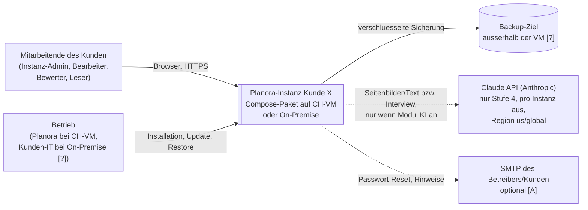
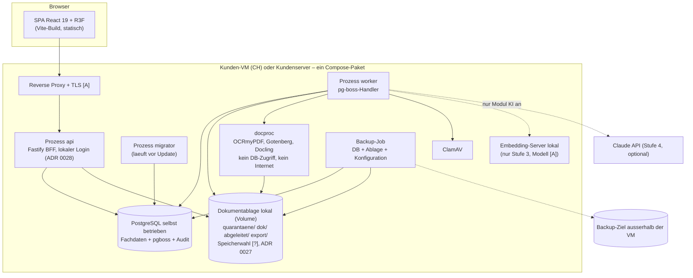
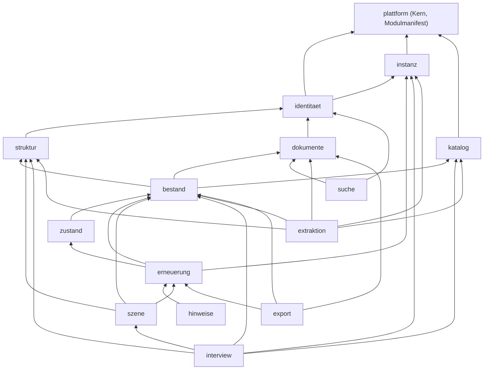
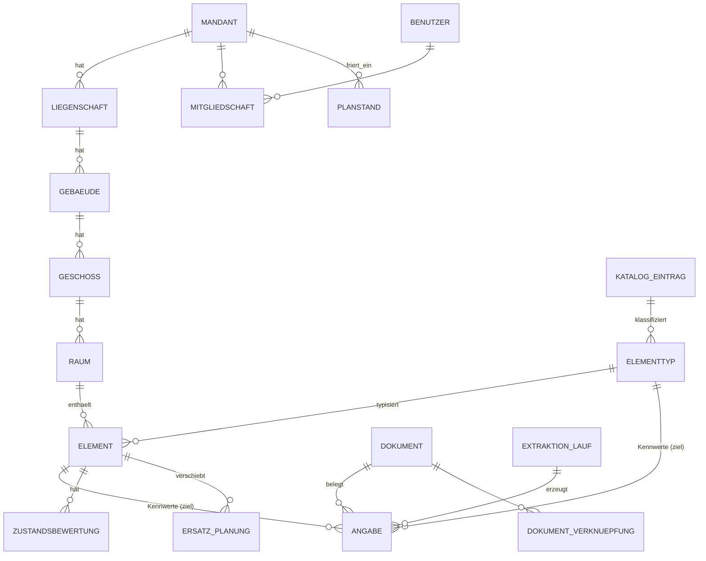
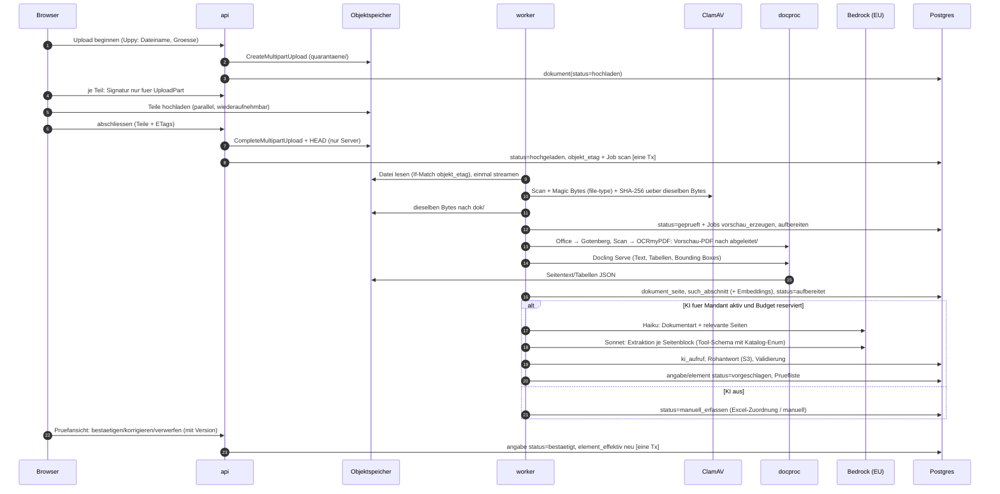
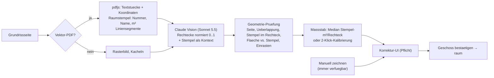
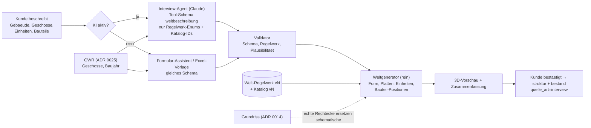

# 03 – Architektur Planora V1

Stand: 2026-11-08 · Rolle: System-Architekt (Welle 2, Orca-Task task_5a6b938dca10) · Status: **Entwurf zur Freigabe**
Basis (verbindlich): `00-kontext.md` (E1–E10 und PO-Antworten E11–E22), `01-domaene.md` (FA-01..FA-38), `02-tech-recherche.md`.
Die PO-Antworten E11–E22 (Stand 2026-11-08) sind eingearbeitet; wo 01-domaene ein anderes Default vorschlug, gilt E11–E22.
Kennzeichnung: **[F]** Fakt mit Quelle · **[A]** Annahme (durch Spike oder PO zu bestaetigen) · **[?]** offen.
Quellenkuerzel: `Qn-Dom` = Quelle n in 01-domaene, `Qn-Tech` = Quelle n in 02-tech-recherche, `FA-nn` = Anforderung in 01 Kap. 7.
**E31 (2026-11-09): Pflicht-Bausteine** laut `06-bausteine-open-source.md` und ADR 0022–0024 sind eingearbeitet (Kap. 2.2, 5, 6, 10, 15).
**E32 (2026-11-09): oeffentliche APIs** geo.admin.ch/GWR, Nager.Date, Pwned Passwords (ADR 0025) sind eingearbeitet (Kap. 2.1, 3.3, 4.2, 9.7, 15).
**E33 (2026-11-09): geschlossene 3D-Welt** mit Regelwerk, Interview-Agent und deterministischem Weltgenerator (ADR 0026), einfacher Look mit Leistungsstufen (ADR 0008 angepasst, Spike S3b) sind eingearbeitet (Kap. 3, 7, 15).
Entscheide im Detail: `adr/0001`–`adr/0031` (Index: `adr/0000-adr-vorlage-und-index.md`). BMAD-Arbeitsprotokoll und Spine: `bmad/planning-artifacts/architecture/architecture-Planora-2026-11-08/`.
**Welle 4 / B2B (E34–E37, 2026-11-09):** Gueltigkeit siehe **Kap. 0**; umgestellt sind Kap. 0, 2, 3, 9, 10, 12, die uebrigen Kapitel folgen in Welle 4b.

---

## 0. Gueltigkeit ab Welle 4 (B2B)

[F] Die PO-Entscheide **E34–E37 (2026-11-09)** ersetzen widersprechende Vorgaben dieses Dokuments: B2B mit **einer Instanz pro Kunde**, ein **Docker-Compose-Paket** (eigene CH-VM von uns oder On-Premise), **lokaler Login mit Rollen**, **KI nur ueber die Claude API direkt**, Kundenfeatures als **Module mit Schalter pro Instanz**. E24 (keine Kosten/Investitionsplanung in V1) bleibt. Aenderungsliste: `07-analyse-b2b.md`.

| Thema | Gilt ab Welle 4 | Ersetzt |
|---|---|---|
| Betrieb | ADR 0027: Compose-Paket pro Kunde, eigenes PostgreSQL, lokale Dokumentablage, Backup/Restore/Update pro Instanz, Versionsmanifest, N/N-1 | ADR 0002 (Exoscale-Managed) |
| Login | ADR 0028: lokaler Login mit Rollen; SSO spaeter als Modul | ADR 0007 (Keycloak) |
| Kundenmodule | ADR 0029: Modulmanifest, Schalter pro Instanz, Default aus, Pruefung an HTTP- und Job-Grenze | neu |
| KI | ADR 0030: Claude API direkt, Stufe 4, pro Instanz standardmaessig aus; Kostenbremse ADR 0017 bleibt | ADR 0003 (Bedrock) |
| Datentrennung | ADR 0031: Instanz-Isolation plus App-Autorisierung | ADR 0010 (RLS) |

**Lieferstufen** [A, Plan V2 `docs/plan/umsetzungsplan.html`]: Stufe 1 = 3D + Dokumente, Erfassung per Formular/Excel · Stufe 2 = + Lebensdauer und Ampel (Ziel Uebergabe Siemens) · Stufe 3 = + lokale Suche · Stufe 4 = + Claude-Interview und KI-Auslesen.
**Zurueckgestellt bis nach der Demo:** Grundriss-Erkennung (ADR 0014), Preise/Investitionsplan (ADR 0018, E24), FR/IT (ADR 0019), oeffentliche APIs (ADR 0025).

**Stand dieses Dokuments:** Kapitel 0, 2, 3, 9, 10 und 12 sind auf Welle 4 umgestellt. Die uebrigen Kapitel tragen, wo sie Mandanten/RLS/Bedrock/Keycloak/Exoscale voraussetzen, den Hinweis «[A] in Welle 4b anzupassen, siehe 07 Kap. 3»; dort gilt im Zweifel dieses Kapitel 0. Die bisherige Fassung der umgestellten Kapitel liegt im Git-Verlauf (Stand vor Branch `welle-4-b2b`, Commit `e64fdb9`).

---

## 1. Zusammenfassung und Qualitaetsziele

> [A] In Welle 4b anzupassen, siehe 07 Kap. 3: dieses Kapitel setzt noch Mandanten, RLS, Bedrock, Exoscale voraus. Bis dahin gilt Kap. 0 (E34–E37, ADR 0027–0031).

### 1.1 Zusammenfassung (10 Punkte)

1. **Modularer Monolith in TypeScript, ein Image, drei Prozessrollen** (`api`, `worker`, `migrator`). 13 Fachmodule mit fester Datenhoheit, Import-Grenzen per Lint erzwungen (ADR 0001).
2. **"Bedingungslos funktionieren" heisst hier:** keine stillen Fehler, kein Datenverlust, kein Mandantenleck, jede Zahl erklaerbar. Es heisst **nicht** 99.99 % Verfuegbarkeit; Ziel V1 ist 99.5 % pro Monat [A]. Jede KI-Funktion hat einen manuellen Weg, der ohne KI zum gleichen Ergebnis fuehrt.
3. **Mandantentrennung dreifach:** PostgreSQL-RLS mit `FORCE` und fail-closed-Kontext, zusammengesetzte Fremdschluessel `(mandant_id, id)`, Rechtepruefung in der App. Pflicht-Tests in der CI (ADR 0010).
4. **Herkunft ist das Datenmodell:** Jeder Kennwert ist eine `angabe` mit Dokument, Seite, Zitat, Konfidenz, Status. In die Rechnung fliessen **nur bestaetigte** Angaben (ADR 0012).
5. **KI liefert Vorschlaege, nie Wahrheit:** Claude Sonnet/Haiku 5.5 ueber **AWS Bedrock eu-central-2 mit EU-Profil** (Abweichung vom PO-Entscheid "Datenstandort CH" fuer den KI-Pfad, ADR 0003). Ausgabe nur gegen Katalog-IDs, Pruefung von Schema, Plausibilitaet und Zitat im Seitentext. KI pro Mandant **opt-in**; vor jedem Aufruf Kostenschaetzung und Budgetreservierung, Antwort-Cache, globaler Not-Aus (ADR 0017).
6. **Erneuerungsrechnung als reine Funktion:** Stichtag explizit, Geld in Rappen, Rechenweg pro Zeile, eingefrorene Planstaende mit Hash; gleiche Eingabe = gleiches Ergebnis. Zustand nach **ZHAW-Methode** (E14), Lebensdauer pro Typ **und pro Element** ueberschreibbar (E11), Ampel-Schwelle pro Bauteiltyp (E17), Preise aus eigener **Preisdatenbank** (E15) (ADR 0013, 0018, 0021).
7. **Grundriss hybrid:** Vektor-Stempel + Claude Vision + deterministische Geometriepruefung + Pflicht-Korrektur-UI; manuelles Zeichnen immer verfuegbar (ADR 0014).
8. **3D darstellerisch:** BatchedMesh, Sprite-Pins mit hierarchischem Clustering, Element-Positionen per deterministischem Auto-Layout im Raum; Budget 10'000 Elemente bei 60 fps auf Laptop mit integrierter GPU [A] (ADR 0008).
9. **Offen fuer Austausch und Sprachen:** Klassifikation (ETIM, eBKP-H) nur als austauschbare Mappings an der fuehrenden Planora-Katalog-ID (E12/E13); DE/FR/IT ab V1 (E20); Export/Import Richtung Stratus ueber einen Adapter (E22) (ADR 0011, 0019, 0020).
10. **Betrieb Schweiz:** Exoscale Zuerich (Managed PG Business mit PITR/HA, SOS), Offsite Genf, Docker Compose zum Start, On-Prem mit denselben Images; RPO 5 min / RTO 4 h [A], monatlicher automatischer Restore-Test (ADR 0002).

### 1.2 Qualitaetsziele (priorisiert)

Bei Zielkonflikten gewinnt das hoeher stehende Ziel.

| Rang | Qualitaetsziel | Konkretes Szenario / Messgroesse | Hauptmechanismen |
|---|---|---|---|
| 1 | **Korrektheit der Daten** | Kein unbestaetigter KI-Wert in Rechnung oder Export (Test: 0 Treffer). Summen Investitionsplan = Summe der Zeilen auf den Rappen (FA-26). Rechnung reproduzierbar: gleicher Planstand → byte-identisches Ergebnis. | ADR 0012, 0013; Validator; Optimistic Locking |
| 2 | **Mandantentrennung** | 0 Fremdzeilen in RLS-, Pool-Leak- und API-Tests (FA-01); fehlender Kontext → Fehler, nie leere oder fremde Daten. | ADR 0010; CI-Katalogpruefung |
| 3 | **Nachvollziehbarkeit** | Fuer jede Aenderung wer/wann/alt/neu abrufbar (FA-06); fuer jeden effektiven Wert Quelle + Rangstufe (FA-21); fuer jedes KI-Ergebnis Prompt-, Modell-, Katalog- und Pipeline-Version. | ADR 0015, 0012; `extraktion_lauf` |
| 4 | **Verfuegbarkeit und Wiederherstellbarkeit** | 99.5 %/Monat [A]; RPO DB ≤ 5 min, Dokumente ≤ 24 h; RTO ≤ 4 h [A]; KI-Ausfall blockiert keine Nicht-KI-Funktion. | Kap. 10; Schutzschalter; manuelle Wege |
| 5 | **Performance** | API p95 ≤ 300 ms fuer Lesezugriffe [A]; Erneuerungsliste 10'000 Elemente ≤ 2 s [A]; 3D 60 fps median / p95-Frame ≤ 33 ms bei 10'000 Elementen [A]. | Projektion `element_effektiv`; Kap. 7 |
| 6 | **Portabilitaet** | Gleiche Images laufen auf Exoscale, AWS und On-Prem; nur libpq, S3-API, OIDC, OCI (E7). | ADR 0001, 0002 |

---

## 2. Kontext- und Containerdiagramm (C4)

> Welle 4 (E34–E37): umgestellt auf eine Instanz pro Kunde (ADR 0027, 0031). Keycloak, Bedrock, Exoscale-Managed und oeffentliche APIs (E32) entfallen aus dem Bild.

### 2.1 Systemkontext (eine Kundeninstanz)



[F] E36: Claude ist die einzige fachliche externe API. [?] Ob Betriebsverkehr (ClamAV-Signaturen, Image-/Modell-Downloads, SMTP, Zeit) darunter faellt, ist offen (07 Kap. 8 Punkt 6).

### 2.2 Container (pro Kunde identisch)



Regeln: Nur der Reverse Proxy ist von aussen erreichbar. `docproc`, `ClamAV` und der Embedding-Server sind nur aus dem internen Netz der Instanz erreichbar und haben kein Internet. Nur `worker` spricht mit der Claude API, und nur wenn das Modul KI aktiv ist (ADR 0029, 0030). Keine Container, Volumes, Netze oder Secrets werden zwischen Kundeninstanzen geteilt (ADR 0031). Monitoring: schlanke Healthchecks und Backup-/Job-Alarmierung [A]; Voll-Observability-Stack ist keine Demo-Pflicht (07 Kap. 7).

---

## 3. Module des Monolithen

> Welle 4 (E34–E37): Modul `mandant` wird `instanz` (Instanzparameter, kein Mandantenkontext); `mitMandant()`/Mandantenwechsel entfallen; jedes Modul hat eine Lieferstufe und einen Schalter nach ADR 0029.

### 3.1 Innenstruktur jedes Moduls (ADR 0001)

```text
src/
  plattform/            # Kern: DB-Transaktion mitTransaktion(), IDs, Fehler, Konfig, Logging, Audit-Funktion, Job-Registry, Modulmanifest + modulAktiv()
  module/<name>/
    api/index.ts        # einziger Import-Punkt fuer andere Module (Funktionen + Typen)
    domain/             # reine Logik, kein IO, kein Date.now()
    ports/              # Interfaces (Repository, Provider)
    adapters/           # Postgres, Dokumentablage, HTTP, KI
    jobs/               # pg-boss-Handler (pruefen modulAktiv + aktuelle Rechte)
    http/               # Fastify-Routen (duenn: Modul-Schalter → Recht → Validierung → api → Antwort)
web/                    # SPA
docproc/                # fertige Container (ADR 0009)
katalog/                # katalog.vN.json, welt-regelwerk.vN.json, GLB-Quellen
eval/                   # Golden-Set-Definitionen (ohne Kundendokumente, ab Stufe 4)
```

Testbarkeit: `domain/` mit reinen Unit-Tests; `adapters/` gegen echte PostgreSQL-Testinstanz (Container); jedes Modul ersetzt fremde Module in Tests durch Fakes ihrer `api/index.ts`-Typen.

### 3.2 Abhaengigkeitsrichtung



Pfeil = "darf aufrufen". Alles darf `plattform` nutzen. Rueckwaerts-Aufrufe und Zyklen sind verboten; Rueckmeldungen laufen ueber Jobs/Ereignisse (pg-boss). Zurueckgestellte Module (`preise`, Grundriss-Teil von `extraktion`, `austausch`) sind im Graph nicht enthalten; sie kommen bei Wiederaufnahme als Module nach ADR 0029 mit eigenen Kanten dazu.

### 3.3 Modulkatalog

| Modul | Stufe / Schalter [A] | Zweck | Oeffentliche API (Auszug) | Abhaengig von | Datenhoheit (Tabellen) |
|---|---|---|---|---|---|
| **plattform** | Kern, immer an | Transaktionen, IDs (UUIDv7), Fehlerformat, Konfiguration, Logging, Audit-Ereignis, Job-Registrierung, **Modulmanifest und Modul-Schalter** (ADR 0029) | `mitTransaktion(ctx, fn)`, `neueId()`, `auditEreignis()`, `jobs.senden()`, `modulAktiv(id)` | – | `modul_schalter`, `audit_eintrag` (Schreiben nur per Trigger/Funktion) |
| **identitaet** | 1, immer an | Lokaler Login (ADR 0028), Sessions, Benutzer, Rollen, Liegenschafts-Scope, Autorisierung, Recovery | `aktuellerKontext(req)`, `pruefe(recht, liegenschaftId)`, `benutzerVerwalten()`, `sitzungenEntziehen(benutzerId)` | instanz | `benutzer`, `anmeldedaten`, `rolle_zuordnung`, `rolle_liegenschaft`, `sitzung` |
| **instanz** | 1, immer an | Instanzparameter: Anzeige-/ZHAW-/Ampel-Defaults, Betriebsstunden-Defaults; KI-Zustimmung und Budget ab Stufe 4 | `parameter()`, `parameterAendern()`, `kiErlaubt()` | plattform | `instanz_einstellung`, `ki_zustimmung` |
| **katalog** | 1, immer an | Versionierter Bauteil-Katalog je Instanz (Katalog-ID fuehrend), Texte DE, Klassifikations-Mappings, Planora-Standard-Lebensdauern, lokale Lebensdauer-Tabelle und Ampel-Schwellen (E11, E17) | `eintrag(katalogId)`, `alle(version)`, `mapping(katalogId, system)`, `lebensdauerTabelle()`, `ampelSchwelle(katalogId)` | plattform | `katalog_version`, `katalog_eintrag`, `katalog_text`, `klassifikation_mapping`, `lebensdauer_tabelle`, `ampel_schwelle` |
| **struktur** | 1, immer an | Liegenschaft → Gebaeude → Geschoss → Einheit/Raum; Stammdaten manuell (GWR zurueckgestellt) | `baum(gebaeudeId)`, CRUD | identitaet | `liegenschaft`, `gebaeude`, `geschoss`, `raum` |
| **dokumente** | 1, immer an | Upload, Quarantaene/Scan, lokale Ablage, Metadaten (E21), Verknuepfungen, **Viewer**: Vorschau-PDF, Seiten-Sprung, Markierung (ADR 0016, 0022) | `uploadBeginnen()`, `status()`, `seitenText()`, `verknuepfen()`, `vorschauUrl()` | identitaet | `dokument`, `dokument_seite`, `dokument_verknuepfung` |
| **interview** (Erfassung) | 1: Formular/Excel immer an · 4: Agent hinter Modul KI | Gefuehrte Erfassung Gebaeude → Geschosse → Einheiten → Bauteile; Formular-Assistent und Excel-Vorlage mit validierter Zeilenvorschau; spaeter Claude-Agent mit demselben Schema (ADR 0026) | `erfassungStarten(gebaeudeId?)`, `excelVorschau(datei)`, `beschreibung(id)`, `vorschau(id)`, `uebernehmen(id, version)`, ab Stufe 4 `antworten(id, text)` | struktur, bestand, katalog, instanz, szene | `interview`, `interview_nachricht` |
| **bestand** | 1, immer an | Elementtypen, Elemente, Angaben mit Herkunft je Eingabekanal, Pruefliste, Projektion `element_effektiv` | `vorschlaegeErfassen()`, `entscheiden()`, `effektiv()`, `pruefliste()`, CRUD | struktur, katalog, dokumente | `elementtyp`, `element`, `angabe`, `element_effektiv` |
| **szene** | 1, immer an | 3D-Lesemodell, deterministischer Weltgenerator (ADR 0026), Leistungsstufen normal/schwach/2D | `szene(gebaeudeId)`, `weltErzeugen(beschreibung, regelwerkVersion)` (rein) | struktur, bestand, erneuerung | keine Fachdaten (nur Cache) |
| **zustand** | 2 [?, Scope ZHAW offen] | Zustandsbewertung nach ZHAW (E14), Historie | `bewerten()`, `aktuelleBewertung()` | bestand | `zustandsbewertung` |
| **erneuerung** | 2, immer an ab Stufe 2 | **Lebensdauer und Ampel**: reiner Rechenkern fuer Ersatzjahr, Quellenrangfolge, Vollstaendigkeit, Ampel; **ohne** Preise/Investitionsplan (E24) | `berechne(eingabe)` (rein), `liste(filter, stichtag)` | bestand, zustand, instanz | `planstand` [A, ohne Geldbetraege] |
| **hinweise** [A] | 2, Schalter | Hinweise «bald ersetzen» in der App, optional E-Mail; Datenhoheit aus E30 neu zu pruefen | `hinweiseFuer(benutzer)` | erneuerung | `hinweis` [A] |
| **export** | 2, immer an | Excel-Export Bestand/Lebensdauer, Instanz-Gesamtexport, Loeschlauf | `excel()`, `instanzExport()` | erneuerung, bestand, dokumente | `export_auftrag` |
| **suche** | 3, Schalter (Default aus) | Dokumentname, Volltext, lokale Semantik (pgvector, RRF, lokaler Embedding-Server); Treffer nach Liegenschaftsrechten (ADR 0023) | `suchen(anfrage, filter)`, `indexieren(dokId)` | dokumente, identitaet | `such_abschnitt` |
| **extraktion** | 4, Schalter «KI» (Default aus) | Klassifikation und Auslesen ueber Claude API (ADR 0030), Validierung, Kostenbremse (ADR 0017) | `dokumentVerarbeiten(dokId)`, `budgetStatus()` | dokumente, bestand, struktur, katalog, instanz | `extraktion_lauf`, `ki_aufruf`, `ki_budget`, `ki_cache` |
| *preise* | zurueckgestellt (E24, ADR 0018) | spaeteres Kundenmodul | – | – | – |
| *austausch* | [?] PO, Stratus-Scope (ADR 0020) | spaeteres Modul; Excel-Import gehoert zu `interview` | – | – | – |

[A] Tabellen- und Spaltennamen fuer `identitaet`, `instanz` und `hinweise` sind Vorschlaege; das Datenmodell (Kap. 4) wird in Welle 4b nachgezogen.

---

## 4. Datenmodell

> [A] In Welle 4b anzupassen, siehe 07 Kap. 3: dieses Kapitel setzt noch Mandanten, RLS voraus. Bis dahin gilt Kap. 0 (E34–E37, ADR 0027–0031).

### 4.1 Kernentitaeten



### 4.2 Tabellen (Auszug, verbindliche Spalten)

Gemeinsame Spalten jeder Mandantentabelle: `id uuid` (UUIDv7, PK), `mandant_id uuid NOT NULL`, `version int NOT NULL` (Optimistic Locking), `erstellt_am/von`, `geaendert_am/von`, `UNIQUE (mandant_id, id)`.

| Tabelle | Schluessel / wichtige Spalten | Bemerkung |
|---|---|---|
| `mandant` | `id`, `name`, `status` (aktiv/gekuendigt/geloescht), `ki_aktiv bool DEFAULT false` | RLS: Zeile sichtbar nur fuer eigenen Mandanten |
| `mandant_parameter` | `zustandsmodell` (Default `zhaw_v1`, E14), `zhaw_knick` (Default 0,75 [A]), `nutzungsgrenze_default` (Default 0,25 [A, Bereich 0,1–0,4 laut Q12-Dom]), `teuerung_satz numeric(6,4)` (fester Satz, anpassbar, E16; Default 0,0100 [A]), `ampel_gelb_jahre_default` (Default 3 [A, FA-23]; pro Bauteiltyp ueberschreibbar, E17), `sprache_default` (de/fr/it, E20) | eine Zeile pro Mandant, versioniert |
| `benutzer` | `id`, `keycloak_sub UNIQUE`, `email`, `name`, `sprache` (de/fr/it) | global (keine mandant_id), RLS: nur eigener Datensatz + Mitglieder des aktiven Mandanten via Funktion |
| `mitgliedschaft` | `(mandant_id, benutzer_id) UNIQUE`, `rolle` | Rollen Kap. 9.2 |
| `mitgliedschaft_liegenschaft` | `(mandant_id, mitgliedschaft_id, liegenschaft_id)` | leer = alle Liegenschaften |
| `liegenschaft`, `gebaeude` | `gebaeude.uebergabedatum date`, `gebaeude.egid` (`UNIQUE (mandant_id, egid)`), `liegenschaft.kanton` | Uebergabedatum = Default-Einbaudatum (FA-16); EGID aus GWR (ADR 0025) |
| `feiertag` (global) | `datum`, `kanton` (NULL = CH), `name` | jaehrlicher Import aus Nager.Date; genutzt von `hinweise`, `zustand` (ADR 0025) |
| `geschoss` | `gebaeude_id`, `bezeichnung`, `reihenfolge int`, `hoehe_m numeric`, `grundriss_dokument_id`, `grundriss_seite`, `massstab_m_pro_einheit`, `status` (entwurf/bestaetigt) | |
| `raum` | `geschoss_id`, `nummer`, `bezeichnung`, `x_m, y_m, breite_m, tiefe_m numeric(9,3)`, `quelle_art`, `raum_vorschlag_id`, `art` (Einheit-Art aus Welt-Regelwerk), `geometrie_quelle` (schematisch/grundriss/manuell) | Rechteck im Geschoss-Koordinatensystem (E3); Einheiten aus dem Interview sind Raeume mit `geometrie_quelle=schematisch` (ADR 0026) |
| `interview`, `interview_nachricht` | `gebaeude_id`, `status` (offen/zur_bestaetigung/uebernommen/verworfen), `weltbeschreibung jsonb`, `regelwerk_version`, `katalog_version`, `modus` (agent/formular/excel); Nachrichten mit Rolle und Text | Herkunft fuer `quelle_art=interview` (ADR 0026) |
| `raum_vorschlag` | `geschoss_id`, `extraktion_lauf_id`, normierte Koordinaten, Stempeltext, `konfidenz`, `status` | wird bei "Geschoss bestaetigen" zu `raum` |
| `katalog_version`, `katalog_eintrag` | `katalog_id text` (stabil, fuehrend, z.B. `leuchte.downlight`), `version`, `gruppe` (Planora-Gruppe fuer Plan und Filter), `glb_datei`, `glb_sha256`, `icon`, `ld_min/mittel/max_jahre` (Planora-Standard, E11), `nutzungsgrenze`, `ampel_gelb_jahre`, `betriebsstunden_pro_jahr`, `kosten_bezugsgroesse`, `referenzquelle` | global, read-only fuer App (ADR 0011). **Keine CRB-Werte** (E11) |
| `katalog_text` | `(katalog_id, version, sprache)` PK, `name`, `beschreibung` | DE/FR/IT (E20); eigene Uebersetzungen |
| `klassifikation_mapping` | `(katalog_id, system, code)`, `system_version`, `bezeichnung` | `system` ∈ {`etim`, `ebkp_h`, weitere}; optional, austauschbar (E12/E13); ETIM mit Attribution ODC-BY [F, Q9-Dom] |
| `mandant_lebensdauer` | `elementtyp_id` UNIQUE, `ld_min/mittel/max_jahre`, `nutzungsgrenze`, `quelle` (`planora_standard@vN` / `manuell`), `begruendung` | **Lebensdauer-Tabelle des Mandanten** (E11): bei Anlage eines Elementtyps automatisch aus dem Planora-Standard kopiert, danach frei editierbar |
| `mandant_ampel` | `katalog_id` UNIQUE, `ampel_gelb_jahre` | Schwelle pro Bauteiltyp (E17) |
| `preisquelle`, `hersteller_artikel`, `preis_eintrag` | Quelle (manuell/import/feed, Format, Lizenz), Artikel (`hersteller_norm`, `artikelnr`, `gtin` opt., `katalog_id`), Preis (`preis_rappen`, `bezugsgroesse`, `preisjahr`, `gueltig_ab`, `preisquelle_id`) | **global**, Preisdatenbank pro Typ (E15), nur einfuegend (Historie) |
| `mandant_preis` | `elementtyp_id` oder `katalog_id`, `preis_rappen`, `bezugsgroesse`, `preisjahr`, `gueltig_ab`, `quelle` | Mandantenpreise und Import (FA-24) |
| `elementtyp` | `katalog_id NOT NULL`, `hersteller`, `typbezeichnung`, `UNIQUE (mandant_id, katalog_id, hersteller_norm, typ_norm)` | Typ-Ebene: Lebensdauer, Datenblatt, Preis |
| `element` | `elementtyp_id`, `raum_id` (oder `geschoss_id` falls Raum unbekannt), `anlagekennzeichen`, `menge int ≥ 1`, `position jsonb NULL` (manuell), `status` (vorgeschlagen/aktiv/verworfen/ausgebaut) | Element-Ebene: Einbaudatum, Standort, Zustand. `menge` erlaubt Sammelelemente gleicher Typ/Raum/Einbaudatum [A] |
| `angabe` | siehe 4.4 | Herkunft je Wert |
| `element_effektiv` | `element_id PK`, effektive Werte + `quelle_rang` je Merkmal (ohne aufgeloeste Lebensdauer; die loest nur `erneuerung` auf, Kap. 8.1), `datenstand` | Projektion, neu aufbaubar |
| `zustandsbewertung` | `element_id`, `datum`, `zustandswert numeric(2,1)` (1,0 … 0,0 in 0,1-Schritten, ZHAW, E14), `notiz`, `foto_dokument_id`, `bewerter_id` | nur Einfuegen; neueste gilt (FA-31) |
| `ersatz_planung` | `element_id`, `zyklus int`, `geplantes_jahr`, `begruendung` | ueberschreibt nie das berechnete Jahr (FA-28) |
| `planstand` | `stichtag`, `horizont`, `regelwerk_version`, `eingabe_hash`, `eingabe_objekt` (S3), `summen jsonb`, `eingefroren_von/am` | unveraenderlich |
| `dokument` | `sha256`, `UNIQUE (mandant_id, sha256)`, `dateiname`, `mime`, `groesse`, `seiten`, `dokumentart`, `kbob_fachbereich`/`kbob_dtc` (Werteliste nach KBOB-Richtlinie [F, Q3-Dom], E21; KI schlaegt vor), `status` (Zustandsautomat Kap. 5.2), `gebaeude_id` | Objekt: `dok/m/<mandant>/<sha256>` |
| `dokument_verknuepfung` | `dokument_id`, `ziel_typ` (elementtyp/element/gebaeude/geschoss), `ziel_id` | n:m (FA-10) |
| `extraktion_lauf` | `dokument_id`, `stufe`, `seiten_von/bis`, `pipeline_version`, `prompt_id@version`, `modell_id`, `katalog_version`, `docproc_version`, `eingabe_hash`, `status`, `versuche`, `fehler` | eine Zeile pro Stufe und Seitenblock |
| `ki_aufruf` | `extraktion_lauf_id`, `provider`, `profil`, `modell_id`, `tokens_in/out`, `kosten_rappen`, `dauer_ms`, `ergebnis` (ok/fehler/cache) | **ohne Inhalt**; Beleg fuer FA-37 |
| `ki_budget` | `monat`, `limit_rappen`, `verbraucht_rappen`, `reserviert_rappen` | ADR 0017 |
| `audit_eintrag` | siehe ADR 0015 | append-only, Hash-Kette |

Spaltenregeln: Geld `bigint` in Rappen mit Waehrung CHF implizit; Datum `date`, Zeitpunkte `timestamptz` (UTC gespeichert, Anzeige Europe/Zurich); Masse in Metern `numeric(9,3)`; Texte normalisiert fuer Vergleich in eigenen `_norm`-Spalten.

### 4.3 RLS-Policies

Fuer jede Tabelle mit `mandant_id` (Muster, handgeschrieben, ADR 0005/0010):

```sql
ALTER TABLE element ENABLE ROW LEVEL SECURITY;
ALTER TABLE element FORCE ROW LEVEL SECURITY;
CREATE POLICY mandant_isolation ON element
  USING (mandant_id = app.mandant())
  WITH CHECK (mandant_id = app.mandant());
-- app.mandant(): liest current_setting('app.mandant_id', true); leer/NULL -> RAISE EXCEPTION
```

Fremdschluessel immer mandantenrein, z.B. `FOREIGN KEY (mandant_id, raum_id) REFERENCES raum (mandant_id, id)`.
Globale Tabellen (`katalog_*`): `GRANT SELECT` an `planora_app`, kein Schreibrecht. `benutzer`: eigene Policy (eigener Datensatz oder Mitglied im aktiven Mandanten). `audit_eintrag`: RLS + nur `SELECT`.

### 4.4 Herkunft (Provenance) je ausgelesenem Wert

`angabe` (ADR 0012): `ziel_typ`, `ziel_id`, `merkmal` (geschlossene Liste: `hersteller`, `typbezeichnung`, `lebensdauer_jahre`, `lebensdauer_stunden`, `betriebsstunden_pro_jahr`, `leistung_kw`, `einbaudatum`, `menge`, `raum_zuordnung`, `katalog_zuordnung`, `anlagekennzeichen`, `garantie_bis`, …), `wert jsonb` (Schema je Merkmal), `einheit`, `quelle_art` (manuell/ki/import/abgeleitet), `dokument_id`, `seite`, `zitat`, `bbox`, `konfidenz`, `konfidenz_stufe` (hoch/mittel/tief), `status` (vorgeschlagen/bestaetigt/verworfen/ersetzt), `extraktion_lauf_id`, `entschieden_von/am`.

Aufloesung des effektiven Werts (rein, deterministisch): nur `bestaetigt` → Rang nach Quelle: (1) manuell, (2) Herstellerdatenblatt (Dokumentart Datenblatt), (3) Protokoll/Liste, (4) abgeleitet (z.B. Einbaudatum = Uebergabedatum, FA-16) → bei Gleichstand juengste Entscheidung → bei Gleichstand kleinste `id`. Fuer die Lebensdauer gilt die vollstaendige Rangfolge aus Kap. 8.1 (inkl. Lebensdauer-Tabelle des Mandanten, E11). Lebensdauer-Tabelle, Preise und Ampel-Schwellen sind **Mandanten-Parameter** (Tabellen mit Audit bzw. `gueltig_ab`), keine Angaben.

### 4.5 Versionierung und Audit

- Optimistic Locking: Jede schreibende API verlangt `erwartete_version`; Abweichung → HTTP 409 mit aktuellem Stand (AD-11).
- Fachhistorie: `angabe` und `zustandsbewertung` sind nur-einfuegend (Geschichte im Modell). Andere Tabellen: Historie ueber `audit_eintrag` (alt/neu als JSON).
- Katalog: versioniert per `katalog_version`; jede `angabe` und jeder `extraktion_lauf` kennt die Katalogversion.
- Rechenregeln: `regelwerk_version` in jedem Ergebnis und Planstand.

### 4.6 Elementtyp vs. Element, Katalog-IDs, eBKP-H/ETIM

- **Katalogeintrag** (global): "was fuer ein Bauteil" → 3D-Modell, Icon, Planora-Gruppe, Standard-Lebensdauer, Ampel-Default; ETIM/eBKP-H nur ueber `klassifikation_mapping`.
- **Elementtyp** (Mandant): "welches Produkt" (Hersteller + Typ) → Zeile in der Lebensdauer-Tabelle (`mandant_lebensdauer`), Datenblatt-Dokument, Preis.
- **Element** (Mandant): "welches Exemplar wo" → Raum, Anlagekennzeichen, Menge, Einbaudatum, Zustand, Ersatzplanung, **eigene Lebensdauer** als manuelle Angabe (E11: Monoblock 1 und 2 koennen verschiedene Lebensdauern haben; ein Sammelelement mit abweichender Lebensdauer wird dafuer geteilt).
- Ist der Hersteller/Typ unbekannt, wird ein generischer Elementtyp pro Katalog-ID und Mandant verwendet (`hersteller = NULL`).
- **Klassifikation austauschbar (E12/E13):** Die Planora-Katalog-ID ist der einzige fuehrende Schluessel. ETIM und eBKP-H sind optionale Zeilen in `klassifikation_mapping`; ein weiteres System (oder ein eigenes) kommt als neuer `system`-Wert dazu, ohne Schemaaenderung. Der Investitionsplan gruppiert standardmaessig nach Planora-Gruppe; die Gruppierung nach eBKP-H ist eine Option, wenn das Mapping vorhanden ist. eBKP-H nur als Code ohne CRB-Texte (rechtliches Restrisiko E13 [?]); ETIM-Klassennamen englisch, Anzeige ueber eigene `katalog_text` [A].
- **Mehrsprachigkeit (E20):** UI-Texte in Sprachdateien de/fr/it; Stammdaten-Texte (Katalog, Wertelisten wie Dokumentart, KBOB-Codes, Rechenweg-Bausteine) in Texttabellen je Sprache; Kundendaten (Raumnamen, Notizen) werden nicht uebersetzt. Excel-Export in der Sprache des Benutzers. Fehlende Uebersetzung → Rueckfall auf Deutsch, in CI als Warnung gezaehlt.

---

## 5. KI-Pipeline Ende-zu-Ende

> [A] In Welle 4b anzupassen, siehe 07 Kap. 3: dieses Kapitel setzt noch Mandanten, Bedrock voraus. Bis dahin gilt Kap. 0 (E34–E37, ADR 0027–0031).

### 5.1 Ablauf



### 5.2 Zustandsautomat Dokument

`hochladen → geprueft | abgelehnt → aufbereitet | fehlgeschlagen → klassifiziert → extrahiert → zur_pruefung → abgeschlossen`; Nebenzustaende `pausiert_budget`, `pausiert_ki_aus`, `nicht_auswertbar` (DWG/IFC/DOC, FA-08). Jeder Job prueft den Ausgangszustand; ist der Folgezustand schon erreicht, endet er ohne Wirkung (Idempotenz).

### 5.3 Stufen

| Stufe | Werkzeug | Ausgabe | KI? |
|---|---|---|---|
| Scan | ClamAV, Magic Bytes, SHA-256 | sauber/abgelehnt | nein |
| Vorschau | Gotenberg (Office), OCRmyPDF (Scan), sharp (Miniaturen) – ADR 0022 | Vorschau-PDF in `abgeleitet/` | nein |
| Aufbereitung | Excel: exceljs im Worker; PDF-Vektor: pdfjs-dist + Docling Serve; Scan: OCRmyPDF → Docling Serve | `dokument_seite` (Text, Bloecke mit Koordinaten, Tabellen), `such_abschnitt` (ADR 0023) | nein |
| Klassifikation | Haiku 5.5, nur Text der ersten Seiten + Seitentitel [A] | Dokumentart, KBOB-Fachbereich und Dokumenttypcode (E21), Sprache (de/fr/it/en), Gebaeude/Geschoss-Hinweis, relevante Seitenbereiche | ja (sonst Benutzer waehlt) |
| Spaltenzuordnung Excel | Haiku 5.5: Kopfzeile + 20 Beispielzeilen [A] → Zuordnungsvorschlag | Zuordnung, vom Benutzer bestaetigt; danach deterministischer Import | ja (sonst manuell, FA-38) |
| Extraktion | Sonnet 5.5, Seitenbloecke zu 20 Seiten [A], Bild + Text | strukturierte Vorschlaege mit Seite + Zitat | ja |
| Grundriss | Kap. 6 | Raum-Vorschlaege | ja (sonst manuell) |
| Validierung | deterministisch (5.6) | Konfidenzstufe, Pruefliste | nein |
| Pruefung | Mensch | bestaetigt/verworfen | nein |

### 5.4 Idempotenz und Retries

- Job-Schluessel: `<stufe>:<dokument_id>:<seitenblock>:<pipeline_version>`. Doppelter Job = kein zweiter Lauf.
- KI-Antwort-Cache (`ki_cache`): Schluessel SHA-256(Seiteninhalt + Prompt-Version + Modell-ID + Katalog-Version) → kein Doppelbezahlen bei Retry nach DB-Fehler.
- Vorschlaege tragen `extraktion_lauf_id`; ein wiederholter Lauf ersetzt die **noch unentschiedenen** Vorschlaege desselben Laufs, nie bestaetigte Angaben.
- Dasselbe Dokument (gleicher SHA-256 im Mandanten) wird nicht neu extrahiert, ausser bei neuer Pipeline-/Prompt-Version auf Anforderung.
- Abgleich mit Bestand: Element mit gleichem `anlagekennzeichen` im gleichen Gebaeude → Vorschlag als neue Angabe am bestehenden Element, nicht als neues Element.

| Fehlerklasse | Retry | Grenze [A] |
|---|---|---|
| Bedrock Drosselung/5xx/Timeout | exponentiell 5 s … 10 min, Jitter | 6 Versuche, danach `fehlgeschlagen` + Alarm |
| Bedrock 4xx (Validierung, Groesse) | kein Retry; Seitenblock halbieren, einmal erneut | 1 |
| Antwort verletzt Schema | 1 Retry mit Fehlermeldung im Prompt | 1, danach Pruefliste "KI-Antwort ungueltig" |
| docproc Absturz/Timeout | 2 Retries, danach Seitenblock einzeln | 3 |
| DB-Konflikt (Version) | sofort, 3 Versuche | 3 |
| Schutzschalter offen | Job wartet (verschoben), zaehlt nicht als Versuch | – |

### 5.5 Strukturierte Ausgabe nur gegen Katalog-IDs

- Aufruf mit Tool-Definition/JSON-Schema; Feld `katalog_id` als **Enum der gueltigen IDs der aktuellen Katalogversion plus `null`** (null = unbekannt → Pruefliste). Freitext-Typen sind im Schema nicht vorgesehen (E8, FA-14).
- Jedes Feld eines Vorschlags hat `{ wert, einheit, seite, zitat, konfidenz }`. Ohne `seite` und `zitat` ist ein Wert ungueltig.
- Dokumente in DE/FR/IT/EN werden mit demselben Prompt verarbeitet (E20); Zitate bleiben in Originalsprache, Werte werden normalisiert (Dezimal- und Tausendertrennzeichen, Einheiten). OCR-Sprachen deu+fra+ita+eng [A].
- Prompt enthaelt: Katalogliste (ID, Name, Kurzbeschreibung), Merkmalsliste mit Einheiten, Regeln ("nicht raten; null wenn nicht im Dokument"). Prompt-Caching fuer den statischen Teil [A: Verfuegbarkeit unter Bedrock in S5 pruefen].

### 5.6 Validierung und Konfidenzschwellen

Deterministische Pruefungen nach jeder KI-Antwort:
1. Schema (Zod) und Katalog-ID gueltig in der verwendeten Katalogversion.
2. **Grounding:** `zitat` kommt im Seitentext (Docling/OCR) der angegebenen Seite vor (normalisiert: Leerraum, Bindestriche, Gross/Klein); unscharfe Uebereinstimmung ≥ 0,9 [A] zaehlt als "unscharf".
3. **Wert im Zitat:** der Zahlenwert steht im Zitat (z.B. "50'000 h" → 50000, Einheit h).
4. **Plausibilitaet je Merkmal** [A]: Lebensdauer 1–100 Jahre; Stunden 1'000–200'000; Einbaudatum zwischen 1950 und Uebergabedatum + 1 Jahr; Menge 1–10'000; Leistung > 0.
5. **Querpruefung:** derselbe Wert aus zwei Dokumenten → Bestaetigung; Widerspruch → beide "mittel" mit Hinweis.

Stufen [A, kalibriert am Golden Set so, dass Praezision der Stufe "hoch" ≥ 98 %]:

| Stufe | Bedingung | UI |
|---|---|---|
| hoch | Pruefungen 1–4 bestanden, Zitat exakt, Modellkonfidenz ≥ 0,90 | sammelbestaetigbar (FA-18: 100 in ≤ 3 Klicks) |
| mittel | 1, 3, 4 bestanden; Zitat unscharf oder Modellkonfidenz 0,60–0,90 oder Widerspruch | einzeln bestaetigen |
| tief / Pruefliste | Katalog `null`, Zitat nicht gefunden, Plausibilitaet verletzt, Modellkonfidenz < 0,60 | Pruefliste, nie automatisch |

Bei Scans ohne verlaesslichen OCR-Text ist "hoch" ausgeschlossen. Nichts wird je automatisch bestaetigt.

**Prompt Injection (E31, AD-6):** Dokumentinhalte sind nicht vertrauenswuerdig. Der Prompt grenzt Dokumenttext und -bilder als Daten ab und weist an, darin enthaltene Anweisungen zu ignorieren; das Modell hat keine Tools mit Nebenwirkung (nur das Extraktions-Schema). Das Golden Set enthaelt praeparierte Dokumente mit eingebetteten Anweisungen; erwartet wird keine Wirkung ausser Stufe "tief"/Pruefliste. Gilt auch fuer Reranking/Antworten der Suche (ADR 0023).

### 5.7 Kostenbremse, Abschaltung, Datenfluss

- Kostenbremse: ADR 0017 (Schaetzung, Reservierung, Monats-/Tages-/Dokumentgrenzen, Cache, Schutzschalter).
- Seitenvorauswahl: Haiku waehlt relevante Seiten (Datenblatt-Seiten mit Kennwerten, Listen), Sonnet sieht nur diese → Kosten und Laufzeit bei grossen Uploads begrenzt.
- **KI pro Mandant abschaltbar (FA-37):** Pruefung an drei Stellen: beim Erzeugen des Jobs, im Job-Handler und im Provider-Adapter (letzte Schranke). Jeder Aufruf steht in `ki_aufruf`; Abnahmetest: Mandant mit KI aus, Upload von 10 Dokumenten → 0 Zeilen in `ki_aufruf`, 0 Netzaufrufe am Fake-Provider.
- Protokolle mit Unterschriften: nur Textebene an die KI, keine Seitenbilder, wenn Text vorhanden [A, Datenminimierung].

### 5.8 Prompt-/Modellversionierung und Golden Set

- Prompts liegen im Repo unter `src/module/extraktion/prompts/<prompt_id>/<semver>.md` mit Schema-Datei; nie zur Laufzeit editierbar. Modell-IDs und Profil-ARN in Konfiguration. `pipeline_version` = Kombination aus Prompt-Versionen, Validator-Version, docproc-Version.
- **Golden Set:** (a) synthetische und oeffentliche Dokumente im Repo (`eval/`), (b) Pilotdokumente mit schriftlicher Zustimmung in einem separaten, zugriffsbeschraenkten Bucket in CH, nie im Repo. **Stand E18:** Der Pilotkunde liefert vorerst nur Architekturunterlagen (Grundrisse); fuer TGA-Listen und Datenblaetter stuetzt sich das Golden Set bis auf Weiteres auf oeffentlich verfuegbare Hersteller-Datenblaetter und synthetische Anlagelisten (DE/FR/IT) [A]. Die FA-13-Schwellen gelten erst als bewiesen, wenn echte TGA-Dokumente gemessen sind. Je Dokument: erwartete Raeume (Rechtecke), Elemente, Kennwerte mit Seite.
- **Messgroessen:** Feld-Trefferquote je Merkmal und Dokumentart (FA-13: Excel ≥ 90 %, Scan ≥ 70 %), Raum-Recall und IoU (FA-12: ≥ 80 % Raeume), Praezision der Stufe "hoch", Rate "falscher Wert bestand Validierung" (Ziel ≤ 1 % [A]), Kosten pro Seite, Laufzeit.
- **Regel:** Jede Aenderung an Prompt, Modell-ID, Katalog oder Validator laeuft durch das Golden Set (CI-Job, Bedrock-Staging-Konto). Release nur, wenn keine Kennzahl um mehr als 2 Prozentpunkte schlechter wird [A] und die FA-Schwellen halten. Ergebnisse versioniert unter `eval/ergebnisse/`.

---

## 6. Grundriss → Raum-Rechtecke

> [A] In Welle 4b anzupassen, siehe 07 Kap. 3: Grundriss-Erkennung ist zurueckgestellt bis nach der Demo (ADR 0014); Erfassung ueber Formular/Excel (Kap. 3, Modul `interview`). Grundrisse bleiben als Dokumente hochlad- und betrachtbar.

Hybrider Ablauf (ADR 0014):



- **Koordinaten:** KI liefert normierte Seitenkoordinaten; nach Massstab werden Raeume in Metern im Geschoss-System gespeichert (Ursprung links unten der Seite [A]). Geschosse eines Gebaeudes werden ueber einen gemeinsamen Referenzpunkt ausgerichtet (Benutzer setzt ihn einmal pro Geschoss, Default: Seitenursprung [A]).
- **Pruefregeln [A]:** Ueberlappung zweier Rechtecke > 10 % → beide "mittel"; Flaechenabweichung zum Stempel > 15 % → "mittel"; Raum ohne Stempel → "tief"; Einrasten an parallele Linie innerhalb 1 % der Seitenbreite.
- **Nicht-Rechtecke** (L-Raeume, Korridore): Benutzer zerlegt in mehrere Rechtecke mit gleicher Raumnummer (Raum hat 1..n Rechtecke [A]) oder nimmt das umschliessende Rechteck. E3 bleibt gewahrt.
- **Korrektur-UI** (Bausteine E31: PDF.js-Unterlage, react-konva, Zustand + zundo, flatbush; ADR 0014): Unterlage (Grundrissbild), Rechtecke ziehen/verschieben/skalieren mit Einrasten, Tastatur fuer Feinschritte, Mehrfachauswahl, Liste der Raeume neben dem Plan, Farbcode nach Konfidenz, "Rueckgaengig". Kennzahl: Korrekturzeit pro Geschoss (Spike S1).
- **Fallback manuell:** gleiche UI ohne Vorschlaege; ausserdem Raumliste per Excel (Nummer, Name, Flaeche) → Rechtecke werden als Raster vorplatziert und vom Benutzer verschoben [A].
- Elemente ohne bekannten Raum haengen am Geschoss (`raum_id NULL`, `geschoss_id` gesetzt) und erscheinen in 3D in einer Geschoss-Sammelzone.

---

## 7. 3D-Pipeline

### 7.0 Geschlossene Welt (E33, ADR 0026)



- Die KI liefert nur die **Beschreibung**, nie Geometrie. Geometrie entsteht ausschliesslich im deterministischen Weltgenerator: gleiche Beschreibung + gleiche Regelwerk-Version → gleiche Welt.
- Das Welt-Regelwerk (`katalog/welt-regelwerk.vN.json`) legt Gebaeudeformen, Geschoss-Codes, Einheit-Arten, erlaubte Bauteile je Einheit-Art, Layout- und Darstellungsregeln fest. Kunden koennen nur innerhalb dieser Regeln beschreiben, nicht frei modellieren.
- Schematische Einheiten und Positionen sind in UI und Export als "schematisch" gekennzeichnet.

### 7.1 Katalog → GLB-Bibliothek → Szene

1. **Modellierung** in Blender: Ursprung am Boden, Meter, keine Texturen, Ton-Look; je Katalog-ID ein Modell (30–50 [A, E8]).
2. **Optimierung:** `gltf-transform optimize --compress meshopt` (+ `dedup`, `weld`, `simplify`) [F, Q53a-Tech]; LOD1 per `simplify` auf ca. 10 % [A].
3. **Pruefung in CI** (Budgets unten), Hash in `katalog_eintrag.glb_sha256`; Auslieferung als unveraenderliche, gehashte statische Dateien (lange Cache-Dauer).
4. **Szene-Endpunkt** (`szene`-Modul): pro Gebaeude kompakte Struktur: Geschosse (Hoehe, Reihenfolge), Raum-Rechtecke, Elemente (id, katalog_id, raum, Position oder Auto-Layout-Index, Ampel, Menge), Cluster-Vorberechnung; `datenstand`-Hash fuer HTTP-Caching.
5. **Client (ADR 0008, E33):** Look nach Regelwerk: Glas-Geschossplatten (eine transparente Geometrie), Grenzlinien (eine `LineSegments`), Geschoss-Beschriftungen, optional graue Umgebung; Uebersicht mit Pins (instanzierte Sprites, Symbol je Gewerk, Ampelfarbe); im Detail (Geschoss/Einheit gewaehlt) Bauteil-Modelle als `InstancedMesh` pro Katalogtyp; Explosionsansicht = Y-Offset pro Geschoss; orthografische isometrische Kamera; **kein** Postprocessing, keine Echtzeit-Schatten; Zeichnen nur bei Aenderung (`frameloop="demand"`).

### 7.2 Auto-Layout, Clustering, LOD

- **Auto-Layout:** Elemente eines Raums werden nach (katalog_id, element_id) sortiert und in einem Raster mit Randabstand 0,3 m [A] im Rechteck verteilt; Sammelelemente (`menge > 1`) als ein Modell mit Zaehler-Badge. Deterministisch: gleiche Daten → gleiche Positionen.
- **Clustering:** Stufe 1 Geschoss (Zaehler je Ampelfarbe), Stufe 2 Raum, Stufe 3 Katalogtyp im Raum, Stufe 4 Einzelpin. Uebergang nach Zoomstufe und Bildschirmabstand < 24 px [A].
- **LOD:** LOD0 nahe, LOD1 ab Bildschirmgroesse < 40 px [A], unterhalb 8 px [A] nur Pin, kein Modell.
- **Filter (FA-36):** Sichtbarkeit pro Instanz (BatchedMesh `setVisibleAt`) statt Neuaufbau.

### 7.3 Performancebudget [A, Spike S3 beweist]

| Groesse | Budget |
|---|---|
| Zielgeraet "Standard-Laptop" | integrierte GPU Klasse Intel Iris Xe, 16 GB RAM, 1920×1080, aktueller Chrome/Edge |
| Elemente pro Gebaeude | 10'000 Ziel, 20'000 ohne Absturz (FA-34) |
| Bildrate | 60 fps median beim Drehen, p95-Frame ≤ 33 ms (≥ 30 fps) |
| Draw-Calls | ≤ 100 gesamt |
| Dreiecke gesamt sichtbar | ≤ 2 Mio. |
| GLB je Bauteil | LOD0 ≤ 5'000 Dreiecke, LOD1 ≤ 500, Datei ≤ 150 kB |
| GLB-Bibliothek gesamt | ≤ 5 MB komprimiert |
| Szene-Daten 10'000 Elemente | ≤ 1,5 MB komprimiert; erste Darstellung ≤ 3 s nach Navigation |
| Klick → Detailpanel | ≤ 100 ms (Picking ≤ 16 ms) |
| GPU-Speicher | ≤ 512 MB |

**Leistungsstufen (ADR 0008, Spike S3b):** *normal* (echte GPU: Glaettung an, dpr ≤ 1,5, Glas, Umgebung, Bauteil-Modelle im Detail) · *schwach* (Software-Renderer erkannt oder < 30 fps in den ersten 2 s: Glaettung aus, dpr 0,75, kein Glas, keine Umgebung, nur Pins) · *2D* (< 15 fps in "schwach", kein WebGL2 oder Benutzerwahl: 2D-Ansicht + Tabellen, alle Funktionen). Gemessen ohne GPU in Full HD [F, S3b]: ≈ 19 fps mit allen Effekten, ≈ 55 fps in Stufe "schwach".

---

## 8. Erneuerungs- und Investitionsrechnung

> [A] In Welle 4b anzupassen, siehe 07 Kap. 3: dieses Kapitel setzt noch Mandanten voraus. Bis dahin gilt Kap. 0 (E34–E37, ADR 0027–0031).

Reiner Rechenkern (ADR 0013). Eingabe: Schnappschuss, `stichtag` S (Jahr s), Horizont H (10|20), `regelwerk_version`.

### 8.1 Lebensdauer L (Jahre), Rangfolge der Quellen (E11)

| Rang | Quelle | Bedingung |
|---|---|---|
| 1 | Manuell am **Element** | Angabe `lebensdauer_*` am Element, `bestaetigt`, `quelle_art=manuell` (E11) |
| 2 | Manuell am **Elementtyp** | `mandant_lebensdauer.quelle = manuell` (Benutzer hat die Lebensdauer-Tabelle angepasst) |
| 3 | Herstellerdatenblatt am Elementtyp | Angabe `bestaetigt`, Dokumentart Datenblatt |
| 4 | Planora-Standard | `mandant_lebensdauer` mit `quelle = planora_standard@vN` (bei Anlage des Typs aus `katalog_eintrag` kopiert) |

(00-kontext "manuell > Herstellerdatenblatt > Richtwert", verfeinert durch E11.) Kopieren statt Verweisen: Eine neue Katalogversion aendert keine bestehenden Mandantenwerte still; ein Abgleich "neue Planora-Standards verfuegbar" wird dem Mandanten-Admin als Vorschlag angezeigt.

Bandbreite: Jede Stufe liefert L_min, L_mittel, L_max. Gibt eine Quelle nur einen Wert L' (z.B. Datenblatt), wird die Bandbreite proportional uebernommen: `L_min' = L' × L_min/L_mittel`, `L_max' = L' × L_max/L_mittel` aus dem Planora-Standard [A].

Stundenangabe (FA-17): `L = L_h / h_a`, mit `h_a` = Betriebsstunden pro Jahr (Element > Elementtyp > Katalog-Default), gerundet auf 0,1 Jahr half-up. Rechenweg-Text: "50'000 h ÷ 2'500 h/a = 20,0 J." Fehlt `h_a`, ist die Stundenangabe nicht verwendbar → naechster Rang, Hinweis im Rechenweg.

### 8.2 Einbaujahr E

Bestaetigte Angabe `einbaudatum` (Protokoll, manuell) → sonst Uebergabedatum des Gebaeudes, markiert "abgeleitet" (FA-16). Ohne beides **und** ohne Bewertung: Element ist "unvollstaendig", erscheint in der Liste mit Hinweis, nicht im Plan, nie stillschweigend mit 0. Mit Bewertung genuegt die Bewertung (8.3, Aequivalenzalter).

### 8.3 Zustand nach ZHAW-Methode, Ersatzjahr und Restlebensdauer (E14)

Grundlage: Zustandswert z von 1 (neu) bis 0, lineare Alterung bis 0,4, darunter progressiv, Nutzungsgrenze 0,1–0,4 je Anforderung, Bandbreite min/mittel/max, Kurve wird durch Inspektion angepasst [F, Q12-Dom]. Die exakte Kurvenform ist im Artikel nicht als Formel uebernommen; Planora legt sie wie folgt fest [A, vor Umsetzung mit Hubbuch/Paganini 2015 abgleichen, Spike S10]:

- Parameter je Element: L (aus 8.1), Nutzungsgrenze g (Typ > Mandant-Default 0,25 [A]), Knick k (Mandant, Default 0,75 [A]); `a_k = k × L`.
- **Alterungskurve** fuer Alter a:
  - `a ≤ a_k`: `z(a) = 1 − 0,6 × a / a_k` (linear bis 0,4)
  - `a_k < a ≤ L`: `z(a) = 0,4 − (0,4 − g) × ((a − a_k)/(L − a_k))²` (progressiv, erreicht g bei a = L)
- **Ohne Bewertung:** `J1 = E + rund(L)`.
- **Mit neuester Bewertung** im Jahr t mit Zustandswert z_t (Skala 1,0 … 0,0 in 0,1-Schritten, 10 Stufen plus 0 [A]): Aequivalenzalter a* = Umkehrfunktion der Kurve:
  - `z_t ≥ 0,4`: `a* = a_k × (1 − z_t) / 0,6`
  - `g < z_t < 0,4`: `a* = a_k + (L − a_k) × √((0,4 − z_t)/(0,4 − g))`
  - `z_t ≤ g`: `a* = L` (Ersatz faellig)
  - `RL_t = L − a*`, `J1 = t + rund(RL_t)`. Ein unbekanntes Einbaujahr ist damit kein Hindernis (ZHAW "Ansatz 2" [F, Q12-Dom]).
- **Bandbreite:** gleiche Rechnung mit L_min und L_max ergibt fruehestes und spaetestes Ersatzjahr; angezeigt als Spanne, der Plan rechnet mit L_mittel.
- **Restlebensdauer** am Stichtag: `RL = max(0, J1 − s)`.
- **Naechste Inspektion (Vorschlag, kein Auftrag, E10):** 5 Jahre vor `E + L_min`, bzw. 5 Jahre vor dem berechneten J1 nach einer Inspektion [F, Q12-Dom].
- `rund` = kaufmaennisch half-up auf ganze Jahre; Quadratwurzel in Dezimalarithmetik mit fester Genauigkeit (≥ 20 Stellen [A]).
- Das Zustandsmodell bleibt eine Strategie (`zustandsmodell = zhaw_v1`); eine spaetere Variante kommt als `zhaw_v2` daneben, alte Planstaende rechnen mit ihrer Version weiter.
- **Geplantes Jahr (FA-28):** `ersatz_planung.geplantes_jahr` ersetzt J1 nur im Plan; beide Jahre werden angezeigt.

### 8.4 Ersatzzyklen im Horizont (FA-27)

Folgejahre `J(n+1) = J(n) + rund(L_neu)` mit `L_neu` = L_mittel des Elementtyps aus der Lebensdauer-Tabelle (Rang 2 oder 4; Ersatzprodukt unbekannt) [A]; ohne Zustand. Ereignisse mit `s ≤ J ≤ s + H − 1` landen im Plan; ueberfaellige (J1 < s) werden im Jahr s ausgewiesen und als "ueberfaellig seit J1" markiert.

### 8.5 Kosten und Teuerung (FA-24, FA-25, E15, E16)

- **Preis P** (Rappen) mit Preisjahr p und Bezugsgroesse aus der Preisdatenbank (Modul `preise`), Rangfolge: Mandantenpreis am Elementtyp > Mandantenpreis an der Katalog-ID > Herstellerpreis (global, Abgleich Hersteller + Artikel/Typ) > Planora-Standardpreis je Katalog-ID [A] > keiner. Je Stufe gilt der Eintrag mit dem juengsten `gueltig_ab ≤ Stichtag`.
- **Automatische Aktualisierung (E15):** Eine Preisquelle schreibt nur **neue** `preis_eintrag`-Zeilen mit `gueltig_ab`; nichts wird ueberschrieben. Laufende Ansichten zeigen damit neue Preise ab Gueltigkeit, eingefrorene Planstaende behalten ihre Preise. V1: manuelle Pflege und Excel/CSV-Import; Feed-Adapter (z.B. BMEcat, Datanorm, Grosshandel [A]) folgen hinter dem Port `PreisQuelle`, sobald Quellen und Lizenzen geklaert sind (Spike S12, Risiko R11). Demontage/Nebenkosten als eigener Zuschlag pro Katalog-ID [A].
- **Ereigniskosten:** `K(J) = rund_rappen( Menge × P × (1 + i)^(J − p) )`, i = fester Teuerungssatz des Mandanten, anpassbar (E16; Default 1,0 %/a [A]). Exponent mit Dezimalarithmetik (≥ 20 signifikante Stellen [A]), Rundung half-up **einmal pro Ereignis**.
- Fehlender Preis → Ereignis mit `kosten = null`, Status "Kosten fehlen"; Summen zeigen "davon ohne Kosten: n Elemente", nie 0 CHF (FA-24).

### 8.6 Ampel (FA-23, E17)

N = Schwelle **pro Bauteiltyp**: `mandant_ampel(katalog_id)` > `katalog_eintrag.ampel_gelb_jahre` > `mandant_parameter.ampel_gelb_jahre_default` (Default 3 [A]). **rot** wenn J ≤ s; **gelb** wenn s < J ≤ s + N; **gruen** sonst; **grau** wenn unvollstaendig. J = geplantes Jahr falls gesetzt, sonst J1.

### 8.7 Investitionsplan und Determinismus

- Plan = Summe der gerundeten Ereigniskosten je Jahr, gruppiert nach Gebaeude und Planora-Gruppe, wahlweise nach eBKP-H, wenn gemappt (FA-26, E13). Summen werden aus Zeilen gebildet, nie getrennt gerechnet.
- Determinismus: keine Zeitfunktion, keine Zufallszahl, stabile Sortierung (Gebaeude, Gruppe, Katalog-ID, Element-ID), kanonisches JSON fuer `eingabe_hash`. Test: Eigenschaftstest "zweimal rechnen → identische Bytes"; Planstand-Nachrechnung im CI.
- Excel-Export (FA-29) in DE/FR/IT: Werte plus Spalten fuer Rechenweg und Quelle; Summenzeilen als Excel-Formeln, deren Ergebnis im Test mit dem Kern verglichen wird.

---

## 9. Sicherheit und Datenschutz

> Welle 4 (E34–E37): lokaler Login statt Keycloak, Instanzgrenze statt RLS, Claude API direkt statt Bedrock, lokale Secrets statt AWS/Exoscale. Oeffentliche APIs (E32) und Preisexport entfallen.

### 9.1 Authentifizierung (ADR 0028, 0004)
Lokaler Login im Fastify-BFF mit etablierter Auth-Bibliothek [A, Kandidaten in ADR 0028]; speicherhartes Passwort-Hashing [A]; Rate-Limit und Sperre; Erstadmin ueber einmaligen Einrichtungs-Token, kein Standardpasswort. Session serverseitig, Cookie `httpOnly; Secure; SameSite=Lax`, Rotation nach Login und Rechteaenderung, Leerlauf-Timeout 30 min, absolut 12 h [A]. Logout, Sperre, Rollenentzug und Passwortwechsel entziehen bestehende Sessions sofort. [?] PO: MFA fuer lokale Konten in Stufe 1/2 Pflicht oder optional? SSO (z.B. Entra ID) spaeter als Modul (ADR 0029), ohne zweite Rollenquelle.

### 9.2 Rollenmodell (Autorisierung nur in Planora-DB)

| Rolle | Rechte | Scope |
|---|---|---|
| Instanz-Admin | Benutzer/Rollen, Modul-Schalter (ADR 0029), Parameter, KI-Zustimmung und Budget (ab Stufe 4), Export, Loeschauftrag | ganze Instanz |
| Bearbeiter | Struktur, Erfassung (Formular/Excel), Dokumente, Vorschlaege pruefen/bestaetigen, ab Stufe 4 KI starten | Liegenschaften laut Zuordnung |
| Bewerter [A] | lesen + Zustandsbewertung | Liegenschaften |
| Leser | lesen, Excel-Export | Liegenschaften |
| Betrieb (Planora oder Kunden-IT) | kein Fachzugriff in der App; Installation, Update, Backup/Restore auf Host-Ebene | Host |

Pruefung je Request und je Job: Session → Modul aktiv → Rolle → Liegenschaft des Zielobjekts. Gilt auch fuer Viewer-URLs, Derivate, Downloads und Suchtreffer. Unit-Tests je Recht × Rolle (Matrix-Test). [?] PO: Welche Liegenschafts-/Eigentuemergrenzen gelten innerhalb eines Kunden (07 Kap. 8 Punkt 8)?

### 9.3 Instanzgrenze (ADR 0031)
Pro Kunde eigene DB, Volumes, Secrets, Netze und Backup-Ziele; keine geteilten Container mit Kundendaten. Innerhalb der Instanz minimale DB-Rechte (`planora_app` ohne Owner/DDL, Audit nur lesend). [A] Wer Host- oder DB-Owner-Zugriff hat, kann technisch Fachdaten lesen; das steht im Betriebsvertrag, Betreiberzugriffe werden protokolliert. Externer Pentest vor Produktivdaten (Plan V2) mit Fokus Login, Rollen, Upload, Viewer [A].

### 9.4 Verschluesselung
- Transport: TLS 1.2+ (bevorzugt 1.3), HSTS am Reverse Proxy; interne Verbindungen im isolierten Compose-Netz [A].
- Ruhend: Datentraegerverschluesselung der VM bzw. des Kundenservers [A, bei On-Premise Sache des Kunden [?]]; Backups clientseitig verschluesselt (z.B. age [A]), Schluessel ausserhalb der VM.
- Felder: keine besonders schuetzenswerten Personendaten in V1 [A] → keine Feldverschluesselung.

### 9.5 Secrets
Nie im Repository und nie im Compose-Paket. Pro Instanz eigene Secrets (DB-Passwoerter je Rolle, Session-Schluessel, Backup-Schluessel, ab Stufe 4 Claude-API-Schluessel) als Secret-Dateien auf dem Host (Rechte 0600) [A]; Ablage der Betreiberkopie im Passwort-Tresor mit 2FA. Rotation bei Personalwechsel und nach Vorfall [A]. Secret-Scanning in CI. Fehlende Secrets → Container startet nicht (fail closed).

### 9.6 Audit-Log
ADR 0015, instanzbezogen: Trigger, append-only, Hash-Kette, taegliche Kettenpruefung; Fachereignisse Login, Fehlversuche, Rollen-/Modul-Schalter-Aenderung, Import, Export, Instanz-Update, KI-Aufruf (Stufe 4). Abruf pro Objekt in der UI (FA-06).

### 9.7 revDSG
- Bei CH-VM ist Planora Auftragsbearbeiterin (Art. 9 DSG [F, Q22-Dom]); Subprozessoren: VM-Anbieter CH [?, Wahl offen], Anthropic nur bei eingeschalteter KI. Bei On-Premise bearbeitet der Kunde selbst; Planora nur bei Supportzugriff [A].
- Bekanntgabe ins Ausland (Art. 16 [F, Q24-Dom]): nur der KI-Pfad (Stufe 4) an Anthropic, Region `us`/`global` (ADR 0030); muss im Vertrag und in der KI-Zustimmung benannt werden. [?] PO/Jurist: Zulaessigkeit und Garantien klaeren (07 Kap. 8 Punkt 5).
- Verzeichnis der Bearbeitungstaetigkeiten, Datenschutzerklaerung, Auskunfts-/Loeschprozess.
- Personendaten in V1: Benutzerkonten, Audit-Akteure, Namen/Unterschriften in Dokumenten [A, 01 Kap. 5.1].

### 9.8 Datenfluss zur KI (Stufe 4)
Nur wenn Modul KI aktiv + Zustimmung + Budget + eigener API-Schluessel der Instanz (ADR 0029, 0030). Inhalt: Seitenbilder/Text ausgewaehlter Seiten bzw. Interview-Antworten, Katalogliste, Prompt. Nie: Benutzerdaten, Audit. [F] Direkte API: Inferenz `us`/`global`, Standardaufbewahrung bis 30 Tage mit Ausnahmen (Quellen ADR 0030, Abruf 2026-11-09). Rohantworten speichert Planora in der lokalen Ablage (`abgeleitet/`), geloescht mit dem Dokument. Stufen 1–3 erzeugen keinen externen Inhaltsabfluss.

### 9.9 Loeschkonzept

| Objekt | Ausloeser | Ablauf | Frist |
|---|---|---|---|
| Dokument | Bearbeiter loescht | Papierkorb, danach Original, Seiten, Derivate, Suchindex und Rohantworten geloescht; Angaben behalten `zitat`, Dokumentbezug "geloescht" | 30 Tage [A] |
| Element/Struktur | Bearbeiter | Status `ausgebaut`/geloescht; Historie bleibt im Audit | sofort |
| Benutzer | Admin oder Austritt | Sessions entzogen, Konto gesperrt; Personendaten pseudonymisiert, Audit behaelt Pseudonym | 30 Tage [A] |
| Instanz | Vertragsende | Export bereitgestellt → Instanz gestoppt → DB, Volumes und Secrets der Instanz geloescht → Loeschprotokoll an Kunden | 30 Tage nach Vertragsende [A]; Backups laufen nach Frist aus [A, 07 Kap. 8 Punkt 7] |
| Quarantaene | automatisch | geloescht | 7 Tage [A] |

### 9.10 Instanz-Export
Asynchroner Job, ZIP in der lokalen Ablage, Download-Link 24 h gueltig [A]: `manifest.json` (Formatversion, Instanz-Version aus dem Versionsmanifest, Zeitpunkt, SHA-256 je Datei), `daten/*.jsonl` je Entitaet (inkl. Angaben mit Herkunft, Bewertungen, Audit), `dokumente/` (Originale), `excel/` (Bestand, Lebensdauer, Ampel). Kein Preis-/Investitionsexport (E24). Format dokumentiert und versioniert (Portabilitaet, Exit).

### 9.11 Austausch mit Stratus (E22)
[?] PO: E22 ist durch E34–E37 nicht ausdruecklich aufgehoben; ob ein Stratus-Austausch zur Demo gehoert, ist offen (ADR 0020). Bis zum Entscheid kein Stratus-Adapter im Lieferumfang; Excel-Erfassung (Modul `interview`) ist davon unabhaengig.

---

## 10. Betrieb

> Welle 4 (E35, ADR 0027): ein Compose-Paket pro Kunde, CH-VM oder On-Premise. Exoscale-Managed (PITR/HA, SOS, LB, SKS), Keycloak, Bedrock und die Werkzeug-Pflicht aus E31 fuer GlitchTip, Uptime Kuma, cosign, Renovate, ZAP (Plan V2, «Gestrichen») entfallen fuer die Demo.

### 10.1 Umgebungen

| Umgebung | Zweck | Daten | KI |
|---|---|---|---|
| lokal | Entwicklung mit demselben Compose-Paket (PG, Ablage, docproc, ClamAV) | synthetisch | Fake-Provider; Claude API nur mit synthetischen Daten |
| CI | Unit, Adapter gegen PG-Container, Rechenkern, E2E, Installations-/Update-Test aus sauberer VM [A] | synthetisch | Fake |
| Abnahme-Instanz | Paket wie beim Kunden, vor Produktivdaten (Plan V2) | synthetisch + freigegebene Testdaten | aus, ab Stufe 4 mit Test-Schluessel |
| Kundeninstanz | eine pro Kunde: CH-VM (Betrieb Planora) oder On-Premise (Betrieb [?]) | Kundendaten | pro Instanz standardmaessig aus (ADR 0030) |

### 10.2 Paket und Installation
- **Compose-Paket** mit fixierten Image-Digests, Versionsmanifest (ADR 0027), Beispielkonfiguration ohne Secrets, Volumes fuer DB/Ablage/Backups, Healthcheck je Container und Ressourcenbudgets je Dienst [A].
- **Installation** aus sauberer, unterstuetzter Linux-VM [A: Distribution und Mindestgroesse im Scaffold festlegen]: Paket laden → Secrets/TLS setzen → `migrator` → Start → Erstadmin per Einrichtungs-Token (ADR 0028). Nachweis: Import/Upload/Viewer/3D/Ampel laufen ohne Claude-Schluessel.
- **CI-Pruefungen** fuer jedes Release: SBOM (Syft), Schwachstellen-Scan (Trivy), Lizenzpruefung inkl. Container und Modellgewichte, Secret-Scan (Gitleaks), Semgrep CE [A, soweit Plan V2 sie nicht zurueckstellt].
- **Offline-Lieferung** (On-Premise ohne Internet): Images als Archiv importierbar [A]. [?] PO: Netzfreigaben und Updatebezug On-Premise (07 Kap. 8 Punkt 6).

### 10.3 Updates und Migrationen pro Instanz
Ablauf: Backup → `migrator` mit Migrationslock und Journal (verhindert parallelen Lauf) → `api`/`worker` mit neuem Image → Health-Pruefung → Freigabe. Expand/contract wie bisher: (1) neue Spalte/Tabelle nullable oder mit Default, (2) Code schreibt beides, (3) Backfill als Job in Bloecken, (4) Code liest neu, (5) alte Spalte im naechsten Release entfernen. Indexe `CONCURRENTLY` (nichttransaktionaler Schritt, im Journal einzeln markiert). `lock_timeout` 5 s [A]. Schema und Job-Payloads bleiben **N/N-1-kompatibel**; Worker lehnen unbekannte Job-Schemaversionen ab statt sie falsch auszufuehren. Rueckweg: vorheriges Image; bei nicht rueckwaertskompatiblem Schritt geuebter Restore. Katalog-/Regelwerk-Updates erhalten lokale Overrides und bestehende Zuordnungen (ADR 0011, 0026).
[?] PO: Wer installiert/erzwingt Updates, welche Wartungsfenster, welche Versionen werden betreut (07 Kap. 8 Punkt 2)?

### 10.4 Backup und Restore pro Instanz

| Was | Mechanismus [A] | Aufbewahrung |
|---|---|---|
| PostgreSQL | taeglicher konsistenter Dump (`pg_dump`), verschluesselt; WAL-Archivierung fuer kuerzeres RPO nur falls vereinbart [?] | [?] PO/Vertrag |
| Dokumentablage | Originale/Derivate inhaltsadressiert, inkrementelle Sicherung zusammen mit dem DB-Dump als konsistentes Paar | wie DB + Loeschfrist |
| Konfiguration | Versionsmanifest, Modul-Schalter (in DB), Compose-Konfiguration ohne Secrets | wie DB |
| Secrets/Schluessel | separat im Tresor des Betreibers bzw. Kunden | – |

Ziel: Kopie **ausserhalb der VM** (bei CH-VM anderer Standort/Anbieter [?]; bei On-Premise Kundenziel [?]). **Restore-Nachweis:** Wiederherstellung auf frischer VM ohne die urspruengliche VM und ohne Entwicklerzugang, Hash-/Referenzpruefung, Audit-Kette, Zeitmessung; KI bleibt nach Restore gesperrt, bis die Konfiguration geprueft ist. Haeufigkeit [A]: vor jedem Update und quartalsweise.
[?] PO: Wer sichert, prueft, verschluesselt und restored je Betriebsart; wer verwahrt Schluessel und uebernimmt Vertretung (07 Kap. 8 Punkt 7)?

### 10.5 RPO/RTO [A, neu zu vereinbaren]
Eine Einzel-VM ist kein HA-System. Die bisherigen Werte (RPO 5 min, RTO 4 h, 99,5 %) stuetzten sich auf Managed-PITR/HA und sind nicht uebertragbar (07 Kap. 8 Punkt 7). Vorschlag zur PO-Entscheidung: RPO ≤ 24 h (taeglicher Dump), RTO ≤ 1 Arbeitstag bei CH-VM [A]; On-Premise nach Kundenvertrag [?]. Ausfall Claude API: KI-Funktionen warten, Rest unberuehrt.

### 10.6 Monitoring
Strukturierte Logs (JSON, mit `korrelations_id`, **ohne** Dokumentinhalte/Prompts), Healthchecks je Container, Alarm bei fehlgeschlagenem oder zu altem Backup, fehlgeschlagenen Jobs, Disk > 80 %, Zertifikat < 14 Tage, Bruch der Audit-Kette [A]. Schlanke Dead-Man's-Switch-Alarmierung fuer Backup/Jobs (z.B. Healthchecks, in N6 nicht gestrichen [A, 07 Kap. 7]); kein Voll-Observability-Stack als Demo-Pflicht; keine Telemetrie an Planora ohne Zustimmung (On-Premise).

### 10.7 On-Premise
Dasselbe Paket wie CH-VM (E35), keine Sonderbuilds. Voraussetzungen beim Kunden [A]: unterstuetzte Linux-VM mit Container-Laufzeit, Ressourcen laut Paket, TLS-Zertifikat, Backup-Ziel. KI: aus (Default), Einschalten nur mit Kundenzustimmung und Schluessel (ADR 0030). Support-Matrix N und N-1 (ADR 0027).

---

## 11. Fehlerfaelle und Robustheit

> [A] In Welle 4b anzupassen, siehe 07 Kap. 3: dieses Kapitel setzt noch Mandanten, RLS, Bedrock, Keycloak voraus. Bis dahin gilt Kap. 0 (E34–E37, ADR 0027–0031).

| # | Szenario | Erkennung | Reaktion |
|---|---|---|---|
| 1 | KI liefert Unsinn (falsche Werte, erfundene Typen) | Schema, Katalog-Enum, Grounding (Zitat nicht im Text), Plausibilitaet | Vorschlag "tief" → Pruefliste; nie automatisch bestaetigt; Rate im Monitoring, Golden-Set-Lauf bei Anstieg |
| 2 | KI halluziniert plausiblen Wert mit echtem Zitat aus anderem Kontext | Querpruefung mit zweiter Quelle; Wert muss im Zitat stehen | Stufe "mittel"; Mensch bestaetigt mit Sprung auf Seite (FA-11) |
| 3 | Bedrock nicht erreichbar / gedrosselt | Fehlerquote, Schutzschalter | Jobs pausieren, UI-Hinweis "KI verzoegert"; alle anderen Funktionen laufen; Retry-Plan 5.4 |
| 4 | Bedrock-Profil routet ploetzlich in Nicht-EU-Region | monatliche Profilpruefung | Alarm, globaler KI-Schalter aus bis Klaerung |
| 5 | Modell wird abgekuendigt / Verhalten aendert sich | Anbieter-Ankuendigung, Golden-Set-Abweichung | Modell-ID per Konfiguration wechseln nach Golden-Set-Freigabe |
| 6 | Falsche Mandanten-ID (Programmfehler) | RLS-Fehler (`app.mandant()` wirft), FK-Verletzung bei Querreferenz | Request bricht ab (500, Alarm), keine Daten geschrieben/gelesen; Incident-Prozess |
| 7 | Kontext-Leck ueber Connection-Pool | Pool-Leak-Test in CI; `SET LOCAL` nur im Wrapper; Lint | strukturell ausgeschlossen; Test blockiert Merge |
| 8 | Kaputtes/verschluesseltes PDF | Parser-Fehler in Aufbereitung | Status `fehlgeschlagen` mit Grund pro Datei (FA-07); Original bleibt; manuelle Erfassung moeglich |
| 9 | Virus/Makro | ClamAV, Magic Bytes | `abgelehnt`, Quarantaene 7 Tage, Meldung an Uploader und Admin |
| 10 | 2'000-Seiten-Upload | Seitenzahl nach Aufbereitung, Kostenschaetzung | Aufbereitung in Bloecken; KI nur fuer vorausgewaehlte Seiten; > 600 Seiten oder > CHF 50 → Freigabe durch Admin (ADR 0017) |
| 11 | 1 GB / 50 Dateien gleichzeitig | Upload-Vorgang | direkte S3-Uploads parallel, Status je Datei, Wiederaufnahme einzelner Dateien |
| 12 | Gleichzeitige Bearbeitung desselben Objekts | `version`-Vergleich | 409 mit aktuellem Stand; UI zeigt Unterschied, Benutzer entscheidet; Sammelbestaetigung meldet Konflikte je Eintrag |
| 13 | Doppelte Verarbeitung (Job zweimal, Retry nach Absturz) | Job-Schluessel, Zustandsautomat, KI-Cache | zweiter Lauf ohne Wirkung, keine Doppelkosten |
| 14 | Worker stirbt mitten im Job | pg-boss Ablaufzeit | Job wird neu zugestellt, idempotent |
| 15 | Budget erschoepft | Reservierung scheitert | `pausiert_budget`, Admin-Meldung, Freigabe in UI |
| 16 | Excel mit unerwarteter Struktur | Spaltenzuordnung, Pflichtspalten | Benutzer ordnet zu; nicht zuordenbare Zeilen in Pruefliste (FA-38) |
| 17 | Grundriss nicht erkennbar | 0 Vorschlaege / alle "tief" | manueller Zeichenmodus, Hinweis |
| 18 | Element ohne Einbaudatum / Kosten / Lebensdauer | Rechenkern | "abgeleitet" bzw. "Kosten fehlen" bzw. Planora-Standard aus der Lebensdauer-Tabelle; nie stillschweigend 0 |
| 19 | 3D zu langsam / kein WebGL | Bildratenmessung, Feature-Erkennung | stufenweise Degradation, 2D/Tabelle |
| 20 | DB-Failover waehrend Schreibvorgang | Verbindungsfehler | Transaktion zurueckgerollt, Client-Retry bei idempotenten Aufrufen (Idempotenz-Schluessel im Header fuer POST [A]) |
| 21 | Migration schlaegt fehl | migrator-Exit-Code | Deploy stoppt vor App-Wechsel; Migration ist transaktional; kein Rollout |
| 22 | Restore-Test schlaegt fehl | monatlicher Bericht | Alarm, Behebung vor naechstem Release |
| 23 | Audit-Kette gebrochen | taegliche Pruefung | Alarm, Untersuchung (Hinweis auf Manipulation mit Owner-Rechten) |
| 24 | Keycloak down | Health-Check | keine neuen Logins; bestehende Sessions laufen bis Ablauf weiter (BFF) |
| 25 | Kunden-IdP (Entra) falsch konfiguriert | Login-Fehler je Mandant | lokales Notfall-Admin-Konto pro Mandant mit MFA [A] |

---

## 12. Architektur-Entscheidungsprotokolle (ADRs)

Alle unter `docs/architektur/adr/`; Index und Status-Werte: `adr/0000-adr-vorlage-und-index.md`. Status ab Welle 4 gemaess `07-analyse-b2b.md` Kap. 2; jede betroffene ADR traegt oben einen Statusblock, die bisherige Fassung bleibt als Historie.

| Nr | Datei | Kurz | Status ab Welle 4 |
|---|---|---|---|
| 0001 | `0001-modularer-monolith.md` | Modularer Monolith, hexagonale Module, Prozessrollen | angepasst (Module mit Schalter, 0029) |
| 0002 | `0002-hosting-exoscale.md` | Exoscale Zuerich + Genf | **ersetzt durch 0027** |
| 0003 | `0003-ki-zugang-bedrock-eu.md` | Bedrock EU-Profil | **ersetzt durch 0030** |
| 0004 | `0004-framework-vite-fastify-bff.md` | Vite-SPA + Fastify-BFF | angepasst (lokaler Login, 0028) |
| 0005 | `0005-orm-drizzle-sql-migrationen.md` | Drizzle + handgeschriebenes SQL | angepasst (ohne RLS, Migrationslock/Journal) |
| 0006 | `0006-queue-pg-boss.md` | pg-boss, transaktionale Jobs | angepasst (ohne Mandantenkontext, Modul-/Rechtepruefung) |
| 0007 | `0007-auth-keycloak-authz-in-app.md` | Keycloak AuthN, AuthZ in App | **ersetzt durch 0028** |
| 0008 | `0008-3d-r3f-batchedmesh.md` | 3D InstancedMesh (E33), Pins, Leistungsstufen | angepasst |
| 0009 | `0009-dokumentverarbeitung-docproc-sidecar.md` | docproc-Container — **Abweichung vom PO-Entscheid (gering)** | angepasst (Stufen getrennt) |
| 0010 | `0010-mandantentrennung-rls.md` | RLS + zusammengesetzte FKs | **ersetzt durch 0031** |
| 0011 | `0011-bauteil-katalog.md` | Versionierter Katalog | angepasst (je Instanz ausgeliefert) |
| 0012 | `0012-herkunftsmodell-angabe.md` | Angabe-Modell (Provenance) | angepasst (Herkunft je Eingabekanal) |
| 0013 | `0013-deterministische-erneuerungsrechnung.md` | Reiner Rechenkern | angepasst (Lebensdauer/Ampel, ohne Kosten) |
| 0014 | `0014-grundriss-hybrid.md` | Grundriss hybrid + manuell | zurueckgestellt bis nach Demo |
| 0015 | `0015-audit-log-trigger.md` | Audit per Trigger, Hash-Kette | angepasst (instanzbezogen) |
| 0016 | `0016-upload-quarantaene-virenscan.md` | Quarantaene + ClamAV | angepasst (lokaler Speicher) |
| 0017 | `0017-ki-kostenbremse.md` | Budget, Cache, Schutzschalter | angepasst (Stufe 4, je Instanz) |
| 0018 | `0018-preisdatenbank.md` | Preisdatenbank (E15) | zurueckgestellt bis nach Demo |
| 0019 | `0019-mehrsprachigkeit.md` | DE/FR/IT (E20) | zurueckgestellt bis nach Demo (DE/de-CH) |
| 0020 | `0020-austausch-stratus.md` | Austausch-Port, Stratus (E22) | angepasst, [?] Stratus-Scope |
| 0021 | `0021-zustandsmodell-zhaw.md` | ZHAW-Zustandsmodell, Lebensdauer-Tabelle | angepasst, [?] Zustands-Scope Demo |
| 0022 | `0022-dokument-viewer.md` | Vorschau-PDF, PDF.js, Markierung (E23, E31) | angepasst |
| 0023 | `0023-suche-postgres-hybrid.md` | Volltext + pgvector, RRF (E26, E31) | angepasst (Stufe 3, lokale Embeddings) |
| 0024 | `0024-pflicht-bausteine-und-lizenzen.md` | Pflicht-Bausteine und Lizenzregeln (E31) | angepasst (Stufenliste) |
| 0025 | `0025-oeffentliche-apis-gwr-feiertage-pwned.md` | GWR, Nager.Date, Pwned Passwords (E32) | zurueckgestellt bis nach Demo (E36) |
| 0026 | `0026-geschlossene-3d-welt-interview.md` | Welt-Regelwerk, Erfassung, Weltgenerator (E33) | angepasst (Formular/Excel zuerst, Agent Stufe 4) |
| 0027 | `0027-betrieb-compose-paket-pro-kunde.md` | Compose-Paket pro Kunde, Backup/Restore/Update (E35) | **vorgeschlagen** (neu) |
| 0028 | `0028-lokaler-login-rollen.md` | Lokaler Login mit Rollen (E34) | **vorgeschlagen** (neu) |
| 0029 | `0029-feature-schalter-kundenmodule.md` | Modulmanifest und Schalter pro Instanz (E37) | **vorgeschlagen** (neu) |
| 0030 | `0030-ki-claude-api-direkt.md` | Claude API direkt, Stufe 4, Default aus (E36) — **Abweichung von NFR Datenstandort (teilweise)** | **vorgeschlagen** (neu) |
| 0031 | `0031-instanz-isolation-statt-rls.md` | Instanz-Isolation statt RLS (E34) | **vorgeschlagen** (neu) |

---

## 13. Risiken und zu beweisende Annahmen

> [A] In Welle 4b anzupassen, siehe 07 Kap. 3: dieses Kapitel setzt noch Mandanten, RLS, Bedrock, Keycloak, Exoscale voraus. Bis dahin gilt Kap. 0 (E34–E37, ADR 0027–0031).

### 13.1 Top-Risiken (10 + 3 aus den PO-Antworten)

| # | Risiko | Auswirkung | Gegenmassnahme |
|---|---|---|---|
| R1 | Grundriss-Erkennung zu ungenau (kein Benchmark [F, Q34–36-Tech]) | Produktversprechen "minimaler Aufwand" verfehlt | Spike S1 frueh; manueller Modus gleichwertig; Spezialmodell als V2-Option |
| R2 | Kennwert-Extraktion liefert plausible Falschwerte | falsche Investitionsplaene, Vertrauensverlust | nur bestaetigte Werte rechnen; Grounding; Golden Set; Herkunft sichtbar |
| R3 | Kunden akzeptieren EU-Verarbeitung nicht | KI ungenutzt, Mehraufwand Kunde | opt-in, starker manueller/Excel-Pfad; V2: lokales Modell in CH / On-Prem |
| R4 | Mandantenleck | existenzbedrohend | dreifache Schranke (ADR 0010), CI-Pflichttests, Pentest |
| R5 | Ein-Personen-Entwicklung und -Betrieb (Ausfall, Ueberlast) | Ausfallzeiten, Wissensverlust | verwaltete Dienste, Compose statt K8s, Runbooks, externer Review, ADRs |
| R6 | Planora-Standard-Lebensdauern ohne CRB-Lizenz (E11) zu wenig fundiert; eBKP-H-Codes mit Restrisiko (E13) | Vertrauen in Ersatzjahre; Rechtsrisiko | Standardtabelle vom Chef mit Referenzquelle als Text, Mandant passt pro Typ/Element an; eBKP-H nur als optionales Mapping ohne CRB-Texte, abschaltbar |
| R7 | Drizzle vor 1.0 bricht | Umbauaufwand | exakt pinnen, Sicherheits-SQL getrennt, Abfragen SQL-nah |
| R8 | 3D-Performance auf schwachen Laptops | schlechter Eindruck in Demos | Budgets, Spike S3, Degradation, 2D-Fallback |
| R9 | Exoscale/Aiven: Control Plane ausserhalb CH, Verschluesselung unklar [?] | Security-Fragebogen nicht beantwortbar | schriftliche Klaerung (S7); AWS Zuerich als Plan B dank Standard-Schnittstellen |
| R10 | KI-Kosten oder Bedrock-Quoten ueberschreiten Erwartung | Kosten, lange Laufzeiten | Kostenbremse, Seitenvorauswahl, Cache, Batch; Messung S5/S6 |
| R11 | Automatische Preisaktualisierung (E15) nicht machbar: keine zugaenglichen Herstellerpreis-Feeds, Lizenzen, Zuordnung Artikel → Typ unsicher | Preisdatenbank veraltet, Plan ungenau | V1 manuell + Import; Port `PreisQuelle`; Spike S12; Preisalter im Plan sichtbar ("Preis von 2026") |
| R12 | Kein echtes TGA-Testmaterial (E18) | FA-13-Schwellen unbewiesen bis Pilot liefert | oeffentliche Datenblaetter + synthetische Listen; Abnahme FA-13 erst mit echten Dokumenten; beim Pilotkunden aktiv TGA-Unterlagen anfordern |
| R13 | Stratus-Format unbekannt (E22) | Austausch verzoegert | Adapter-Port, Excel/CSV-Zwischenformat, Kontakt Basler & Hofmann (S13) |

### 13.2 Annahmen, die in Welle 3 (`spikes/`) bewiesen werden muessen

| Spike | Annahme | Messbares Erfolgskriterium |
|---|---|---|
| S1 Grundriss | Hybrid erkennt Raeume brauchbar | 10 echte Grundrisse (5 Vektor, 5 Scan): Raum-Recall ≥ 80 % bei Vektor (FA-12), Median-IoU ≥ 0,70 [A]; Korrekturzeit ≤ 5 min pro Geschoss mit 30 Raeumen [A] |
| S2 Extraktion | Claude + Validator liefert verlaessliche Vorschlaege | 20–30 oeffentliche Hersteller-Datenblaetter + synthetische Listen in DE/FR/IT (E18, E20): Feld-Trefferquote Excel ≥ 90 %, Scan-PDF ≥ 70 % (FA-13); Praezision Stufe "hoch" ≥ 98 %; falsche Werte, die die Validierung bestehen, ≤ 1 % [A] |
| S3 3D | BatchedMesh + Sprite-Pins halten Budget | 20'000 Dummy-Elemente, 10 Geschosse, Laptop mit Iris-Xe-Klasse: 60 fps median, p95-Frame ≤ 33 ms, erste Darstellung ≤ 3 s, Picking ≤ 16 ms (Kap. 7.3) |
| S4 RLS | Mandantentrennung haelt unter Last | Pool-Leak-Test: 2 Mandanten, 10'000 parallele Requests, Pool 10 → 0 Fremdzeilen; fehlender Kontext → Fehler; `planora_app` ohne `BYPASSRLS` auf Exoscale; Audit-Trigger mit Hash-Kette: Sammelbestaetigung 100 Angaben ≤ 2 s [A] |
| S5 Bedrock EU | Modelle und Profil verfuegbar | Sonnet 5.5 und Haiku 5.5 per EU-Profil aus eu-central-2 aufrufbar; `get-inference-profile` listet nur EU/EWR/CH-Regionen; Tool-Schema mit 50er-Enum funktioniert; 500 Seiten in ≤ 30 min innerhalb der Kontingente [A]; Prompt-Caching/Batch verfuegbar ja/nein dokumentiert |
| S6 KI-Kosten | Kosten wie in 02 Kap. 2.4 | 500-Seiten-Gebaeude ≤ CHF 20 mit Sonnet 5.5 inkl. EU-Zuschlag (+10 % [F, Q23-Tech]); Abweichung Schaetzung vs. Ist ≤ 25 % [A] |
| S7 Exoscale | Betriebsannahmen halten | schriftliche Antworten: PG-Version ≥ 16 [A], Aiven-Control-Plane-Standort, Verschluesselung at rest; PITR-Restore einer 10-GB-DB ≤ 1 h; RPO ≤ 5 min nachgewiesen |
| S8 docproc | Docling/OCRmyPDF skaliert | 2'000-Seiten-PDF ohne Absturz mit ≤ 4 GB RAM; ≥ 1 Seite/s auf 4 vCPU fuer Vektor-PDF, ≥ 0,2 Seiten/s fuer Scans [A] |
| S9 Keycloak | SSO mit mehreren Kunden-IdPs | 2 Entra-Test-Tenants + 1 lokales Konto mit MFA im selben Realm, Zuordnung per E-Mail-Domain; Login ≤ 5 s; BFF-Session-Ablauf funktioniert |
| S10 Rechenkern | Determinismus und ZHAW-Kurve | ZHAW-Kurve (8.3) gegen Originalartikel Q12-Dom und 10 Beispielrechnungen des Chefs geprueft, Abweichung Ersatzjahr ≤ 1 Jahr [A]; Eigenschaftstest 10'000 Zufalls-Schnappschuesse: 2 Laeufe auf 2 Maschinen byte-identisch; Testtabelle des Test-Architekten (FA-22) 100 % gruen; Excel-Formelsummen = Kernsummen |
| S12 Preisquellen | Herstellerpreise automatisch beziehbar (E15) | ≥ 2 Quellen (Hersteller oder CH-Grosshandel) mit maschinenlesbarem Feed (z.B. BMEcat/Datanorm [A]) und kommerziell nutzbarer Lizenz; automatische Zuordnung Artikel → Katalog-ID fuer ≥ 50 % der 30–50 Katalogtypen [A] |
| S13 Stratus | Austausch technisch moeglich (E22) | Formatbeschreibung von Basler & Hofmann erhalten; Testexport von 1'000 Elementen wird von Stratus ohne manuelle Nacharbeit importiert |
| S11 Drizzle/Migrationen | ORM + Sicherheits-SQL vertragen sich | `pgPolicy`/Hand-SQL auf Exoscale-PG angewendet; CI-Katalogpruefung erkennt absichtlich fehlende Policy; expand/contract-Migration unter Last ohne Fehler-Requests |

---

## 14. Bewusst nicht in V1

> [A] In Welle 4b anzupassen, siehe 07 Kap. 3: dieses Kapitel setzt noch Mandanten voraus. Bis dahin gilt Kap. 0 (E34–E37, ADR 0027–0031).

- Alles aus E10: Wartungsauftraege, Stoerungsmeldungen, Tickets, Live-Sensordaten.
- BIM-Bearbeitung, IFC-/DWG-Auslesen (nur Ablage, FA-08), Plansymbolerkennung, Reverse Engineering/Import aus Bestandssystemen (E9).
- Nicht-rechteckige Raumgeometrie (E3); echte Element-Positionen aus Plaenen.
- Teuerung per Index (z.B. BFS-Baupreisindex) statt festem Satz (E16), Szenarien-Vergleich mehrerer Plaene.
- Automatische Herstellerpreis-Feeds (E15): nur Port und Datenmodell in V1, Adapter nach Spike S12.
- Automatische Uebersetzung von Kundendaten; weitere Sprachen ausser DE/FR/IT.
- Vertragsausstattung nach FINMA-RS 2018/3 (E19: keine Finanzinstitute als Zielkunden).
- SCIM-Provisionierung, kundenverwaltete Schluessel (BYOK), Datenbank pro Mandant in SaaS, Multi-Region-Aktiv-Aktiv, Kubernetes zum Start.
- Lokales/selbst betriebenes KI-Modell, Fine-Tuning, Opus/Fable als Standardmodell.
- Native Mobile-App und Offline-Modus fuer die Begehung (Tablet-Browser genuegt, FA-30) [A].
- Oeffentliche API fuer Dritte; Austauschformate ausser Stratus und Excel/CSV.
- ISO-27001-Zertifizierung von Planora selbst (Ziel: dokumentierte Kontrollen + zertifizierter Hoster, 01 Kap. 5.2).

---

## 15. Pflicht-Bausteine je Modul (E31)

> [A] In Welle 4b anzupassen, siehe 07 Kap. 3: dieses Kapitel setzt noch Mandanten, RLS, Bedrock, Keycloak voraus. Bis dahin gilt Kap. 0 (E34–E37, ADR 0027–0031).

Verbindlich nach ADR 0024; Begruendung und Abgleich in `06-bausteine-open-source.md`.

| Modul / Teil | Pflicht-Bausteine |
|---|---|
| `web` (allgemein) | React 19, Vite, TanStack Query, TanStack Table + Virtual, Zustand, react-hook-form + zod, shadcn/ui (Radix), i18next/react-i18next, kbar |
| `web` Upload | Uppy (`@uppy/aws-s3`, Multipart) – AD-20 |
| `web` Viewer | PDF.js, React PDF Highlighter (gleiche `pdfjs-dist`) – ADR 0022 |
| `web` Grundriss | react-konva, zundo, flatbush – ADR 0014 |
| `web` 3D | three, React Three Fiber, drei; InstancedMesh, `frameloop="demand"`, Leistungsstufen – ADR 0008 |
| `interview` / `szene` (E33) | Claude ueber Bedrock mit Tool-Schema `weltbeschreibung`, zod-Validator, Weltgenerator als reine Funktion, react-hook-form fuer den Formular-Assistenten, exceljs fuer die Excel-Vorlage – ADR 0026 |
| `api` | Fastify, pino (mit Redaction), zod, @fastify/rate-limit |
| `dokumente` / `worker` | file-type, ClamAV, exceljs, sharp – ADR 0016 |
| `docproc` | Docling Serve, OCRmyPDF, Gotenberg – ADR 0009 |
| `suche` | PostgreSQL-Volltext (de/fr/it/en), pgvector, Embedding-Server (Anbieter E27) – ADR 0023 |
| `hinweise` | Nodemailer + MJML; lokal/CI Mailpit |
| Datenbank-CI | pgTAP (RLS-Suite), Squawk (Migrationen) |
| Betrieb | GlitchTip, Healthchecks, Uptime Kuma |
| Lieferkette | Renovate, Trivy, Syft, cosign, Gitleaks, Semgrep CE, license-checker, OWASP ZAP |
| Tests | Playwright, @axe-core/playwright, k6 |
| Uebersetzung | Tolgee (selbst gehostet), Sprachdateien im Repo bleiben Build-Quelle |
| Oeffentliche APIs (E32) | geo.admin.ch/GWR (`struktur`), Nager.Date + `date-holidays` als Rueckfall (`hinweise`, `zustand`), Pwned Passwords (Keycloak) – ADR 0025 |

Eigenbau bleibt nur fuer den fachlichen Kern: Rechenkern, Herkunftsmodell, Audit-Hash-Kette, KI-Kostenbremse, Mandantentrennung.

---

## Anhang A – Verbleibende Annahmen mit sicherem Default (austauschbar)

> [A] In Welle 4b anzupassen, siehe 07 Kap. 3: dieses Kapitel setzt noch Mandanten, Keycloak voraus. Bis dahin gilt Kap. 0 (E34–E37, ADR 0027–0031).

Die PO-Antworten E11–E22 sind verbindlich; hier stehen nur die Annahmen, die darueber hinaus getroffen wurden.

| Thema | Default [A] | Austauschbar ueber |
|---|---|---|
| Planora-Standard-Lebensdauern (E11) | Tabelle vom Chef, je Katalog-ID min/mittel/max, Referenzquelle als Text | `katalog_eintrag`, `mandant_lebensdauer` |
| Bandbreite bei Einzelwert | proportional zum Planora-Standard | Regelwerkversion |
| ZHAW-Kurve (E14) | Knick 0,75 × L, Nutzungsgrenze 0,25, Skala in 0,1-Schritten | `mandant_parameter`, Katalog, Strategie `zhaw_vN` |
| Teuerung (E16) | 1,0 %/a | `mandant_parameter.teuerung_satz` |
| Ampel (E17) | Default 3 Jahre, pro Bauteiltyp ueberschreibbar | `katalog_eintrag`, `mandant_ampel` |
| Preise (E15) | manuell + Import; Planora-Standardpreis je Katalog-ID | Port `PreisQuelle`, `mandant_preis` |
| ETIM/eBKP-H (E12/E13) | optionale Mappings, ETIM englisch, eBKP-H nur Code | `klassifikation_mapping` |
| Stratus (E22) | Excel/CSV mit dokumentierter Struktur, bis das Format bekannt ist | Adapter `AustauschFormat` |
| KI-Zustimmung | KI bei Mandantenanlage aus (opt-in) | `mandant.ki_aktiv` |
| Verfuegbarkeit | 99,5 %/Monat, RPO 5 min, RTO 4 h | Betriebsvertrag |
| Konfidenzschwellen | 0,90 / 0,60 | Konfiguration, Golden-Set-Kalibrierung |
| Budget | CHF 200/Monat/Mandant, CHF 300/Tag global | `ki_budget`, Konfiguration |
| Zielkunden Manor, Siemens (E19) | Entra ID als IdP | Keycloak-IdP je Mandant |
