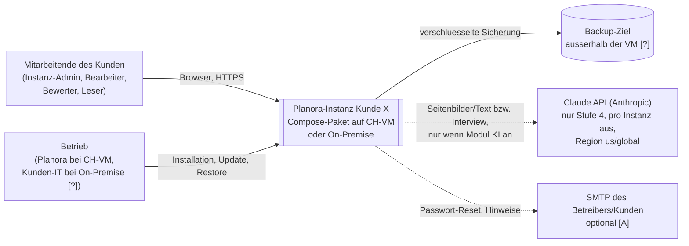
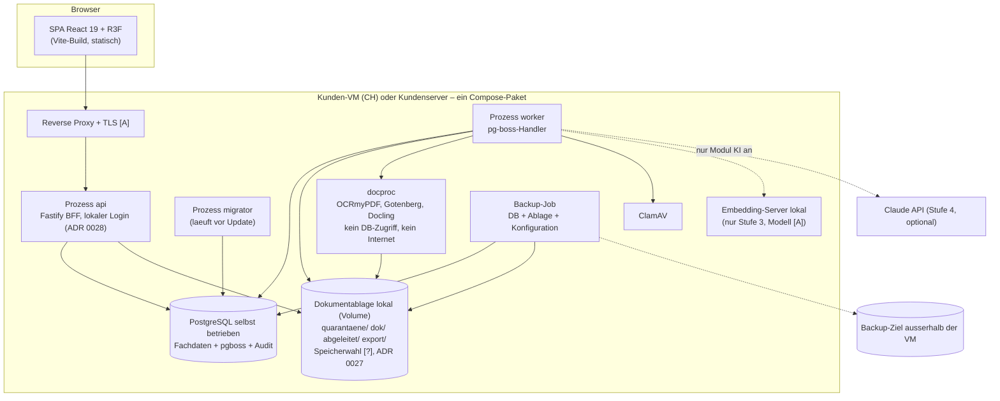
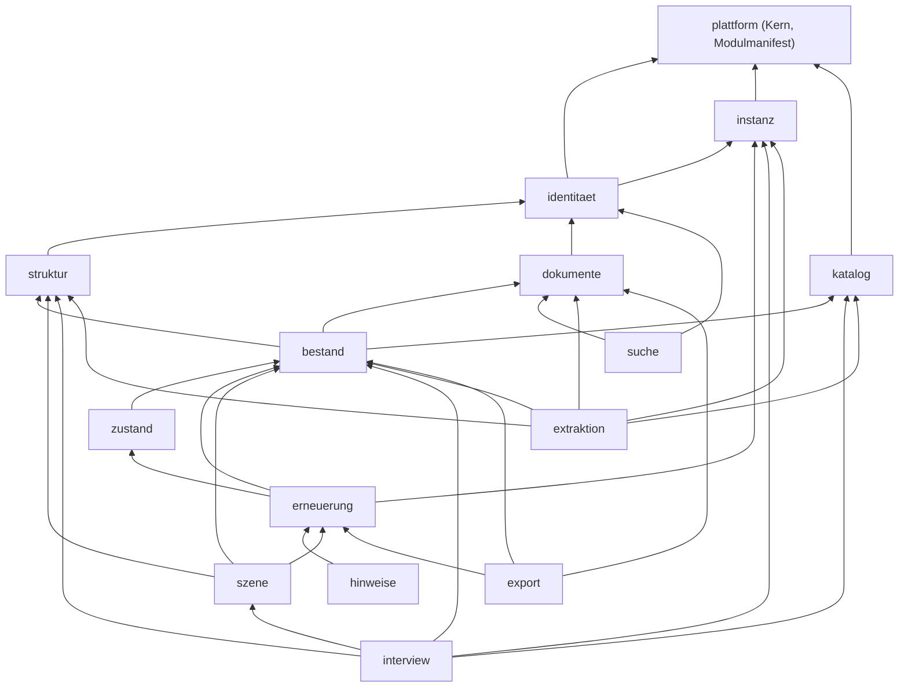
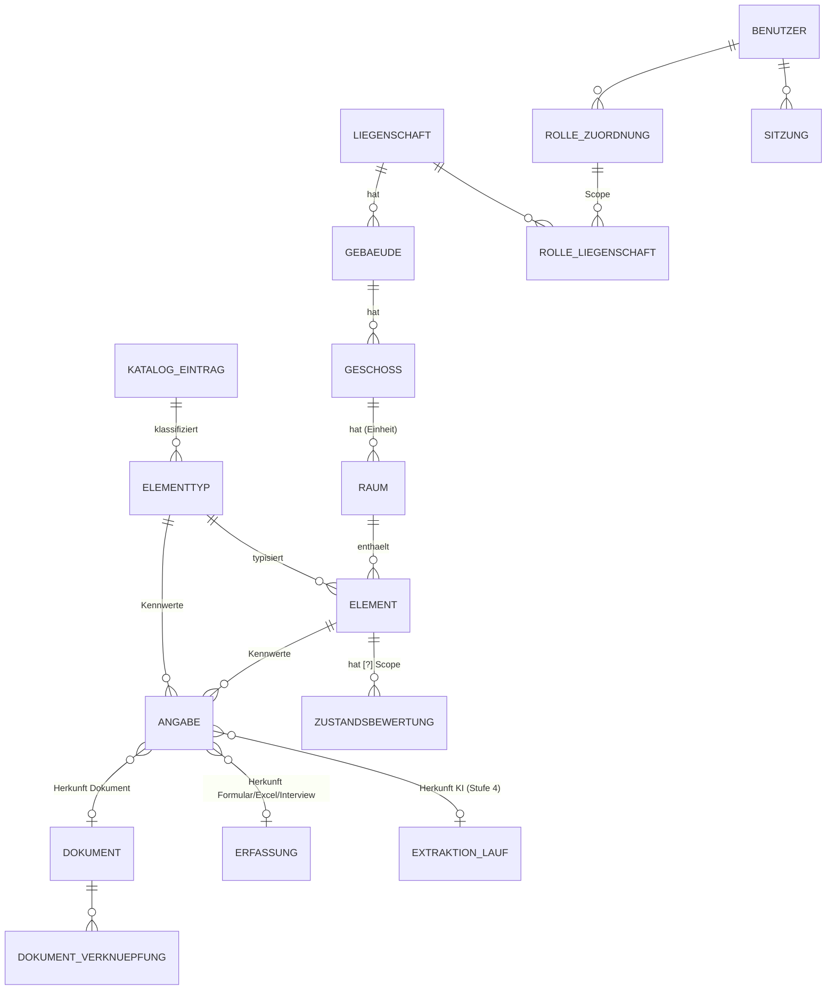
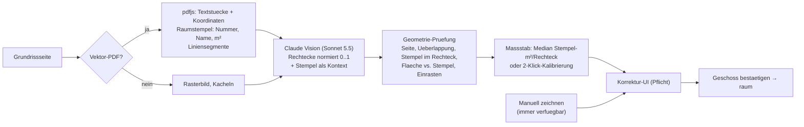
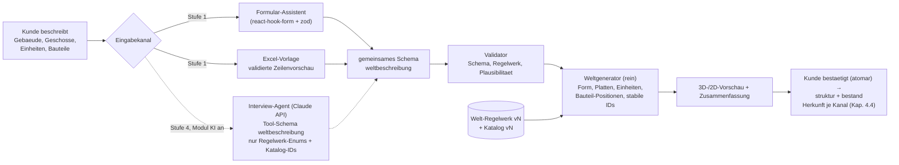

# 03 – Architektur Planora V1

> **Aktualisierung 2026-11-11:** E38 / [ADR 0032](adr/0032-gebaeude-vorbereiten-kunde-erfasst-technik.md) praezisiert die Erfassung: Planora erstellt die schematische Huelle; Kunden definieren Einheiten und Technik mit Folgefragen. Standort und Versorgung sind getrennt zu modellieren. Aktueller Implementierungs-/Abnahmestand und naechste Aufgaben: [Fortsetzungsplan](../superpowers/plans/2026-11-11-fortsetzung.md). Diese Produktpraezisierung ist geplant, noch nicht implementiert.

Stand: 2026-11-08 · Rolle: System-Architekt (Welle 2, Orca-Task task_5a6b938dca10) · Status: **Entwurf zur Freigabe**
Basis (verbindlich): `00-kontext.md` (E1–E10 und PO-Antworten E11–E22), `01-domaene.md` (FA-01..FA-38), `02-tech-recherche.md`.
Die PO-Antworten E11–E22 (Stand 2026-11-08) sind eingearbeitet; wo 01-domaene ein anderes Default vorschlug, gilt E11–E22.
Kennzeichnung: **[F]** Fakt mit Quelle · **[A]** Annahme (durch Spike oder PO zu bestaetigen) · **[?]** offen.
Quellenkuerzel: `Qn-Dom` = Quelle n in 01-domaene, `Qn-Tech` = Quelle n in 02-tech-recherche, `FA-nn` = Anforderung in 01 Kap. 7.
**E31 (2026-11-09): Pflicht-Bausteine** laut `06-bausteine-open-source.md` und ADR 0022–0024 sind eingearbeitet (Kap. 2.2, 5, 6, 10, 15).
**E32 (2026-11-09): oeffentliche APIs** geo.admin.ch/GWR, Nager.Date, Pwned Passwords (ADR 0025) sind eingearbeitet (Kap. 2.1, 3.3, 4.2, 9.7, 15).
**E33 (2026-11-09): geschlossene 3D-Welt** mit Regelwerk, Interview-Agent und deterministischem Weltgenerator (ADR 0026), einfacher Look mit Leistungsstufen (ADR 0008 angepasst, Spike S3b) sind eingearbeitet (Kap. 3, 7, 15).
Entscheide im Detail: `adr/0001`–`adr/0031` (Index: `adr/0000-adr-vorlage-und-index.md`). BMAD-Arbeitsprotokoll und Spine: `bmad/planning-artifacts/architecture/architecture-Planora-2026-11-08/`.
**Welle 4 / B2B (E34–E37, 2026-11-09):** Gueltigkeit siehe **Kap. 0**; alle Kapitel sind umgestellt (Kap. 0, 2, 3, 9, 10, 12 in Welle 4; Kap. 1, 4–8, 11, 13–15, Anhang A in Welle 4b).

---

## 0. Gueltigkeit ab Welle 4 (B2B)

[F] Die PO-Entscheide **E34–E37 (2026-11-09)** ersetzen widersprechende Vorgaben dieses Dokuments: B2B mit **einer Instanz pro Kunde**, ein **Docker-Compose-Paket** (eigene CH-VM von uns oder On-Premise), **lokaler Login mit Rollen**, **KI nur ueber die Claude API direkt**, Kundenfeatures als **Module mit Schalter pro Instanz**. E24 (keine Kosten/Investitionsplanung in V1) bleibt. Aenderungsliste: `07-analyse-b2b.md`.

| Thema | Gilt ab Welle 4 | Ersetzt |
|---|---|---|
| Betrieb | ADR 0027: Compose-Paket pro Kunde, eigenes PostgreSQL, lokale Dokumentablage, Backup/Restore/Update pro Instanz, Versionsmanifest, N/N-1 | ADR 0002 (Exoscale-Managed) |
| Login | ADR 0028: lokaler Login mit Rollen; SSO spaeter als Modul | ADR 0007 (Keycloak) |
| Kundenmodule | ADR 0029: Modulmanifest, Schalter pro Instanz, Default aus, Pruefung an HTTP- und Job-Grenze | neu |
| KI | ADR 0030: Claude API direkt, Stufe 4, pro Instanz standardmaessig aus; Kostenbremse ADR 0017 bleibt | ADR 0003 (Bedrock) |
| Datentrennung | ADR 0031: Instanz-Isolation plus App-Autorisierung | ADR 0010 (RLS) |

**Lieferstufen** [A, Plan V2 `docs/plan/umsetzungsplan.html`]: Stufe 1 = 3D + Dokumente, Erfassung per Formular/Excel · Stufe 2 = + Lebensdauer und Ampel (Ziel Uebergabe Siemens) · Stufe 3 = + lokale Suche · Stufe 4 = + Claude-Interview und KI-Auslesen.
**Zurueckgestellt bis nach der Demo:** Grundriss-Erkennung (ADR 0014), Preise/Investitionsplan (ADR 0018, E24), FR/IT (ADR 0019), oeffentliche APIs (ADR 0025).

**Stand dieses Dokuments:** Kapitel 0, 2, 3, 9, 10 und 12 sind in Welle 4 umgestellt, Kapitel 1, 4–8, 11, 13–15 und Anhang A in Welle 4b (gemaess 07 Kap. 3). Historische Spike-Ergebnisse und Tabellen sind als «historisch» gekennzeichnet erhalten (Kap. 6.2, 7.3, 13.3); bei Widerspruch gilt dieses Kapitel 0. Die bisherige Fassung der umgestellten Kapitel liegt im Git-Verlauf (Stand vor Branch `welle-4-b2b`, Commit `e64fdb9`).

---

## 1. Zusammenfassung und Qualitaetsziele

> Welle 4b (E34–E37, 2026-11-09): umgestellt gemaess 07 Kap. 3. Die Fassung vor Welle 4 (Mandanten, RLS, Bedrock, Exoscale, Preise) liegt im Git-Verlauf (Commit `e64fdb9`).

### 1.1 Zusammenfassung (10 Punkte)

1. **Modularer Monolith in TypeScript, ein Image, drei Prozessrollen** (`api`, `worker`, `migrator`). Fachmodule mit fester Datenhoheit, Import-Grenzen per Lint erzwungen (ADR 0001); jedes Modul hat eine Lieferstufe und, wo vorgesehen, einen Schalter pro Instanz (ADR 0029). Eine Codebasis, keine kundenspezifischen Branches (E37).
2. **Eine Instanz pro Kunde (E34):** dasselbe Compose-Paket auf eigener CH-VM oder On-Premise, mit eigener Datenbank, Dokumentablage, Secrets, Netz und Backup-Ziel (ADR 0027, 0031). In der App gibt es keine Mandantenwahl und keinen Mandantenkontext.
3. **"Bedingungslos funktionieren" heisst hier:** keine stillen Fehler, kein Datenverlust, keine falsche Ampel ohne Kennzeichnung, keine Daten einer anderen Instanz, jeder Wert erklaerbar. Es heisst **nicht** Hochverfuegbarkeit: Eine Einzel-VM ist kein HA-System; RPO/RTO werden neu vereinbart (Kap. 10.5, [?] PO, `08-pruefung.md` PO-Entscheid Nr. 4).
4. **Erfassung ohne KI zuerst:** Formular-Assistent und Excel-Vorlage mit validierter Zeilenvorschau → deterministischer Weltgenerator → 3D-Vorschau → Bestaetigung (ADR 0026). KI ist nie Voraussetzung fuer eine Funktion.
5. **Herkunft ist das Datenmodell:** Jeder Kennwert ist eine `angabe` mit typisierter Herkunft je Eingabekanal (Formular, Excel-Zeile/Zelle, Dokument/Seite/Zitat, ab Stufe 4 Interview-Antwort oder KI-Lauf) und Status. In Lebensdauer und Ampel fliessen **nur bestaetigte** Angaben (ADR 0012).
6. **Dokumente KI-frei:** Upload per serverseitig abgeschlossenem Multipart, Quarantaene + ClamAV + Magic Bytes ueber dieselben Bytes, lokale Vorschau (Gotenberg, OCRmyPDF), Viewer im Browser ohne Download mit Seiten-Sprung und Markierung (ADR 0016, 0022). K01 bleibt Gate vor Kundendaten.
7. **Lebensdauer und Ampel als reiner Rechenkern:** Stichtag explizit, Quellenrangfolge, technisches Ersatzjahr, Vollstaendigkeit, Ampel; gleiche Eingabe = gleiches Ergebnis (ADR 0013). **Keine** Preise, Teuerung oder Investitionsplanung (E24). Umfang der ZHAW-Zustandsbewertung in der Demo offen ([?] PO, `08-pruefung.md` PO-Entscheid Nr. 8).
8. **3D sinngemaess (E33):** geschlossene Welt aus Regelwerk und Katalog, `InstancedMesh` pro Katalogtyp, Sprite-Pins mit Clustering, Leistungsstufen normal/schwach/2D, 2D mit allen Funktionen (ADR 0008, 0026).
9. **Lokaler Login mit Rollen und Liegenschafts-Scope** (ADR 0028), SSO spaeter als Modul ohne zweite Rollenquelle. Sprache DE/de-CH; FR/IT zurueckgestellt (ADR 0019).
10. **Stufen 3 und 4:** Suche lokal ab Stufe 3 (PostgreSQL-Volltext + pgvector + lokaler Embedding-Server, ADR 0023); Claude API direkt nur ab Stufe 4, pro Instanz standardmaessig aus, mit Zustimmung, eigenem Schluessel und Budget (ADR 0030, 0017). Stufen 1–3 erzeugen keinen externen Inhaltsabfluss. Ob E27-Teile (Anfrageverstaendnis/Reranking/Antwort mit Quellen) schon Stufe 3 gehoeren: [?] PO, `08-pruefung.md` PO-Entscheid Nr. 11.

### 1.2 Qualitaetsziele (priorisiert)

Bei Zielkonflikten gewinnt das hoeher stehende Ziel.

| Rang | Qualitaetsziel | Konkretes Szenario / Messgroesse | Hauptmechanismen |
|---|---|---|---|
| 1 | **Korrektheit der Daten** | Kein unbestaetigter Wert in Lebensdauer, Ampel oder Export (Test: 0 Treffer). Lebensdauer-/Ampel-Orakel 100 % gruen, Faelle fachlich freigegeben. Gleiche Eingabe + Stichtag + Regelversion → byte-identisches Ergebnis. Unbekannt/unvollstaendig erscheint grau, nie als gruen. | ADR 0012, 0013; Validator; Optimistic Locking |
| 2 | **Instanz-Isolation und Rollenrechte** | Zwei installierte Instanzen teilen kein Volume, Netz, Secret oder Backup-Ziel (Installationstest). Rechte-Matrix Rolle × Recht × Liegenschaft gruen an API, Viewer-URLs, Derivaten, Downloads, Jobs und ab Stufe 3 Suchtreffern; Rechteentzug wirkt sofort. | ADR 0028, 0029, 0031 |
| 3 | **Wiederherstellbarkeit und betreibbare Installation** | Installation aus sauberer VM nach Runbook; Update N-1 → N mit befuellten Daten ohne Verlust; Restore auf frischer VM ohne Entwicklerzugang mit Hash-/Referenzpruefung. RPO/RTO: Vorschlag 24 h / 1 Arbeitstag bei CH-VM [A], [?] PO (`08-pruefung.md` PO-Entscheid Nr. 4). KI-Ausfall blockiert keine Nicht-KI-Funktion. | ADR 0027; Kap. 10 |
| 4 | **Nachvollziehbarkeit** | Fuer jede Aenderung wer/wann/alt/neu abrufbar (FA-06); fuer jeden effektiven Wert Quelle + Rangstufe (FA-21); Login, Rollen-/Modul-Schalter-Aenderung, Import und Instanz-Update im Audit; ab Stufe 4 Prompt-, Modell-, Katalog- und Pipeline-Version je KI-Ergebnis. | ADR 0015, 0012 |
| 5 | **Performance** | API p95 ≤ 300 ms fuer Lesezugriffe [A]; Lebensdauer-/Ampelliste 10'000 Elemente ≤ 2 s [A]; 3D-Budget Kap. 7.3 auf Kunden-Laptop bzw. Kunden-VDI [A]. | Projektion `element_effektiv`; Kap. 7 |
| 6 | **Portabilitaet** | Dasselbe Compose-Paket laeuft auf CH-VM und On-Premise ohne Sonderbuild (E35); nur Standard-Schnittstellen (libpq, OCI, Dateisystem bzw. S3-API je Speicherwahl, [?] PO, `08-pruefung.md` PO-Entscheid Nr. 3). | ADR 0001, 0027 |

---

## 2. Kontext- und Containerdiagramm (C4)

> Welle 4 (E34–E37): umgestellt auf eine Instanz pro Kunde (ADR 0027, 0031). Keycloak, Bedrock, Exoscale-Managed und oeffentliche APIs (E32) entfallen aus dem Bild.

### 2.1 Systemkontext (eine Kundeninstanz)



[F] E36: Claude ist die einzige fachliche externe API. [?] Ob Betriebsverkehr (ClamAV-Signaturen, Image-/Modell-Downloads, SMTP, Zeit) darunter faellt, ist offen (07 Kap. 8 Punkt 6).

### 2.2 Container (pro Kunde identisch)



Regeln: Nur der Reverse Proxy ist von aussen erreichbar. `docproc`, `ClamAV` und der Embedding-Server sind nur aus dem internen Netz der Instanz erreichbar und haben kein Internet. Nur `worker` spricht mit der Claude API, und nur wenn das Modul KI aktiv ist (ADR 0029, 0030). Keine Container, Volumes, Netze oder Secrets werden zwischen Kundeninstanzen geteilt (ADR 0031). Monitoring: schlanke Healthchecks und Backup-/Job-Alarmierung [A]; Voll-Observability-Stack ist keine Demo-Pflicht (07 Kap. 7).

---

## 3. Module des Monolithen

> Welle 4 (E34–E37): Modul `mandant` wird `instanz` (Instanzparameter, kein Mandantenkontext); `mitMandant()`/Mandantenwechsel entfallen; jedes Modul hat eine Lieferstufe und einen Schalter nach ADR 0029.

### 3.1 Innenstruktur jedes Moduls (ADR 0001)

```text
src/
  plattform/            # Kern: DB-Transaktion mitTransaktion(), IDs, Fehler, Konfig, Logging, Audit-Funktion, Job-Registry, Modulmanifest + modulAktiv()
  module/<name>/
    api/index.ts        # einziger Import-Punkt fuer andere Module (Funktionen + Typen)
    domain/             # reine Logik, kein IO, kein Date.now()
    ports/              # Interfaces (Repository, Provider)
    adapters/           # Postgres, Dokumentablage, HTTP, KI
    jobs/               # pg-boss-Handler (pruefen modulAktiv + aktuelle Rechte)
    http/               # Fastify-Routen (duenn: Modul-Schalter → Recht → Validierung → api → Antwort)
web/                    # SPA
docproc/                # fertige Container (ADR 0009)
katalog/                # katalog.vN.json, welt-regelwerk.vN.json, GLB-Quellen
eval/                   # Golden-Set-Definitionen (ohne Kundendokumente, ab Stufe 4)
```

Testbarkeit: `domain/` mit reinen Unit-Tests; `adapters/` gegen echte PostgreSQL-Testinstanz (Container); jedes Modul ersetzt fremde Module in Tests durch Fakes ihrer `api/index.ts`-Typen.

### 3.2 Abhaengigkeitsrichtung



Pfeil = "darf aufrufen". Alles darf `plattform` nutzen. Rueckwaerts-Aufrufe und Zyklen sind verboten; Rueckmeldungen laufen ueber Jobs/Ereignisse (pg-boss). Zurueckgestellte Module (`preise`, Grundriss-Teil von `extraktion`, `austausch`) sind im Graph nicht enthalten; sie kommen bei Wiederaufnahme als Module nach ADR 0029 mit eigenen Kanten dazu.

### 3.3 Modulkatalog

| Modul | Stufe / Schalter [A] | Zweck | Oeffentliche API (Auszug) | Abhaengig von | Datenhoheit (Tabellen) |
|---|---|---|---|---|---|
| **plattform** | Kern, immer an | Transaktionen, IDs (UUIDv7), Fehlerformat, Konfiguration, Logging, Audit-Ereignis, Job-Registrierung, **Modulmanifest und Modul-Schalter** (ADR 0029) | `mitTransaktion(ctx, fn)`, `neueId()`, `auditEreignis()`, `jobs.senden()`, `modulAktiv(id)` | – | `modul_schalter`, `audit_eintrag` (Schreiben nur per Trigger/Funktion) |
| **identitaet** | 1, immer an | Lokaler Login (ADR 0028), Sessions, Benutzer, Rollen, Liegenschafts-Scope, Autorisierung, Recovery | `aktuellerKontext(req)`, `pruefe(recht, liegenschaftId)`, `benutzerVerwalten()`, `sitzungenEntziehen(benutzerId)` | instanz | `benutzer`, `anmeldedaten`, `rolle_zuordnung`, `rolle_liegenschaft`, `sitzung` |
| **instanz** | 1, immer an | Instanzparameter: Anzeige-/ZHAW-/Ampel-Defaults, Betriebsstunden-Defaults; KI-Zustimmung und Budget ab Stufe 4 | `parameter()`, `parameterAendern()`, `kiErlaubt()` | plattform | `instanz_einstellung`, `ki_zustimmung` |
| **katalog** | 1, immer an | Versionierter Bauteil-Katalog je Instanz (Katalog-ID fuehrend), Texte DE, Klassifikations-Mappings, Planora-Standard-Lebensdauern, lokale Lebensdauer-Tabelle und Ampel-Schwellen (E11, E17) | `eintrag(katalogId)`, `alle(version)`, `mapping(katalogId, system)`, `lebensdauerTabelle()`, `ampelSchwelle(katalogId)` | plattform | `katalog_version`, `katalog_eintrag`, `katalog_text`, `klassifikation_mapping`, `lebensdauer_tabelle`, `ampel_schwelle` |
| **struktur** | 1, immer an | Liegenschaft → Gebaeude → Geschoss → Einheit/Raum; Stammdaten manuell (GWR zurueckgestellt) | `baum(gebaeudeId)`, CRUD | identitaet | `liegenschaft`, `gebaeude`, `geschoss`, `raum` |
| **dokumente** | 1, immer an | Upload, Quarantaene/Scan, lokale Ablage, Metadaten (E21), Verknuepfungen, **Viewer**: Vorschau-PDF, Seiten-Sprung, Markierung (ADR 0016, 0022) | `uploadBeginnen()`, `status()`, `seitenText()`, `verknuepfen()`, `vorschauUrl()` | identitaet | `dokument`, `dokument_seite`, `dokument_verknuepfung` |
| **interview** (Erfassung) | 1: Formular/Excel immer an · 4: Agent hinter Modul KI | Gefuehrte Erfassung Gebaeude → Geschosse → Einheiten → Bauteile; Formular-Assistent und Excel-Vorlage mit validierter Zeilenvorschau; spaeter Claude-Agent mit demselben Schema (ADR 0026) | `erfassungStarten(gebaeudeId?)`, `excelVorschau(datei)`, `beschreibung(id)`, `vorschau(id)`, `uebernehmen(id, version)`, ab Stufe 4 `antworten(id, text)` | struktur, bestand, katalog, instanz, szene | `interview`, `interview_nachricht` |
| **bestand** | 1, immer an | Elementtypen, Elemente, Angaben mit Herkunft je Eingabekanal, Pruefliste, Projektion `element_effektiv` | `vorschlaegeErfassen()`, `entscheiden()`, `effektiv()`, `pruefliste()`, CRUD | struktur, katalog, dokumente | `elementtyp`, `element`, `angabe`, `element_effektiv` |
| **szene** | 1, immer an | 3D-Lesemodell, deterministischer Weltgenerator (ADR 0026), Leistungsstufen normal/schwach/2D | `szene(gebaeudeId)`, `weltErzeugen(beschreibung, regelwerkVersion)` (rein) | struktur, bestand; nutzt `lebensdauer`/`erneuerung` nur wenn aktiv (Ampelfarben), siehe M1-Spec §4 | keine Fachdaten (nur Cache) |
| **zustand** | 2 [?, Scope ZHAW offen] | Zustandsbewertung nach ZHAW (E14), Historie | `bewerten()`, `aktuelleBewertung()` | bestand | `zustandsbewertung` |
| **erneuerung** | 2, immer an ab Stufe 2 | **Lebensdauer und Ampel**: reiner Rechenkern fuer Ersatzjahr, Quellenrangfolge, Vollstaendigkeit, Ampel; **ohne** Preise/Investitionsplan (E24) | `berechne(eingabe)` (rein), `liste(filter, stichtag)` | bestand, zustand, instanz | `planstand` [A, ohne Geldbetraege] |
| **hinweise** [A] | 2, Schalter | Hinweise «bald ersetzen» in der App, optional E-Mail; Datenhoheit aus E30 neu zu pruefen | `hinweiseFuer(benutzer)` | erneuerung | `hinweis` [A] |
| **export** | 2, immer an | Excel-Export Bestand/Lebensdauer, Instanz-Gesamtexport, Loeschlauf | `excel()`, `instanzExport()` | erneuerung, bestand, dokumente | `export_auftrag` |
| **suche** | 3, Schalter (Default aus) | Dokumentname, Volltext, lokale Semantik (pgvector, RRF, lokaler Embedding-Server); Treffer nach Liegenschaftsrechten (ADR 0023) | `suchen(anfrage, filter)`, `indexieren(dokId)` | dokumente, identitaet | `such_abschnitt` |
| **extraktion** | 4, Schalter «KI» (Default aus) | Klassifikation und Auslesen ueber Claude API (ADR 0030), Validierung, Kostenbremse (ADR 0017) | `dokumentVerarbeiten(dokId)`, `budgetStatus()` | dokumente, bestand, struktur, katalog, instanz | `extraktion_lauf`, `ki_aufruf`, `ki_budget`, `ki_cache` |
| *preise* | zurueckgestellt (E24, ADR 0018) | spaeteres Kundenmodul | – | – | – |
| *austausch* | [?] PO, Stratus-Scope (ADR 0020) | spaeteres Modul; Excel-Import gehoert zu `interview` | – | – | – |

[A] Tabellen- und Spaltennamen fuer `identitaet`, `instanz` und `hinweise` sind Vorschlaege; das Datenmodell steht in Kap. 4 (Welle 4b).

---

## 4. Datenmodell

> Welle 4b (E34–E37, 2026-11-09): umgestellt gemaess 07 Kap. 3 auf **eine Kundeninstanz**: keine `mandant_id`, keine RLS, normale Fremdschluessel, lokale Benutzer/Rollen/Scopes, Instanzparameter, Modulkonfiguration, Erfassungsentwurf. Preis-, GWR-/Feiertags- und Grundriss-Vorschlagtabellen sind nicht im Demo-Schema. Fassung vor Welle 4 im Git-Verlauf (`e64fdb9`). Tabellen- und Spaltennamen bleiben Vorschlaege [A] bis zur M1-Spec.

### 4.1 Kernentitaeten (eine Instanz)



Es gibt keine Entitaet "Mandant": Die Instanz selbst ist die Kundengrenze (ADR 0031). Instanzweite Einstellungen liegen in `instanz_einstellung` (eine Zeile, versioniert).

### 4.2 Tabellen (Auszug, verbindliche Spalten)

Gemeinsame Spalten jeder Fachtabelle: `id uuid` (UUIDv7, PK), `version int NOT NULL` (Optimistic Locking), `erstellt_am/von`, `geaendert_am/von`. Fremdschluessel sind normale FKs auf `id`; keine zusammengesetzten Mandanten-Schluessel.

| Tabelle | Lieferstufe | Schluessel / wichtige Spalten | Bemerkung |
|---|---|---|---|
| `instanz_einstellung` | 1 | `anzeige_name`, `ampel_gelb_jahre_default` (Default 3 [A, FA-23]), `betriebsstunden_default`, `sprache` (fest `de-CH`), Zustandsparameter `zustandsmodell`/`zhaw_knick`/`nutzungsgrenze_default` nur falls Zustand im Scope ([?] PO, `08-pruefung.md` PO-Entscheid Nr. 8) | eine Zeile, versioniert, Aenderung im Audit |
| `modul_schalter` | 1 | `modul_id`, `aktiv bool DEFAULT false`, `manifest_version`, `geaendert_von/am` | ADR 0029; Kernmodule ohne Zeile sind immer an |
| `benutzer` | 1 | `id`, `anmeldename UNIQUE`, `email`, `name`, `status` (aktiv/gesperrt/pseudonymisiert), `audit_pseudonym uuid UNIQUE` | lokaler Login (ADR 0028); `audit_pseudonym` ab Erstanlage, siehe 4.5 |
| `anmeldedaten` | 1 | `benutzer_id`, `passwort_hash`, `hash_verfahren`, `fehlversuche`, `gesperrt_bis`, `einrichtungs_token_hash`, `reset_token_hash`, `token_ablauf` | nur Hashes, nie Klartext; Verfahren laut Auth-Bibliothek [A, ADR 0028] |
| `sitzung` | 1 | `benutzer_id`, `erstellt_am`, `letzte_aktivitaet`, `ablauf_absolut`, `entzogen_am` | serverseitig; Entzug sofort bei Logout/Sperre/Rollenentzug/Passwortwechsel |
| `rolle_zuordnung` | 1 | `(benutzer_id, rolle) UNIQUE` | Rollen Kap. 9.2 |
| `rolle_liegenschaft` | 1 | `(rolle_zuordnung_id, liegenschaft_id)` | leer = alle Liegenschaften [A]; interne Grenzen [?] PO (`08-pruefung.md` PO-Entscheid Nr. 2) |
| `liegenschaft`, `gebaeude` | 1 | `gebaeude.uebergabedatum date`, `gebaeude.egid` (optional, manuell, `UNIQUE` falls gesetzt) | Stammdaten manuell; GWR-Vorbelegung zurueckgestellt (ADR 0025) |
| `geschoss` | 1 | `gebaeude_id`, `code` (Regelwerk), `bezeichnung`, `reihenfolge int`, `hoehe_m numeric`, `status` (entwurf/bestaetigt) | Grundriss-Spalten (`grundriss_dokument_id`, `massstab_*`) entfallen fuer die Demo (ADR 0014 zurueckgestellt) |
| `raum` | 1 | `geschoss_id`, `nummer`, `bezeichnung`, `art` (Einheit-Art aus Welt-Regelwerk), `x_m, y_m, breite_m, tiefe_m numeric(9,3)`, `geometrie_quelle` (schematisch/manuell), `stabile_erfassungs_id` | Rechteck im Geschoss-Koordinatensystem (E3); Einheiten aus der Erfassung sind `schematisch` (ADR 0026) |
| `erfassung` | 1 | `gebaeude_id`, `kanal` (formular/excel, ab Stufe 4 agent), `status` (offen/zur_bestaetigung/uebernommen/verworfen), `weltbeschreibung jsonb`, `regelwerk_version`, `katalog_version`, `quelle_dokument_id` (Excel-Datei), `bestaetigt_von/am` | Erfassungsentwurf; bisher `interview` genannt. Uebernahme atomar (ADR 0026) |
| `erfassung_zeile` | 1 | `erfassung_id`, `blatt`, `zeile`, `zelle_bereich`, `rohwerte jsonb`, `ergebnis` (ok/fehler/warnung), `meldung`, `ziel_typ`, `ziel_id` | validierte Zeilenvorschau Excel; Grundlage der Herkunft Excel-Zeile/Zelle |
| `interview_nachricht` | 4 | `erfassung_id`, `rolle`, `text`, `zeitpunkt` | nur Kanal `agent` (Modul KI) |
| `katalog_version`, `katalog_eintrag` | 1 | `katalog_id text` (stabil, fuehrend, z.B. `leuchte.downlight`), `version`, `gruppe`, `glb_datei`, `glb_sha256`, `icon`, `ld_min/mittel/max_jahre` (Planora-Standard, E11), `nutzungsgrenze`, `ampel_gelb_jahre`, `betriebsstunden_pro_jahr`, `referenzquelle` | mit dem Release ausgeliefert, je Instanz read-only fuer die App (ADR 0011). **Keine CRB-Werte** (E11). `kosten_bezugsgroesse` entfaellt (E24) |
| `katalog_text` | 1 | `(katalog_id, version, sprache)` PK, `name`, `beschreibung` | Demo nur `de`; Struktur bleibt sprachneutral (ADR 0019) |
| `klassifikation_mapping` | 1 | `(katalog_id, system, code)`, `system_version`, `bezeichnung` | optional, austauschbar (E12/E13); ETIM mit Attribution ODC-BY [F, Q9-Dom] |
| `lebensdauer_tabelle` | 2 | `elementtyp_id UNIQUE`, `ld_min/mittel/max_jahre`, `nutzungsgrenze`, `quelle` (`planora_standard@vN` / `manuell`), `begruendung` | Lebensdauer-Tabelle der Instanz (E11): bei Anlage des Typs aus dem Katalog kopiert, danach editierbar; bisher `mandant_lebensdauer` |
| `ampel_schwelle` | 2 | `katalog_id UNIQUE`, `ampel_gelb_jahre` | Schwelle pro Bauteiltyp (E17); bisher `mandant_ampel` |
| `elementtyp` | 1 | `katalog_id NOT NULL`, `hersteller`, `typbezeichnung`, `UNIQUE (katalog_id, hersteller_norm, typ_norm)` | Typ-Ebene: Lebensdauer, Datenblatt (kein Preis, E24) |
| `element` | 1 | `elementtyp_id`, `raum_id` (oder `geschoss_id` falls Raum unbekannt), `anlagekennzeichen`, `menge int ≥ 1`, `position jsonb NULL`, `status` (vorgeschlagen/aktiv/verworfen/ausgebaut), `stabile_erfassungs_id` | Element-Ebene: Einbaudatum, Standort, Zustand |
| `angabe` | 1 | siehe 4.4 | Herkunft je Wert |
| `element_effektiv` | 1 | `element_id PK`, effektive Werte + `quelle_rang` je Merkmal, `datenstand` | Projektion, neu aufbaubar; Lebensdauer loest nur `erneuerung` auf (Kap. 8.1) |
| `zustandsbewertung` | 2 [?] | `element_id`, `datum`, `zustandswert numeric(2,1)`, `notiz`, `foto_dokument_id`, `bewerter_id` | nur Einfuegen; nur falls Zustand im Demo-Scope ([?] PO, `08-pruefung.md` PO-Entscheid Nr. 8) |
| `planstand` | 2 [A] | `stichtag`, `regelwerk_version`, `katalog_version`, `eingabe_hash`, `ergebnis jsonb`, `eingefroren_von/am` | eingefrorener Lebensdauer-/Ampelstand **ohne Geldbetraege** (E24); ob die Demo Planstaende braucht, ist [A] |
| `dokument` | 1 | `sha256`, `UNIQUE (sha256)`, `dateiname`, `mime`, `groesse`, `seiten`, `dokumentart`, `kbob_fachbereich`/`kbob_dtc` (E21, manuell; KI-Vorschlag erst Stufe 4), `status` (Kap. 5.2), `gebaeude_id`, `vorschau_version` | Ablagepfad `dok/<sha256>` in der lokalen Ablage der Instanz (ADR 0016, 0027) |
| `dokument_seite` | 1 | `dokument_id`, `seite`, `text`, `bloecke jsonb` (Koordinaten im Vorschau-PDF), `vorschau_version` | Grundlage fuer Seiten-Sprung und Markierung (ADR 0022) |
| `dokument_verknuepfung` | 1 | `dokument_id`, je eine nullable FK-Spalte `elementtyp_id` / `element_id` / `gebaeude_id` / `geschoss_id`, `CHECK (genau eine gesetzt)` | n:m (FA-10); typisierte Referenzen statt `ziel_typ/ziel_id` (07 Kap. 3) |
| `such_abschnitt` | 3 | `dokument_id`, `seite`, `text`, `tsv`, `embedding vector(n)`, `modell_id` | ADR 0023; Dimension und Modell [A], Modulschalter `suche` |
| `extraktion_lauf`, `ki_aufruf`, `ki_budget`, `ki_cache` | 4 | wie ADR 0017/0030; `ki_aufruf` ohne Inhalt, `provider` fest `anthropic` | nur Modul KI; keine `profil`-Spalte mehr (Bedrock entfaellt) |
| `hinweis` | 2 [A] | `benutzer_id`, `element_id`, `art`, `erzeugt_am`, `gelesen_am` | Modul `hinweise`; Datenhoheit aus E30 noch zu pruefen |
| `export_auftrag` | 2 | `art`, `status`, `datei_pfad`, `erstellt_von`, `bereit_bis` | Download nur ueber autorisierte Route (Kap. 9.10) |
| `audit_eintrag`, `audit_akteur` | 1 | siehe 4.5 und ADR 0015 | append-only, Hash-Kette je Instanz |

Nicht im Demo-Schema (zurueckgestellt): `preisquelle`, `hersteller_artikel`, `preis_eintrag`, `mandant_preis`, `ersatz_planung` (Budgetverschiebung, E24/ADR 0018), `feiertag` (ADR 0025), `raum_vorschlag` (ADR 0014). Bei Wiederaufnahme kommen sie als eigenes Modul nach ADR 0029 mit eigener Migration dazu.

Spaltenregeln: Datum `date`, Zeitpunkte `timestamptz` (UTC gespeichert, Anzeige Europe/Zurich); Masse in Metern `numeric(9,3)`; Texte normalisiert fuer Vergleich in eigenen `_norm`-Spalten. Geldspalten gibt es in der Demo nicht (E24).

### 4.3 Datenzugriff und DB-Rechte (statt RLS)

Die Kundengrenze ist die Instanz (eigene DB, ADR 0031); innerhalb der Instanz gibt es **keine** RLS-Policies und keinen `app.mandant()`-Kontext. Absicherung stattdessen:

- **Rollen in PostgreSQL:** `planora_migrator` (Owner, DDL, nur im `migrator`), `planora_app` (DML auf Fachtabellen, kein DDL, kein Owner, kein `BYPASSRLS`-Bedarf), `audit_eintrag` fuer `planora_app` nur `SELECT`, Schreiben nur ueber Trigger/`SECURITY DEFINER`-Funktion mit festem `search_path` (ADR 0015).
- **Katalogtabellen:** `planora_app` nur `SELECT`; neue Katalogversionen kommen ausschliesslich per Migration/Release.
- **Fachliche Autorisierung in der App:** Session → Modul aktiv → Rolle → Liegenschaft des Zielobjekts, an jeder HTTP-Route und in jedem Job (Kap. 9.2, ADR 0028/0029). Abfragen auf liegenschaftsgebundene Daten laufen ueber Repository-Funktionen, die den Scope als Pflichtparameter verlangen [A].
- **Constraints statt Policies:** FKs, `CHECK`- und `UNIQUE`-Constraints sichern Datenkonsistenz; Tests dazu in `05-tests.md` Kap. 12.

### 4.4 Herkunft (Provenance) je Wert

`angabe` (ADR 0012): Zielreferenz typisiert (`element_id` **oder** `elementtyp_id`, `CHECK` genau eine), `merkmal` (geschlossene Liste: `hersteller`, `typbezeichnung`, `lebensdauer_jahre`, `lebensdauer_stunden`, `betriebsstunden_pro_jahr`, `leistung_kw`, `einbaudatum`, `menge`, `raum_zuordnung`, `katalog_zuordnung`, `anlagekennzeichen`, `garantie_bis`, …), `wert jsonb` (Schema je Merkmal), `einheit`, `status` (vorgeschlagen/bestaetigt/verworfen/ersetzt), `entschieden_von/am`, `konfidenz_stufe` (nur KI) und **genau eine Herkunft je Eingabekanal**:

| `quelle_art` | Lieferstufe | Pflicht-Herkunftsfelder | Bemerkung |
|---|---|---|---|
| `formular` | 1 | `erfassung_id`, Feldpfad | manuelle Eingabe im Formular-Assistenten |
| `excel` | 1 | `erfassung_id`, `erfassung_zeile_id` (Blatt, Zeile, Zelle), `quelle_dokument_id` | bestaetigt erst nach validierter Zeilenvorschau, nicht allein nach Spaltenzuordnung (07 Kap. 2, ADR 0012) |
| `manuell` | 1 | `entschieden_von` | direkte Korrektur in der Detailansicht |
| `dokument` | 1 | `dokument_id`, `seite`, `zitat`, `markierung` | Benutzer markiert Beleg im Viewer |
| `abgeleitet` | 1 | Regel-ID (z.B. Einbaudatum = Uebergabedatum, FA-16) | |
| `interview` | 4 | `erfassung_id`, `interview_nachricht_id` | Claude-Agent, gleicher Schreibpfad wie Formular |
| `ki` | 4 | `extraktion_lauf_id`, `dokument_id`, `seite`, `zitat`, `markierung` | Vorschlag, nie automatisch bestaetigt |

**Markierungsfeld vereinheitlicht:** Alle Belegstellen nutzen ein Feld `markierung` = `{ seite, rechtecke: [[x0,y0,x1,y1]…], koordinatensystem: "vorschau_pdf_pt", vorschau_version }`. Die bisherigen Namen `bbox` (Angabe) und `zitat_box` (Viewer) entfallen; der Viewer (ADR 0022) zeichnet direkt aus `markierung`. Aendert sich die Vorschau-Version, gilt die Markierung als "zu pruefen" statt still verschoben [A].

**Ein Resolver** (rein, deterministisch) bestimmt den effektiven Wert: nur `bestaetigt` → Rang nach Quelle: (1) `manuell`/`formular`/`excel`/`interview` (vom Menschen bestaetigt), (2) `dokument`/`ki` mit Dokumentart Herstellerdatenblatt, (3) `dokument`/`ki` mit Protokoll/Liste, (4) `abgeleitet` → bei Gleichstand juengste Entscheidung → bei Gleichstand kleinste `id`. Fuer die Lebensdauer gilt die vollstaendige Rangfolge aus Kap. 8.1. Eine Aenderung am Elementtyp invalidiert `element_effektiv` **aller** Elemente dieses Typs (Fan-out, H11/H12). Lebensdauer-Tabelle und Ampel-Schwellen sind **Instanzparameter** (mit Audit), keine Angaben.

**Statuswechsel:** `vorgeschlagen → bestaetigt | verworfen`; `bestaetigt → ersetzt` nur durch eine neue bestaetigte Angabe desselben Merkmals; jede Entscheidung mit `erwartete_version`.

### 4.5 Versionierung und Audit

- Optimistic Locking: Jede schreibende API verlangt `erwartete_version`; Abweichung → HTTP 409 mit aktuellem Stand (AD-11).
- Fachhistorie: `angabe` und `zustandsbewertung` sind nur-einfuegend. Andere Tabellen: Historie ueber `audit_eintrag` (alt/neu als JSON).
- **Audit-Akteur pseudonym ab Erstschreiben (ADR 0015, Befund 10 in `08-pruefung.md`):** `audit_eintrag.akteur` enthaelt nie Name/E-Mail, sondern `benutzer.audit_pseudonym` (stabile UUID, bei Kontoanlage vergeben). Die Zuordnung Pseudonym → Person liegt getrennt in `audit_akteur` (`audit_pseudonym`, `benutzer_id`, `anzeigename`) und ist loeschbar. Bei Kontopseudonymisierung (Kap. 9.9) wird nur `audit_akteur` geloescht/geleert; gehashte Audit-Ereignisse werden nie umgeschrieben, die Hash-Kette bleibt gueltig. Freitext-Felder im Audit (alt/neu) duerfen keine Benutzer-Personendaten enthalten; Benutzertabellen werden mit Pseudonym statt Klartext protokolliert [A].
- Katalog und Welt-Regelwerk: versioniert per `katalog_version` bzw. `regelwerk_version`; jede `erfassung`, jede `angabe` aus Erfassung und jeder `extraktion_lauf` kennt die verwendeten Versionen.
- Rechenregeln: `regelwerk_version` des Rechenkerns in jedem Ergebnis und Planstand.
- **Updates erhalten lokale Daten:** Ein Katalog- oder Regelwerk-Update ueberschreibt keine lokalen Overrides (`lebensdauer_tabelle.quelle = manuell`, `ampel_schwelle`) und erzeugt keine bestehenden Zuordnungen still neu; Abweichungen zu neuen Planora-Standards erscheinen als Vorschlag fuer den Instanz-Admin (ADR 0011, 0026).

### 4.6 Elementtyp vs. Element, Katalog-IDs, eBKP-H/ETIM

- **Katalogeintrag** (mit dem Release ausgeliefert): "was fuer ein Bauteil" → 3D-Modell, Icon, Planora-Gruppe, Standard-Lebensdauer, Ampel-Default; ETIM/eBKP-H nur ueber `klassifikation_mapping`.
- **Elementtyp** (Instanz): "welches Produkt" (Hersteller + Typ) → Zeile in der Lebensdauer-Tabelle, Datenblatt-Dokument. Kein Preis (E24).
- **Element** (Instanz): "welches Exemplar wo" → Raum/Einheit, Anlagekennzeichen, Menge, Einbaudatum, Zustand, **eigene Lebensdauer** als manuelle Angabe (E11; ein Sammelelement mit abweichender Lebensdauer wird geteilt).
- Ist Hersteller/Typ unbekannt, wird ein generischer Elementtyp pro Katalog-ID verwendet (`hersteller = NULL`).
- **Stabile IDs ueber Wiederimport:** Formular- und Excel-Erfassung vergeben `stabile_erfassungs_id` (z.B. Geschoss-Code + Einheit-Nummer + Zeilenschluessel [A]); ein erneuter Import gleicht ueber diese ID ab (Merge statt Duplikat), damit Dokumentverknuepfungen und Angaben erhalten bleiben.
- **Klassifikation austauschbar (E12/E13):** Die Planora-Katalog-ID ist der einzige fuehrende Schluessel; ETIM und eBKP-H sind optionale Mappings. eBKP-H nur als Code ohne CRB-Texte (rechtliches Restrisiko E13 [?]).
- **Sprache:** Demo DE/de-CH (ADR 0019 zurueckgestellt). UI-Texte in Sprachdateien, Stammdaten-Texte in `katalog_text` mit Sprachschluessel, sprachneutrale IDs; Kundendaten werden nicht uebersetzt. de-CH-Zahlen (`1'000,5`) und Datumsformate in Anzeige, Excel-Import und -Export.

---

## 5. Dokument- und KI-Pipeline Ende-zu-Ende

> Welle 4b (E34–E37, 2026-11-09): umgestellt gemaess 07 Kap. 3. Upload/Scan/Vorschau sind der **KI-freie Grundablauf** (Stufe 1); Suche/Embeddings Stufe 3; Klassifikation/Extraktion ueber die Claude API direkt erst Stufe 4 (ADR 0030). Bedrock, Profil-ARNs, Grundriss und FR/IT-Gates entfallen. Fassung vor Welle 4 im Git-Verlauf (`e64fdb9`).

### 5.1 Ablauf

```mermaid
sequenceDiagram
  autonumber
  participant B as Browser
  participant A as api
  participant S as Lokale Ablage
  participant W as worker
  participant V as ClamAV
  participant D as docproc
  participant E as Embedding-Server
  participant K as Claude API
  participant P as Postgres
  Note over B,P: Stufe 1 – Upload, Scan, Vorschau (ohne KI)
  B->>A: Upload beginnen (Uppy: Dateiname, Groesse)
  A->>P: dokument(status=hochladen), Upload-ID
  B->>A: Teile hochladen (nur ueber api, Recht + Groessenlimit je Teil)
  A->>S: Teile nach quarantaene/<upload_id>/
  B->>A: abschliessen
  A->>S: Teile serverseitig zusammenfuegen (einmalig, Abschluss-Lock)
  A->>P: status=hochgeladen + Job scan [eine Tx]
  W->>S: Datei aus quarantaene/ einmal streamen
  W->>V: Scan + Magic Bytes (file-type) + SHA-256 ueber dieselben Bytes
  W->>S: dieselben Bytes nach dok/<sha256>
  W->>P: status=geprueft + Job vorschau_erzeugen
  W->>D: Office → Gotenberg, Scan → OCRmyPDF, PDF-Text/Bloecke
  D->>S: Vorschau-PDF + Seitentext nach abgeleitet/
  W->>P: dokument_seite, status=aufbereitet
  B->>A: Viewer: Vorschau-URL (Recht je Abruf geprueft)
  Note over B,P: Stufe 3 – Suche (Modul suche an)
  W->>E: Abschnitte einbetten (lokal, kein Internet)
  W->>P: such_abschnitt (tsv + embedding)
  Note over B,P: Stufe 4 – KI (Modul KI an + Zustimmung + Schluessel + Budget)
  alt Modul KI an, Budget reserviert
    W->>K: Klassifikation (Dokumentart, relevante Seiten)
    W->>K: Extraktion je Seitenblock (Tool-Schema mit Katalog-Enum)
    W->>P: ki_aufruf, Validierung, angabe status=vorgeschlagen
  else KI aus
    W->>P: status=aufbereitet bleibt; Erfassung manuell/Formular/Excel
  end
  B->>A: Pruefansicht: bestaetigen/korrigieren/verwerfen (mit Version)
  A->>P: angabe status=bestaetigt, element_effektiv neu [eine Tx]
```

Der Upload-Weg ueber die `api` (statt signierter Direkt-URLs) ist der Vorschlag fuer die lokale Ablage [A]; bei Wahl eines S3-kompatiblen Servers gilt der Multipart-Ablauf aus ADR 0016 mit serverseitigem Abschluss. Speicherwahl: [?] PO, `08-pruefung.md` PO-Entscheid Nr. 3. In beiden Faellen gilt K01: Scan, Hash und Freigabe ueber **dieselben** Bytes, kein Vorschau-Abruf aus `quarantaene/`, Doppelabschluss und Absturz waehrend des Abschlusses ohne Wirkung (Race-/Crash-Test auf dem gelieferten Speicher, `05-tests.md` Kap. 12).

Transaktionen bleiben kurz: Kein Aufruf an ClamAV, docproc, Embedding-Server oder Claude API innerhalb einer offenen DB-Transaktion; Ergebnisse werden danach in eigener Transaktion mit Zustandspruefung geschrieben.

### 5.2 Zustandsautomat Dokument

Grundablauf (Stufe 1): `hochladen → hochgeladen → geprueft | abgelehnt → aufbereitet | fehlgeschlagen`. Ab Stufe 4 zusaetzlich `aufbereitet → klassifiziert → extrahiert → zur_pruefung → abgeschlossen`. Nebenzustaende `pausiert_budget`, `pausiert_ki_aus`, `nicht_auswertbar` (DWG/IFC/DOC ohne Vorschau, FA-08; Original bleibt herunterladbar). Indexierung (Stufe 3) ist ein **eigener** Status `such_index` (offen/fertig/fehler) am Dokument und blockiert weder Viewer noch Erfassung. Jeder Job prueft den Ausgangszustand; ist der Folgezustand schon erreicht, endet er ohne Wirkung (Idempotenz).

### 5.3 Stufen der Verarbeitung

| Verarbeitung | Lieferstufe | Werkzeug | Ausgabe | KI? |
|---|---|---|---|---|
| Scan | 1 | ClamAV, Magic Bytes, SHA-256 | sauber/abgelehnt | nein |
| Vorschau | 1 | Gotenberg (Office), OCRmyPDF (Scan), sharp (Miniaturen) – ADR 0022 | Vorschau-PDF in `abgeleitet/` | nein |
| Aufbereitung | 1 | Excel: exceljs im Worker; PDF: pdfjs-dist; Scan: OCRmyPDF | `dokument_seite` (Text, Bloecke mit Koordinaten) | nein |
| Excel-Erfassung | 1 | exceljs + feste Planora-Vorlage, deterministische Validierung | `erfassung_zeile` (Zeilenvorschau) | nein |
| Indexierung | 3 | Docling Serve (Tabellen/Struktur) [A, Einsatz in Stufe 3 pruefen], Chunking, lokaler Embedding-Server | `such_abschnitt` (ADR 0023) | nein (lokales Modell) |
| Klassifikation | 4 | Claude (kleines Modell [A]), nur Text der ersten Seiten + Seitentitel | Dokumentart, KBOB-Vorschlag (E21), relevante Seitenbereiche | ja (sonst Benutzer waehlt) |
| Spaltenzuordnung fremder Excel | 4 | Claude: Kopfzeile + 20 Beispielzeilen [A] | Zuordnungsvorschlag, dann Zeilenvorschau wie Stufe 1 | ja (sonst Planora-Vorlage/manuell, FA-38) |
| Extraktion | 4 | Claude (groesseres Modell [A]), Seitenbloecke zu 20 Seiten [A], Bild + Text | strukturierte Vorschlaege mit Seite + Zitat | ja |
| Validierung | 1 (Formular/Excel), 4 (KI) | deterministisch (5.6) | Pruefliste, Konfidenzstufe | nein |
| Pruefung | 1 | Mensch | bestaetigt/verworfen | nein |

Grundriss-Erkennung ist zurueckgestellt (Kap. 6). Modell-IDs werden in der Konfiguration gefuehrt und erst nach Golden-Set-Lauf (5.8) gewechselt; konkrete Modelle [A].

### 5.4 Idempotenz und Retries

- Job-Schluessel: `<stufe>:<dokument_id>:<seitenblock>:<pipeline_version>`. Doppelter Job = kein zweiter Lauf. Job-Payloads tragen eine Schemaversion; der Worker lehnt unbekannte Versionen ab (ADR 0006, Kap. 10.3).
- KI-Antwort-Cache (`ki_cache`, Stufe 4): Schluessel SHA-256(Seiteninhalt + Prompt-Version + Modell-ID + Katalog-Version) → kein Doppelbezahlen bei Retry nach DB-Fehler. Keine Exactly-once-Zusage fuer die Abrechnung: ein Request, dessen Antwort wegen Absturz verloren ging, gilt als "Abrechnung ungewiss" und wird in der Budget-Reconciliation (ADR 0017) gezaehlt.
- Vorschlaege tragen `extraktion_lauf_id`; ein wiederholter Lauf ersetzt nur **noch unentschiedene** Vorschlaege desselben Laufs, nie bestaetigte Angaben.
- Dasselbe Dokument (gleicher SHA-256 in der Instanz) wird nicht neu extrahiert, ausser bei neuer Pipeline-/Prompt-Version auf Anforderung.
- Abgleich mit Bestand: Element mit gleichem `anlagekennzeichen` im gleichen Gebaeude → Vorschlag als neue Angabe am bestehenden Element.

| Fehlerklasse | Retry | Grenze [A] |
|---|---|---|
| Claude API Drosselung (429)/5xx/Timeout | exponentiell 5 s … 10 min, Jitter, `retry-after` beachten | 6 Versuche, danach `fehlgeschlagen` + Alarm |
| Claude API 4xx (Validierung, Groesse) | kein Retry; Seitenblock halbieren, einmal erneut | 1 |
| Claude API 401/403 (Schluessel ungueltig/entzogen) | kein Retry; Modul KI pausiert, Admin-Meldung | 0 |
| Antwort verletzt Schema | 1 Retry mit Fehlermeldung im Prompt | 1, danach Pruefliste "KI-Antwort ungueltig" |
| docproc Absturz/Timeout | 2 Retries, danach Seitenblock einzeln | 3 |
| Embedding-Server nicht erreichbar | exponentiell, Dokument bleibt im Viewer nutzbar | 6, danach `such_index=fehler` + Alarm |
| DB-Konflikt (Version) | sofort, 3 Versuche | 3 |
| Schutzschalter offen / Modul aus | Job wartet (verschoben), zaehlt nicht als Versuch | – |

### 5.5 Strukturierte Ausgabe nur gegen Katalog-IDs (Stufe 4)

- Aufruf mit Tool-Definition/JSON-Schema; Feld `katalog_id` als **Enum der gueltigen IDs der aktuellen Katalogversion plus `null`** (null = unbekannt → Pruefliste). Keine Freitext-Typen (E8, FA-14).
- Jedes Feld eines KI-Vorschlags hat `{ wert, einheit, seite, zitat, konfidenz }`. Ohne `seite` und `zitat` ist ein **KI**-Wert ungueltig. (Fuer Formular/Excel gilt die Herkunft aus Kap. 4.4; dort gibt es kein Zitat.)
- Dokumente werden mit einem Prompt verarbeitet; Zitate bleiben in Originalsprache, Werte werden normalisiert (de-CH-Zahlen, Einheiten). Die Demo garantiert nur DE-Dokumente; FR/IT-Dokumente sind nicht ausgeschlossen, aber kein Abnahmekriterium (ADR 0019 zurueckgestellt). OCR-Sprache Demo `deu` (+ `eng`) [A].
- Prompt enthaelt Katalogliste (ID, Name, Kurzbeschreibung), Merkmalsliste mit Einheiten, Regeln ("nicht raten; null wenn nicht im Dokument"). Prompt-Caching fuer den statischen Teil [A, Verfuegbarkeit bei direkter API bei Stufe-4-Start pruefen].

### 5.6 Validierung und Konfidenzschwellen

Deterministische Pruefungen, fuer Formular/Excel (Stufe 1, Regeln 1 und 4) und nach jeder KI-Antwort (Stufe 4, alle Regeln):
1. Schema (Zod) und Katalog-ID gueltig in der verwendeten Katalogversion.
2. **Grounding (KI):** `zitat` kommt im Seitentext der angegebenen Seite vor (normalisiert: Leerraum, Bindestriche, Gross/Klein); unscharfe Uebereinstimmung ≥ 0,9 [A] zaehlt als "unscharf".
3. **Wert im Zitat (KI):** der Zahlenwert steht im Zitat (z.B. "50'000 h" → 50000, Einheit h).
4. **Plausibilitaet je Merkmal** [A]: Lebensdauer 1–100 Jahre; Stunden 1'000–200'000; Einbaudatum zwischen 1950 und Uebergabedatum + 1 Jahr; Menge 1–10'000; Leistung > 0.
5. **Querpruefung (KI):** derselbe Wert aus zwei Dokumenten → Bestaetigung; Widerspruch → beide "mittel" mit Hinweis.

Stufen fuer KI-Vorschlaege [A, kalibriert am Golden Set so, dass Praezision der Stufe "hoch" ≥ 98 %]:

| Stufe | Bedingung | UI |
|---|---|---|
| hoch | Pruefungen 1–4 bestanden, Zitat exakt, Modellkonfidenz ≥ 0,90 | sammelbestaetigbar (FA-18: 100 in ≤ 3 Klicks) |
| mittel | 1, 3, 4 bestanden; Zitat unscharf oder Modellkonfidenz 0,60–0,90 oder Widerspruch | einzeln bestaetigen |
| tief / Pruefliste | Katalog `null`, Zitat nicht gefunden, Plausibilitaet verletzt, Modellkonfidenz < 0,60 | Pruefliste, nie automatisch |

Bei Scans ohne verlaesslichen OCR-Text ist "hoch" ausgeschlossen. Nichts wird je automatisch bestaetigt.

**Prompt Injection (E31, AD-6):** Dokumentinhalte und Interview-Eingaben sind nicht vertrauenswuerdig. Der Prompt grenzt Dokumenttext/-bilder als Daten ab und weist an, darin enthaltene Anweisungen zu ignorieren; das Modell hat keine Tools mit Nebenwirkung (nur Extraktions- bzw. `weltbeschreibung`-Schema). Das Golden Set enthaelt praeparierte Dokumente mit eingebetteten Anweisungen; erwartet wird keine Wirkung ausser Stufe "tief"/Pruefliste. Gilt auch fuer ein spaeteres Claude-Reranking der Suche (Stufe 4, ADR 0023).

### 5.7 Kostenbremse, Abschaltung, Datenfluss (Stufe 4)

- Kostenbremse: ADR 0017 je Instanz (Schaetzung, Reservierung, Monats-/Tages-/Dokumentgrenzen, Cache, Schutzschalter, Reconciliation).
- Seitenvorauswahl: das kleine Modell waehlt relevante Seiten, das groessere sieht nur diese → Kosten und Laufzeit bei grossen Uploads begrenzt.
- **KI pro Instanz abschaltbar (FA-37, ADR 0029/0030):** Pruefung beim Erzeugen des Jobs, im Job-Handler **und unmittelbar vor jedem einzelnen Provider-Dispatch** im Adapter (letzte Schranke, liest den aktuellen Schalterstand, nicht einen Wert vom Jobstart). Abschalten waehrend eines laufenden Jobs: keine weiteren Requests; ein bereits abgesendeter Request laeuft zu Ende, sein Ergebnis wird gespeichert, aber der Job geht nach `pausiert_ki_aus`. Teilresultate bleiben als unentschiedene Vorschlaege; bei Reaktivierung setzt der Job am naechsten offenen Seitenblock fort [A, Vertrag in ADR 0029/0030 zu fixieren, Befund 5 in `08-pruefung.md`]. Abnahmetest: KI aus, Upload von 10 Dokumenten → 0 Zeilen in `ki_aufruf`, 0 Netzaufrufe am Fake-Provider; Race-Test Abschalten waehrend laufender Jobs.
- Ohne gueltige Zustimmung oder ohne API-Schluessel der Instanz startet kein KI-Job (fail closed). Nach Restore bleibt KI gesperrt, bis der Admin die Konfiguration bestaetigt (Kap. 10.4).
- Datenminimierung: Protokolle mit Unterschriften nur als Textebene an die KI, keine Seitenbilder, wenn Text vorhanden [A].
- Datenfluss und Region: Kap. 9.8; keine CH/EU-Bindung zugesichert ([?] PO, `08-pruefung.md` PO-Entscheid Nr. 12).

### 5.8 Prompt-/Modellversionierung und Golden Set (Stufe 4)

- Prompts liegen im Repo unter `src/module/extraktion/prompts/<prompt_id>/<semver>.md` mit Schema-Datei; nie zur Laufzeit editierbar. Modell-IDs in der Konfiguration. `pipeline_version` = Kombination aus Prompt-Versionen, Validator-Version, docproc-Version.
- **Golden Set:** (a) synthetische und oeffentliche Dokumente im Repo (`eval/`), (b) Kundendokumente nur mit schriftlicher Zustimmung, in der Kundeninstanz oder einer freigegebenen Abnahme-Instanz, nie im Repo. Die FA-13-Schwellen gelten erst als bewiesen, wenn **echte, freigegebene TGA-Dokumente** mit dem **direkten Produktionsadapter** (Claude API) gemessen sind; Ergebnisse aus dem Abo-Modus oder nur synthetischen Daten sind kein Nachweis (historischer Stand Spike S2, `05-tests.md`).
- **Messgroessen:** Feld-Trefferquote je Merkmal und Dokumentart (FA-13: Excel ≥ 90 %, Scan ≥ 70 %), Praezision der Stufe "hoch", Rate "falscher Wert bestand Validierung" (Ziel ≤ 1 % [A]), Kosten pro Seite, Laufzeit. Raum-Recall/IoU (FA-12) entfaellt mit der Grundriss-Erkennung.
- **Regel:** Jede Aenderung an Prompt, Modell-ID, Katalog oder Validator laeuft durch das Golden Set (CI-Job mit Test-Schluessel, nur synthetische/oeffentliche Daten). Release nur, wenn eine **feste fachliche Mindestbaseline** gehalten wird (FA-Schwellen) und keine Kennzahl unter die letzte freigegebene Baseline faellt [A]; kein kumulativ erlaubter Qualitaetsverlust. Ergebnisse versioniert unter `eval/ergebnisse/`.

---

## 6. Grundriss → Raum-Rechtecke (zurueckgestellt bis nach der Demo)

> Welle 4b (E34–E37, 2026-11-09): umgestellt gemaess 07 Kap. 3. **Grundriss-Erkennung und Zeichen-Korrektur sind ein spaeteres Modul** (ADR 0014 zurueckgestellt); sie sind weder Voraussetzung noch Demo-Gate.

### 6.1 Geltender Stand (Stufen 1–4)

- **Erfassungsweg** ist Formular/Excel mit Zeilenvorschau → Weltgenerator → Bestaetigung (Kap. 7.0, ADR 0026). Raeume/Einheiten entstehen als schematische Rechtecke (`geometrie_quelle = schematisch`) aus dem Welt-Regelwerk, nicht aus Plaenen.
- **Grundrisse bleiben Dokumente:** hochladen, scannen, im Viewer anzeigen und mit Gebaeude/Geschoss verknuepfen ist ab Stufe 1 moeglich (ADR 0022).
- Massstab, Raum-Recall/IoU, Korrekturzeit und Claude Vision sind **kein** Abnahmekriterium der Stufen 1–4; Spike S1 und FA-12 gelten nur fuer das spaetere Modul.
- Manuelle Feinkorrektur schematischer Rechtecke (verschieben/skalieren) ist [A] kein Demo-Umfang; der funktionale 2D-Weg (Kap. 7.3) zeigt die schematische Anordnung.
- Elemente ohne bekannten Raum haengen am Geschoss (`raum_id NULL`, `geschoss_id` gesetzt) und erscheinen in 3D/2D in einer Geschoss-Sammelzone.
- Wiederaufnahme als eigenes Modul nach ADR 0029 (eigene Lieferstufe, eigener Schalter, eigene Tabellen `raum_vorschlag`, Grundriss-Spalten an `geschoss`); echte Rechtecke duerfen bestehende Element-Zuordnungen nur nach Bestaetigung ersetzen.

### 6.2 Historischer Entwurf (Stand vor Welle 4, nur fuer das spaetere Modul)

[F] Unveraendert aus der Fassung vor Welle 4 uebernommen; gilt nicht fuer die Demo. Erwaehnte Bausteine (Claude Vision Sonnet, Konva-Korrektur-UI) sind bei Wiederaufnahme neu zu beurteilen.

Hybrider Ablauf (ADR 0014):



- **Koordinaten:** KI liefert normierte Seitenkoordinaten; nach Massstab werden Raeume in Metern im Geschoss-System gespeichert (Ursprung links unten der Seite [A]). Geschosse eines Gebaeudes werden ueber einen gemeinsamen Referenzpunkt ausgerichtet (Benutzer setzt ihn einmal pro Geschoss, Default: Seitenursprung [A]).
- **Pruefregeln [A]:** Ueberlappung zweier Rechtecke > 10 % → beide "mittel"; Flaechenabweichung zum Stempel > 15 % → "mittel"; Raum ohne Stempel → "tief"; Einrasten an parallele Linie innerhalb 1 % der Seitenbreite.
- **Nicht-Rechtecke** (L-Raeume, Korridore): Benutzer zerlegt in mehrere Rechtecke mit gleicher Raumnummer (Raum hat 1..n Rechtecke [A]) oder nimmt das umschliessende Rechteck. E3 bleibt gewahrt.
- **Korrektur-UI** (Bausteine E31: PDF.js-Unterlage, react-konva, Zustand + zundo, flatbush; ADR 0014): Unterlage (Grundrissbild), Rechtecke ziehen/verschieben/skalieren mit Einrasten, Tastatur fuer Feinschritte, Mehrfachauswahl, Liste der Raeume neben dem Plan, Farbcode nach Konfidenz, "Rueckgaengig". Kennzahl: Korrekturzeit pro Geschoss (Spike S1).
- **Fallback manuell:** gleiche UI ohne Vorschlaege; ausserdem Raumliste per Excel (Nummer, Name, Flaeche) → Rechtecke werden als Raster vorplatziert und vom Benutzer verschoben [A].
- Elemente ohne bekannten Raum haengen am Geschoss (`raum_id NULL`, `geschoss_id` gesetzt) und erscheinen in 3D in einer Geschoss-Sammelzone.

---

## 7. 3D-Pipeline

> Welle 4b (E34–E37, 2026-11-09): umgestellt gemaess 07 Kap. 3 und Befund 1 in `08-pruefung.md`. Erfassung per **Formular/Excel** (Stufe 1), Claude-Agent erst Stufe 4 hinter Modul KI; **keine GWR- oder Grundriss-Vorbelegung** (ADR 0025, 0014 zurueckgestellt); Standard ist **`InstancedMesh`** (E33, ADR 0008). Fassung vor Welle 4 im Git-Verlauf (`e64fdb9`).

### 7.0 Geschlossene Welt (E33, ADR 0026)



- Alle Kanaele schreiben **dasselbe Schema** `weltbeschreibung`; Formular und Excel erzeugen bei gleicher Beschreibung dieselbe Welt. Der Agent liefert ab Stufe 4 nur die Beschreibung, nie Geometrie, und nutzt denselben sicheren Schreibpfad (Validator → Vorschau → Bestaetigung).
- Geometrie entsteht ausschliesslich im deterministischen Weltgenerator: gleiche Beschreibung + gleiche Regelwerk-Version → gleiche Welt, gleiche stabile IDs (`stabile_erfassungs_id`, Kap. 4.6).
- Das Welt-Regelwerk (`katalog/welt-regelwerk.vN.json`) legt Gebaeudeformen, Geschoss-Codes, Einheit-Arten, erlaubte Bauteile je Einheit-Art, Layout- und Darstellungsregeln fest. Kunden beschreiben nur innerhalb dieser Regeln.
- Stammdaten (Adresse, Baujahr, Geschosszahl, optional EGID) werden manuell erfasst; keine Vorbelegung aus GWR.
- Schematische Einheiten und Positionen sind in UI und Export als "schematisch" gekennzeichnet.
- **Bestaetigung atomar:** Vorschau und Uebernahme beziehen sich auf eine Erfassungs-Version; hat sich die Erfassung nach der Vorschau geaendert, wird die Uebernahme abgelehnt (409) und neu vorgeschaut.
- **Wiederimport und Updates:** Ein erneuter Excel-Import oder eine Formular-Aenderung gleicht ueber stabile IDs ab (Merge, keine Duplikate). Ein neues Regelwerk oder ein Katalog-Update erzeugt bestehende Welten, Element-Zuordnungen und Dokumentverknuepfungen **nicht still neu**: bestehende Welten behalten ihre `regelwerk_version`; eine Neuerzeugung mit neuer Version ist eine sichtbare Aktion mit Vorschau, Differenzanzeige und Bestaetigung [A].

### 7.1 Katalog → GLB-Bibliothek → Szene

1. **Modellierung** in Blender: Ursprung am Boden, Meter, keine Texturen, Ton-Look; je Katalog-ID ein Modell (Anzahl fuer die Demo [?] PO, `08-pruefung.md` PO-Entscheid Nr. 8; bisher 30–50 [A, E8]).
2. **Optimierung:** `gltf-transform optimize --compress meshopt` (+ `dedup`, `weld`, `simplify`) [F, Q53a-Tech]; LOD1 per `simplify` auf ca. 10 % [A].
3. **Pruefung in CI** (Budgets unten), Hash in `katalog_eintrag.glb_sha256`; Auslieferung als unveraenderliche, gehashte statische Dateien im Compose-Paket (lange Cache-Dauer, kein CDN noetig).
4. **Szene-Endpunkt** (`szene`-Modul): pro Gebaeude kompakte Struktur: Geschosse (Hoehe, Reihenfolge), Raum-Rechtecke, Elemente (id, katalog_id, raum, Position oder Auto-Layout-Index, Menge, Ampel falls Modul `erneuerung` aktiv), Cluster-Vorberechnung; `datenstand`-Hash fuer HTTP-Caching. Nur Elemente aus Liegenschaften im Scope des Benutzers.
5. **Client (ADR 0008, E33):** Look nach Regelwerk: Glas-Geschossplatten (eine transparente Geometrie), Grenzlinien (eine `LineSegments`), Geschoss-Beschriftungen, optional graue Umgebung; Uebersicht mit Pins (instanzierte Sprites, Symbol je Gewerk; Farbe = Ampel ab Stufe 2, in Stufe 1 neutral nach Gewerk); im Detail (Geschoss/Einheit gewaehlt) Bauteil-Modelle als `InstancedMesh` pro Katalogtyp; Explosionsansicht = Y-Offset pro Geschoss; orthografische isometrische Kamera; **kein** Postprocessing, keine Echtzeit-Schatten; Zeichnen nur bei Aenderung (`frameloop="demand"`).

### 7.2 Auto-Layout, Clustering, LOD, Filter

- **Auto-Layout:** Elemente eines Raums werden nach (katalog_id, stabile ID) sortiert und in einem Raster mit Randabstand 0,3 m [A] im Rechteck verteilt; Sammelelemente (`menge > 1`) als ein Modell mit Zaehler-Badge. Deterministisch: gleiche Daten → gleiche Positionen.
- **Clustering:** Ebene 1 Geschoss (Zaehler je Ampelfarbe bzw. je Gewerk in Stufe 1), Ebene 2 Raum, Ebene 3 Katalogtyp im Raum, Ebene 4 Einzelpin. Uebergang nach Zoomstufe und Bildschirmabstand < 24 px [A].
- **LOD:** LOD0 nahe, LOD1 ab Bildschirmgroesse < 40 px [A], unterhalb 8 px [A] nur Pin, kein Modell.
- **Filter (FA-36):** Sichtbarkeit pro Instanz im `InstancedMesh` ohne Neuaufbau der Geometrie: ausgeblendete Instanzen erhalten eine Null-Skalierung in `instanceMatrix` (bzw. die sichtbaren Instanzen werden an den Anfang sortiert und `count` reduziert) [A, Variante im Scaffold messen]; Picking ignoriert ausgeblendete Instanzen. Die fruehere BatchedMesh-Methode `setVisibleAt` gilt nicht mehr.

### 7.3 Performancebudget [A, auf Kunden-Laptop und Kunden-VDI zu bestaetigen]

| Groesse | Budget |
|---|---|
| Zielgeraet "Standard-Laptop" | integrierte GPU Klasse Intel Iris Xe, 16 GB RAM, 1920×1080, aktueller Chrome/Edge |
| Zielgeraet "Kunden-VDI" [?] | Siemens-Arbeitsplatz bzw. VDI ohne GPU; konkrete Umgebung mit Siemens klaeren (`08-pruefung.md` PO-Entscheid Nr. 8) |
| Elemente pro Gebaeude | 10'000 Ziel, 20'000 ohne Absturz (FA-34) |
| Bildrate | 60 fps median beim Drehen, p95-Frame ≤ 33 ms (≥ 30 fps) |
| Draw-Calls | ≤ 100 gesamt |
| Dreiecke gesamt sichtbar | ≤ 2 Mio. |
| GLB je Bauteil | LOD0 ≤ 5'000 Dreiecke, LOD1 ≤ 500, Datei ≤ 150 kB |
| GLB-Bibliothek gesamt | ≤ 5 MB komprimiert |
| Szene-Daten 10'000 Elemente | ≤ 1,5 MB komprimiert; erste Darstellung ≤ 3 s nach Navigation |
| Klick → Detailpanel | ≤ 100 ms (Picking ≤ 16 ms) |
| GPU-Speicher | ≤ 512 MB |

**Leistungsstufen (ADR 0008, Spike S3b):** *normal* (echte GPU: Glaettung an, dpr ≤ 1,5, Glas, Umgebung, Bauteil-Modelle im Detail) · *schwach* (Software-Renderer erkannt oder < 30 fps in den ersten 2 s: Glaettung aus, dpr 0,75, kein Glas, keine Umgebung, nur Pins) · *2D* (< 15 fps in "schwach", kein WebGL2 oder Benutzerwahl: 2D-Ansicht + Tabellen mit **allen** Funktionen, inkl. Dokumente oeffnen, Erfassung bestaetigen, ab Stufe 2 Ampel als Text). 
**Historische Messwerte (Spike S3b, Welle 3, unveraendert):** gemessen ohne GPU in Full HD [F, S3b]: ≈ 19 fps mit allen Effekten, ≈ 55 fps in Stufe "schwach". Diese Werte stammen aus der Spike-Umgebung, nicht von Siemens-Hardware; sie ersetzen keine Messung auf Kunden-Laptop/VDI (`05-tests.md` Kap. 12).

---

## 8. Lebensdauer und Ampel

> Welle 4b (E24, E34–E37, 2026-11-09): umgestellt gemaess 07 Kap. 3; bisher "Erneuerungs- und Investitionsrechnung". 8.1–8.3 und 8.6 sind Demo-Kern (Lieferstufe 2) und brauchen fachliche Abnahme; **8.4 Ersatzzyklen, 8.5 Kosten/Teuerung und die Investitionsanteile von 8.7 sind zurueckgestellt** (E24, ADR 0018). Fassung vor Welle 4 im Git-Verlauf (`e64fdb9`).

Reiner Rechenkern (ADR 0013, Modul `erneuerung`, Lieferstufe 2). Eingabe: Schnappschuss der bestaetigten Daten, `stichtag` S (Jahr s), `regelwerk_version`, `katalog_version`. Kein Horizont, keine Geldwerte. Ausgabe je Element: L (Bandbreite), Einbaujahr E, technisches Ersatzjahr J1, Restlebensdauer RL, Ampel, Vollstaendigkeit, Rechenweg mit Quelle je Wert.

### 8.1 Lebensdauer L (Jahre), Rangfolge der Quellen (E11)

| Rang | Quelle | Bedingung |
|---|---|---|
| 1 | Manuell am **Element** | Angabe `lebensdauer_*` am Element, `bestaetigt`, vom Menschen erfasst (manuell/formular/excel, E11) |
| 2 | Manuell am **Elementtyp** | `lebensdauer_tabelle.quelle = manuell` (Benutzer hat die Lebensdauer-Tabelle angepasst) |
| 3 | Herstellerdatenblatt am Elementtyp | Angabe `bestaetigt`, Dokumentart Datenblatt (Beleg manuell markiert oder ab Stufe 4 aus KI-Vorschlag) |
| 4 | Planora-Standard | `lebensdauer_tabelle` mit `quelle = planora_standard@vN` (bei Anlage des Typs aus `katalog_eintrag` kopiert) |

(00-kontext "manuell > Herstellerdatenblatt > Richtwert", verfeinert durch E11.) Kopieren statt Verweisen: Eine neue Katalogversion aendert keine bestehenden Instanzwerte still; ein Abgleich "neue Planora-Standards verfuegbar" wird dem Instanz-Admin als Vorschlag angezeigt (Kap. 4.5).

Bandbreite: Jede Stufe liefert L_min, L_mittel, L_max. Gibt eine Quelle nur einen Wert L' (z.B. Datenblatt), wird die Bandbreite proportional uebernommen: `L_min' = L' × L_min/L_mittel`, `L_max' = L' × L_max/L_mittel` aus dem Planora-Standard [A].

Stundenangabe (FA-17): `L = L_h / h_a`, mit `h_a` = Betriebsstunden pro Jahr (Element > Elementtyp > Katalog-Default > Instanz-Default), gerundet auf 0,1 Jahr half-up. Rechenweg-Text: "50'000 h ÷ 2'500 h/a = 20,0 J." Fehlt `h_a`, ist die Stundenangabe nicht verwendbar → naechster Rang, Hinweis im Rechenweg.

Fehlt jede Quelle (kein Katalog-Standard fuer den Typ), ist L **unbekannt** → Element "unvollstaendig" (8.6 grau), nie ein Ersatzwert.

### 8.2 Einbaujahr E

Bestaetigte Angabe `einbaudatum` (Formular, Excel, Protokoll, manuell) → sonst Uebergabedatum des Gebaeudes, markiert "abgeleitet" (FA-16). Ohne beides **und** ohne Bewertung: Element ist "unvollstaendig", erscheint in der Liste mit Hinweis und grau in 3D/2D, nie stillschweigend mit 0. Mit Bewertung genuegt die Bewertung (8.3, Aequivalenzalter), sofern Zustand im Scope ist.

### 8.3 Technisches Ersatzjahr, Restlebensdauer und Zustand

**Ohne Zustandsbewertung (Mindestumfang Demo):** `J1 = E + rund(L_mittel)`; Bandbreite `E + rund(L_min)` … `E + rund(L_max)` als Spanne angezeigt. `RL = max(0, J1 − s)`.

**Mit Zustand nach ZHAW-Methode (E14) – Umfang [?]:** Ob die Demo die volle ZHAW-Zustandsbewertung oder zunaechst nur Alter/Lebensdauer/Ampel umfasst, entscheidet der PO (`08-pruefung.md` PO-Entscheid Nr. 8; ADR 0021). Die angenaeherte Kurve unten ist **nicht fachlich freigegeben** und wird ohne Freigabe nicht als validierte Methode ausgeliefert (H16, Spike S10).

Grundlage: Zustandswert z von 1 (neu) bis 0, lineare Alterung bis 0,4, darunter progressiv, Nutzungsgrenze 0,1–0,4 je Anforderung, Bandbreite min/mittel/max, Kurve wird durch Inspektion angepasst [F, Q12-Dom]. Die exakte Kurvenform ist im Artikel nicht als Formel uebernommen; Planora legt sie wie folgt fest [A, vor Umsetzung mit Hubbuch/Paganini 2015 abgleichen, Spike S10]:

- Parameter je Element: L (aus 8.1), Nutzungsgrenze g (Typ > Instanz-Default 0,25 [A]), Knick k (Instanz, Default 0,75 [A]); `a_k = k × L`.
- **Alterungskurve** fuer Alter a:
  - `a ≤ a_k`: `z(a) = 1 − 0,6 × a / a_k` (linear bis 0,4)
  - `a_k < a ≤ L`: `z(a) = 0,4 − (0,4 − g) × ((a − a_k)/(L − a_k))²` (progressiv, erreicht g bei a = L)
- **Mit neuester Bewertung** im Jahr t mit Zustandswert z_t (Skala 1,0 … 0,0 in 0,1-Schritten [A]): Aequivalenzalter a* = Umkehrfunktion der Kurve:
  - `z_t ≥ 0,4`: `a* = a_k × (1 − z_t) / 0,6`
  - `g < z_t < 0,4`: `a* = a_k + (L − a_k) × √((0,4 − z_t)/(0,4 − g))`
  - `z_t ≤ g`: `a* = L` (Ersatz faellig)
  - `RL_t = L − a*`, `J1 = t + rund(RL_t)`. Ein unbekanntes Einbaujahr ist damit kein Hindernis (ZHAW "Ansatz 2" [F, Q12-Dom]).
- **Bandbreite:** gleiche Rechnung mit L_min und L_max ergibt fruehestes und spaetestes Ersatzjahr; Ampel rechnet mit L_mittel.
- **Naechste Inspektion (Vorschlag, kein Auftrag, E10):** 5 Jahre vor `E + L_min`, bzw. 5 Jahre vor dem berechneten J1 nach einer Inspektion [F, Q12-Dom].
- Das Zustandsmodell bleibt eine Strategie (`zustandsmodell = zhaw_v1`); eine spaetere Variante kommt als `zhaw_v2` daneben, alte Planstaende rechnen mit ihrer Version weiter.

**Rundung und Arithmetik (beide Varianten):** `rund` = kaufmaennisch half-up auf ganze Jahre; Quadratwurzel in Dezimalarithmetik mit fester Genauigkeit (≥ 20 Stellen [A]). Stichtag S ist immer explizit (kein `Date.now()` im Kern); Jahreswechsel aendert Ergebnisse nur ueber S.

### 8.4 Ersatzzyklen im Horizont – zurueckgestellt

[F] Folgezyklen `J(n+1) = J(n) + rund(L_neu)` und Planungshorizont 10/20 Jahre (FA-27) gehoeren zur Investitionsplanung und sind bis nach der Demo zurueckgestellt (E24). Die Demo zeigt nur das naechste technische Ersatzjahr J1. Wiederaufnahme im spaeteren Kosten-/Planungsmodul (ADR 0018), offene Befunde K02/H07/H14/H15 und E-T4 bleiben dort offen.

### 8.5 Kosten und Teuerung – zurueckgestellt

[F] Preise, Preisrangfolge, Teuerung, Ereigniskosten und "Kosten fehlen" (FA-24, FA-25, E15, E16) sind bis nach der Demo zurueckgestellt (E24, ADR 0018). Der Rechenkern der Demo kennt keine Geldwerte; es gibt keine Preis- oder Geldspalten im Demo-Schema (Kap. 4.2). Der fruehere Text steht im Git-Verlauf (`e64fdb9`) und ist Ausgangspunkt fuer das spaetere Modul.

### 8.6 Ampel (FA-23, E17)

N = Schwelle **pro Bauteiltyp**: `ampel_schwelle(katalog_id)` > `katalog_eintrag.ampel_gelb_jahre` > `instanz_einstellung.ampel_gelb_jahre_default` (Default 3 [A]). Massgeblich ist das **technische Ersatzjahr J1** (8.3), nicht eine Budgetverschiebung; eine geplante Verschiebung (`ersatz_planung`, FA-28) ist zurueckgestellt.

| Farbe | Bedingung | Anzeige (immer auch als Text, nicht nur Farbe) |
|---|---|---|
| **rot** | J1 ≤ s | "ueberfaellig seit J1" bzw. "Ersatz faellig" |
| **gelb** | s < J1 ≤ s + N | "bald ersetzen (J1)" |
| **gruen** | J1 > s + N | "Ersatz voraussichtlich J1" |
| **grau** | unvollstaendig: L unbekannt, E unbekannt ohne Bewertung, oder unbestaetigte Pflichtangabe | "unvollstaendig: <fehlender Wert>"; nie gruen |

Bestandsabdeckung sichtbar: Liste und Gebaeudeuebersicht zeigen die Anzahl grauer Elemente (H17). In Stufe 1 ohne aktives Modul `erneuerung` zeigt die 3D-Welt keine Ampel.

### 8.7 Determinismus und Export

- Determinismus: keine Zeitfunktion, keine Zufallszahl, stabile Sortierung (Gebaeude, Gruppe, Katalog-ID, Element-ID), kanonisches JSON fuer `eingabe_hash`. Test: Eigenschaftstest "zweimal rechnen → identische Bytes"; Nachrechnung eines Planstands im CI.
- Konsistenter Datenstand: Liste, 3D/2D und Export einer Anfrage rechnen auf demselben Schnappschuss und Stichtag (H13 ohne Preisanteil); eine Typaenderung invalidiert alle Elemente des Typs (Kap. 4.4).
- Excel-Export (FA-29, neu begrenzt): Bestand mit Lebensdauer, J1, RL, Ampel, Quelle und Rechenweg je Zeile, de-CH-Zahlen/Datum, nur Deutsch. Texte aus Kundendaten werden beim Export gegen Formel-Injection neutralisiert (kein fuehrendes `=`, `+`, `-`, `@`).
- **Zurueckgestellt (E24):** Investitionsplan je Jahr, Summen nach Planora-Gruppe/eBKP-H, Kostenspalten und Summen-Formeln.

---

## 9. Sicherheit und Datenschutz

> Welle 4 (E34–E37): lokaler Login statt Keycloak, Instanzgrenze statt RLS, Claude API direkt statt Bedrock, lokale Secrets statt AWS/Exoscale. Oeffentliche APIs (E32) und Preisexport entfallen.

### 9.1 Authentifizierung (ADR 0028, 0004)
Lokaler Login im Fastify-BFF mit etablierter Auth-Bibliothek [A, Kandidaten in ADR 0028]; speicherhartes Passwort-Hashing [A]; Rate-Limit und Sperre; Erstadmin ueber einmaligen Einrichtungs-Token, kein Standardpasswort. Session serverseitig, Cookie `httpOnly; Secure; SameSite=Lax`, Rotation nach Login und Rechteaenderung, Leerlauf-Timeout 30 min, absolut 12 h [A]. Logout, Sperre, Rollenentzug und Passwortwechsel entziehen bestehende Sessions sofort. [?] PO: MFA fuer lokale Konten in Stufe 1/2 Pflicht oder optional? SSO (z.B. Entra ID) spaeter als Modul (ADR 0029), ohne zweite Rollenquelle.

### 9.2 Rollenmodell (Autorisierung nur in Planora-DB)

| Rolle | Rechte | Scope |
|---|---|---|
| Instanz-Admin | Benutzer/Rollen, Modul-Schalter (ADR 0029), Parameter, KI-Zustimmung und Budget (ab Stufe 4), Export, Loeschauftrag | ganze Instanz |
| Bearbeiter | Struktur, Erfassung (Formular/Excel), Dokumente, Vorschlaege pruefen/bestaetigen, ab Stufe 4 KI starten | Liegenschaften laut Zuordnung |
| Bewerter [A] | lesen + Zustandsbewertung | Liegenschaften |
| Leser | lesen, Excel-Export | Liegenschaften |
| Betrieb (Planora oder Kunden-IT) | kein Fachzugriff in der App; Installation, Update, Backup/Restore auf Host-Ebene | Host |

Pruefung je Request und je Job: Session → Modul aktiv → Rolle → Liegenschaft des Zielobjekts. Gilt auch fuer Viewer-URLs, Derivate, Downloads und Suchtreffer. Unit-Tests je Recht × Rolle (Matrix-Test). [?] PO: Welche Liegenschafts-/Eigentuemergrenzen gelten innerhalb eines Kunden (07 Kap. 8 Punkt 8)?

### 9.3 Instanzgrenze (ADR 0031)
Pro Kunde eigene DB, Volumes, Secrets, Netze und Backup-Ziele; keine geteilten Container mit Kundendaten. Innerhalb der Instanz minimale DB-Rechte (`planora_app` ohne Owner/DDL, Audit nur lesend). [A] Wer Host- oder DB-Owner-Zugriff hat, kann technisch Fachdaten lesen; das steht im Betriebsvertrag, Betreiberzugriffe werden protokolliert. IT-Freigabe des Kunden vor Produktivdaten ist Pflicht; ein externer Pentest (Fokus Login, Rollen, Upload, Viewer) nur, falls der Kunde ihn verlangt (Plan V2) [A].

### 9.4 Verschluesselung
- Transport: TLS 1.2+ (bevorzugt 1.3), HSTS am Reverse Proxy; interne Verbindungen im isolierten Compose-Netz [A].
- Ruhend: Datentraegerverschluesselung der VM bzw. des Kundenservers [A, bei On-Premise Sache des Kunden [?]]; Backups clientseitig verschluesselt (z.B. age [A]), Schluessel ausserhalb der VM.
- Felder: keine besonders schuetzenswerten Personendaten in V1 [A] → keine Feldverschluesselung.

### 9.5 Secrets
Nie im Repository und nie im Compose-Paket. Pro Instanz eigene Secrets (DB-Passwoerter je Rolle, Session-Schluessel, Backup-Schluessel, ab Stufe 4 Claude-API-Schluessel) als Secret-Dateien auf dem Host (Rechte 0600) [A]; Ablage der Betreiberkopie im Passwort-Tresor mit 2FA. Rotation bei Personalwechsel und nach Vorfall [A]. Secret-Scanning in CI. Fehlende Secrets → Container startet nicht (fail closed).

### 9.6 Audit-Log
ADR 0015, instanzbezogen: Trigger, append-only, Hash-Kette, taegliche Kettenpruefung; Fachereignisse Login, Fehlversuche, Rollen-/Modul-Schalter-Aenderung, Import, Export, Instanz-Update, KI-Aufruf (Stufe 4). Abruf pro Objekt in der UI (FA-06).

### 9.7 revDSG
- Bei CH-VM ist Planora Auftragsbearbeiterin (Art. 9 DSG [F, Q22-Dom]); Subprozessoren: VM-Anbieter CH [?, Wahl offen], Anthropic nur bei eingeschalteter KI. Bei On-Premise bearbeitet der Kunde selbst; Planora nur bei Supportzugriff [A].
- Bekanntgabe ins Ausland (Art. 16 [F, Q24-Dom]): nur der KI-Pfad (Stufe 4) an Anthropic, Region `us`/`global` (ADR 0030); muss im Vertrag und in der KI-Zustimmung benannt werden. [?] PO/Jurist: Zulaessigkeit und Garantien klaeren (07 Kap. 8 Punkt 5).
- Verzeichnis der Bearbeitungstaetigkeiten, Datenschutzerklaerung, Auskunfts-/Loeschprozess.
- Personendaten in V1: Benutzerkonten, Audit-Akteure, Namen/Unterschriften in Dokumenten [A, 01 Kap. 5.1].

### 9.8 Datenfluss zur KI (Stufe 4)
Nur wenn Modul KI aktiv + Zustimmung + Budget + eigener API-Schluessel der Instanz (ADR 0029, 0030). Inhalt: Seitenbilder/Text ausgewaehlter Seiten bzw. Interview-Antworten, Katalogliste, Prompt. Nie: Benutzerdaten, Audit. [F] Direkte API: Inferenz `us`/`global`, Standardaufbewahrung bis 30 Tage mit Ausnahmen (Quellen ADR 0030, Abruf 2026-11-09). Rohantworten speichert Planora in der lokalen Ablage (`abgeleitet/`), geloescht mit dem Dokument. Stufen 1–3 erzeugen keinen externen Inhaltsabfluss.

### 9.9 Loeschkonzept

| Objekt | Ausloeser | Ablauf | Frist |
|---|---|---|---|
| Dokument | Bearbeiter loescht | Papierkorb, danach Original, Seiten, Derivate, Suchindex und Rohantworten geloescht; Angaben behalten `zitat`, Dokumentbezug "geloescht" | 30 Tage [A] |
| Element/Struktur | Bearbeiter | Status `ausgebaut`/geloescht; Historie bleibt im Audit | sofort |
| Benutzer | Admin oder Austritt | Sessions entzogen, Konto gesperrt; Personendaten pseudonymisiert, Audit behaelt Pseudonym | 30 Tage [A] |
| Instanz | Vertragsende | Export bereitgestellt → Instanz gestoppt → DB, Volumes und Secrets der Instanz geloescht → Loeschprotokoll an Kunden | 30 Tage nach Vertragsende [A]; Backups laufen nach Frist aus [A, 07 Kap. 8 Punkt 7] |
| Quarantaene | automatisch | geloescht | 7 Tage [A] |

### 9.10 Instanz-Export
Asynchroner Job, ZIP in der lokalen Ablage, Download-Link 24 h gueltig [A]: `manifest.json` (Formatversion, Instanz-Version aus dem Versionsmanifest, Zeitpunkt, SHA-256 je Datei), `daten/*.jsonl` je Entitaet (inkl. Angaben mit Herkunft, Bewertungen, Audit), `dokumente/` (Originale), `excel/` (Bestand, Lebensdauer, Ampel). Kein Preis-/Investitionsexport (E24). Format dokumentiert und versioniert (Portabilitaet, Exit).

### 9.11 Austausch mit Stratus (E22)
[?] PO: E22 ist durch E34–E37 nicht ausdruecklich aufgehoben; ob ein Stratus-Austausch zur Demo gehoert, ist offen (ADR 0020). Bis zum Entscheid kein Stratus-Adapter im Lieferumfang; Excel-Erfassung (Modul `interview`) ist davon unabhaengig.

---

## 10. Betrieb

> Welle 4 (E35, ADR 0027): ein Compose-Paket pro Kunde, CH-VM oder On-Premise. Exoscale-Managed (PITR/HA, SOS, LB, SKS), Keycloak, Bedrock und die Werkzeug-Pflicht aus E31 fuer GlitchTip, Uptime Kuma, cosign, Renovate, ZAP (Plan V2, «Gestrichen») entfallen fuer die Demo.

### 10.1 Umgebungen

| Umgebung | Zweck | Daten | KI |
|---|---|---|---|
| lokal | Entwicklung mit demselben Compose-Paket (PG, Ablage, docproc, ClamAV) | synthetisch | Fake-Provider; Claude API nur mit synthetischen Daten |
| CI | Unit, Adapter gegen PG-Container, Rechenkern, E2E, Installations-/Update-Test aus sauberer VM [A] | synthetisch | Fake |
| Abnahme-Instanz | Paket wie beim Kunden, vor Produktivdaten (Plan V2) | synthetisch + freigegebene Testdaten | aus, ab Stufe 4 mit Test-Schluessel |
| Kundeninstanz | eine pro Kunde: CH-VM (Betrieb Planora) oder On-Premise (Betrieb [?]) | Kundendaten | pro Instanz standardmaessig aus (ADR 0030) |

### 10.2 Paket und Installation
- **Compose-Paket** mit fixierten Image-Digests, Versionsmanifest (ADR 0027), Beispielkonfiguration ohne Secrets, Volumes fuer DB/Ablage/Backups, Healthcheck je Container und Ressourcenbudgets je Dienst [A].
- **Installation** aus sauberer, unterstuetzter Linux-VM [A: Distribution und Mindestgroesse im Scaffold festlegen]: Paket laden → Secrets/TLS setzen → `migrator` → Start → Erstadmin per Einrichtungs-Token (ADR 0028). Nachweis: Import/Upload/Viewer/3D/Ampel laufen ohne Claude-Schluessel.
- **CI-Pruefungen** fuer jedes Release: SBOM (Syft), Schwachstellen-Scan (Trivy), Lizenzpruefung inkl. Container und Modellgewichte, Secret-Scan (Gitleaks), Semgrep CE [A, soweit Plan V2 sie nicht zurueckstellt].
- **Offline-Lieferung** (On-Premise ohne Internet): Images als Archiv importierbar [A]. [?] PO: Netzfreigaben und Updatebezug On-Premise (07 Kap. 8 Punkt 6).

### 10.3 Updates und Migrationen pro Instanz
Ablauf: Backup → `migrator` mit Migrationslock und Journal (verhindert parallelen Lauf) → `api`/`worker` mit neuem Image → Health-Pruefung → Freigabe. Expand/contract wie bisher: (1) neue Spalte/Tabelle nullable oder mit Default, (2) Code schreibt beides, (3) Backfill als Job in Bloecken, (4) Code liest neu, (5) alte Spalte im naechsten Release entfernen. Indexe `CONCURRENTLY` (nichttransaktionaler Schritt, im Journal einzeln markiert). `lock_timeout` 5 s [A]. Schema und Job-Payloads sollen **N/N-1-kompatibel** bleiben ([A] technisches Ziel; betreuter Versionsumfang ist PO-Entscheid [?]); Worker lehnen unbekannte Job-Schemaversionen ab statt sie falsch auszufuehren. Rueckweg: vorheriges Image; bei nicht rueckwaertskompatiblem Schritt geuebter Restore. Katalog-/Regelwerk-Updates erhalten lokale Overrides und bestehende Zuordnungen (ADR 0011, 0026).
[?] PO: Wer installiert/erzwingt Updates, welche Wartungsfenster, welche Versionen werden betreut (07 Kap. 8 Punkt 2)?

### 10.4 Backup und Restore pro Instanz

| Was | Mechanismus [A] | Aufbewahrung |
|---|---|---|
| PostgreSQL | taeglicher konsistenter Dump (`pg_dump`), verschluesselt; WAL-Archivierung fuer kuerzeres RPO nur falls vereinbart [?] | [?] PO/Vertrag |
| Dokumentablage | Originale/Derivate inhaltsadressiert, inkrementelle Sicherung zusammen mit dem DB-Dump als konsistentes Paar | wie DB + Loeschfrist |
| Konfiguration | Versionsmanifest, Modul-Schalter (in DB), Compose-Konfiguration ohne Secrets | wie DB |
| Secrets/Schluessel | separat im Tresor des Betreibers bzw. Kunden | – |

Ziel: Kopie **ausserhalb der VM** (bei CH-VM anderer Standort/Anbieter [?]; bei On-Premise Kundenziel [?]). **Restore-Nachweis:** Wiederherstellung auf frischer VM ohne die urspruengliche VM und ohne Entwicklerzugang, Hash-/Referenzpruefung, Audit-Kette, Zeitmessung; KI bleibt nach Restore gesperrt, bis die Konfiguration geprueft ist. Haeufigkeit [A]: vor jedem Update und quartalsweise.
[?] PO: Wer sichert, prueft, verschluesselt und restored je Betriebsart; wer verwahrt Schluessel und uebernimmt Vertretung (07 Kap. 8 Punkt 7)?

### 10.5 RPO/RTO [A, neu zu vereinbaren]
Eine Einzel-VM ist kein HA-System. Die bisherigen Werte (RPO 5 min, RTO 4 h, 99,5 %) stuetzten sich auf Managed-PITR/HA und sind nicht uebertragbar (07 Kap. 8 Punkt 7). Vorschlag zur PO-Entscheidung: RPO ≤ 24 h (taeglicher Dump), RTO ≤ 1 Arbeitstag bei CH-VM [A]; On-Premise nach Kundenvertrag [?]. Ausfall Claude API: KI-Funktionen warten, Rest unberuehrt.

### 10.6 Monitoring
Strukturierte Logs (JSON, mit `korrelations_id`, **ohne** Dokumentinhalte/Prompts), Healthchecks je Container, Alarm bei fehlgeschlagenem oder zu altem Backup, fehlgeschlagenen Jobs, Disk > 80 %, Zertifikat < 14 Tage, Bruch der Audit-Kette [A]. Schlanke Dead-Man's-Switch-Alarmierung fuer Backup/Jobs (z.B. Healthchecks, in N6 nicht gestrichen [A, 07 Kap. 7]); kein Voll-Observability-Stack als Demo-Pflicht; keine Telemetrie an Planora ohne Zustimmung (On-Premise).

### 10.7 On-Premise
Dasselbe Paket wie CH-VM (E35), keine Sonderbuilds. Voraussetzungen beim Kunden [A]: unterstuetzte Linux-VM mit Container-Laufzeit, Ressourcen laut Paket, TLS-Zertifikat, Backup-Ziel. KI: aus (Default), Einschalten nur mit Kundenzustimmung und Schluessel (ADR 0030). Support-Matrix N und N-1 (ADR 0027).

---

## 11. Fehlerfaelle und Robustheit

> Welle 4b (E34–E37, 2026-11-09): umgestellt gemaess 07 Kap. 3. Entfallen: RLS-/Pool-Mandantenfehler, Bedrock-Profilrouting, Grundriss, Keycloak-/IdP-Faelle, Preisanteile. Neu: Betriebsfehler einer Einzelinstanz (Disk/OOM, Secrets, Update, Restore), lokaler Login, Modulschalter. Fassung vor Welle 4 im Git-Verlauf (`e64fdb9`).

| # | Szenario | Stufe | Erkennung | Reaktion |
|---|---|---|---|---|
| 1 | KI liefert Unsinn (falsche Werte, erfundene Typen) | 4 | Schema, Katalog-Enum, Grounding, Plausibilitaet | Vorschlag "tief" → Pruefliste; nie automatisch bestaetigt; Rate im Monitoring, Golden-Set-Lauf bei Anstieg |
| 2 | KI halluziniert plausiblen Wert mit echtem Zitat aus anderem Kontext | 4 | Querpruefung; Wert muss im Zitat stehen | Stufe "mittel"; Mensch bestaetigt mit Sprung auf Seite (FA-11) |
| 3 | Claude API nicht erreichbar / gedrosselt / Schluessel ungueltig | 4 | Fehlerquote, Schutzschalter, 401/403 | Jobs pausieren, UI-Hinweis "KI verzoegert" bzw. Admin-Meldung; alle anderen Funktionen laufen; Retry-Plan 5.4 |
| 4 | KI-Schalter wird waehrend laufender Jobs ausgeschaltet | 4 | Pruefung vor jedem Provider-Dispatch | keine weiteren Requests; laufender Request endet, Job → `pausiert_ki_aus`; Teilresultate bleiben unentschieden (Kap. 5.7) |
| 5 | Modell wird abgekuendigt / Verhalten aendert sich | 4 | Anbieter-Ankuendigung, Golden-Set-Abweichung | Modell-ID per Konfiguration wechseln nach Golden-Set-Freigabe |
| 6 | Kaputtes/verschluesseltes PDF, Office mit externen Links | 1 | Parser-Fehler, docproc ohne Netz | Status `fehlgeschlagen` mit Grund pro Datei (FA-07); Original bleibt; externe Links werden nicht aufgeloest |
| 7 | Virus/Makro, falsche Magic Bytes | 1 | ClamAV, file-type | `abgelehnt`, Quarantaene 7 Tage [A], Meldung an Uploader und Admin |
| 8 | ClamAV nicht erreichbar oder Signaturen veraltet | 1 | Healthcheck, Signaturalter | **fail closed:** Dokumente bleiben in `hochgeladen`, keine Freigabe; Alarm; Signaturzufuhr On-Premise [?] PO (`08-pruefung.md` PO-Entscheid Nr. 6) |
| 9 | Doppelabschluss / alter Teil-Upload / Absturz waehrend Abschluss (K01) | 1 | Abschluss-Lock, Upload-Status | zweiter Abschluss ohne Wirkung; nach Absturz Neustart des Abschlusses, Scan nur ueber die finalen Bytes |
| 10 | 2'000-Seiten-Upload, ZIP-/Pixel-Bombe | 1 | Seiten-, Pixel-, Groessenlimits | Aufbereitung in Bloecken bzw. Ablehnung mit Grund; ab Stufe 4 KI nur fuer vorausgewaehlte Seiten, > 600 Seiten → Freigabe durch Admin (ADR 0017) |
| 11 | Disk voll (Ablage, DB, Backups) | 1 | Disk-Alarm > 80 % | Uploads werden mit klarer Meldung abgelehnt, bevor die DB betroffen ist; Lesen bleibt moeglich; Alarm an Betrieb |
| 12 | Speichermangel/OOM durch OCR oder Embeddings | 1/3 | Container-Neustart, Healthcheck | Ressourcenbudgets je Container (Kap. 10.2); docproc/Embedding-Server stuerzen allein ab, `api`/DB bleiben benutzbar; Job wird idempotent wiederholt |
| 13 | Gleichzeitige Bearbeitung desselben Objekts | 1 | `version`-Vergleich | 409 mit aktuellem Stand; UI zeigt Unterschied; Sammelbestaetigung meldet Konflikte je Eintrag |
| 14 | Doppelte Verarbeitung (Job zweimal, Retry nach Absturz) | 1 | Job-Schluessel, Zustandsautomat, KI-Cache | zweiter Lauf ohne Wirkung, keine Doppelkosten |
| 15 | Worker stirbt mitten im Job | 1 | pg-boss Ablaufzeit | Job wird neu zugestellt, idempotent |
| 16 | Job eines abgeschalteten Moduls oder ohne aktuelles Recht des Ausloesers | 1 | `modulAktiv()` und Rechtepruefung im Handler | Job endet ohne Wirkung mit Status "uebersprungen", Audit-Eintrag; keine Daten veraendert |
| 17 | Job mit altem/unbekanntem Payload-Schema nach Update | 1 | Schemaversion im Payload | Worker lehnt ab statt falsch auszufuehren; Job → "abgelehnt_version", Alarm; Behandlung im Update-Runbook (Kap. 10.3, [A] Befund 7 in `08-pruefung.md`) |
| 18 | Budget erschoepft | 4 | Reservierung scheitert | `pausiert_budget`, Admin-Meldung, Freigabe in UI |
| 19 | Excel mit unerwarteter Struktur, Formel-/Fehlerzellen, de-CH-Zahlen | 1 | Vorlagenpruefung, Zeilenvalidierung | Zeilenvorschau mit Fehler je Zeile/Zelle; nichts wird vor Bestaetigung geschrieben; Formeln werden als Wert bzw. Fehler gemeldet, nie ausgefuehrt (FA-38) |
| 20 | Erfassung nach Vorschau geaendert | 1 | Erfassungs-Version | Uebernahme 409, neue Vorschau |
| 21 | Element ohne Einbaudatum / Lebensdauer | 2 | Rechenkern | "abgeleitet" bzw. Planora-Standard aus der Lebensdauer-Tabelle; fehlt beides: grau "unvollstaendig"; nie stillschweigend 0 |
| 22 | 3D zu langsam / kein WebGL / VDI ohne GPU | 1 | Bildratenmessung, Feature-Erkennung | stufenweise Degradation, 2D/Tabelle mit allen Funktionen |
| 23 | DB-Verbindung bricht waehrend Schreibvorgang ab | 1 | Verbindungsfehler | Transaktion zurueckgerollt, Client-Retry bei idempotenten Aufrufen (Idempotenz-Schluessel im Header fuer POST [A]) |
| 24 | Login: falsches Passwort, Brute Force, vergessenes Passwort | 1 | Rate-Limit, Fehlversuchszaehler | Sperre/Verzoegerung, Audit; Reset ueber einmaligen Token (E-Mail falls SMTP vorhanden, sonst durch Instanz-Admin) [A, ADR 0028] |
| 25 | Letzter Instanz-Admin gesperrt oder Passwort verloren | 1 | – | Wiederherstellung nur durch Betrieb auf Host-Ebene mit Einrichtungs-Token-Verfahren, auditiert [A, ADR 0028]; kein Hintertuer-Konto |
| 26 | Fehlendes oder falsches Secret beim Start | 1 | Startpruefung | Container startet nicht (fail closed), klare Meldung im Log ohne Secret-Wert |
| 27 | Pflichtmodul fehlt / Manifest verlangt nicht vorhandene Abhaengigkeit | 1 | Manifestpruefung beim Start und beim Umschalten | Start bzw. Aktivierung abgelehnt, bestehender Zustand bleibt (ADR 0029) |
| 28 | Instanz-Update bricht ab (Migration, Backfill, Index `CONCURRENTLY`) | 1 | migrator-Exit-Code, Journal | App-Wechsel stoppt; Migrationslock verhindert zweiten Lauf; Journal zeigt Schritt; Wiederholung ab Schritt bzw. Rueckweg laut Kap. 10.3 |
| 29 | Backup fehlgeschlagen, zu alt oder an falsches Ziel | 1 | Dead-Man's-Switch, Manifest mit Instanz-ID | Alarm; Backup-Manifest mit fremder Instanz-ID wird beim Restore abgelehnt |
| 30 | Restore mit fehlendem Objekt oder Schluessel | 1 | Hash-/Referenzpruefung | Restore bricht ab, Instanz wird nicht freigegeben; KI bleibt nach jedem Restore gesperrt bis Admin-Pruefung (Kap. 10.4) |
| 31 | Audit-Kette gebrochen | 1 | taegliche Pruefung | Alarm, Untersuchung (Hinweis auf Manipulation mit Owner-Rechten) |
| 32 | Embedding-Server fehlt oder Modell gewechselt | 3 | Healthcheck, `modell_id` im Index | Suche faellt auf Name/Volltext zurueck mit Hinweis; Modellwechsel nur mit Reindexierung |

---

## 12. Architektur-Entscheidungsprotokolle (ADRs)

Alle unter `docs/architektur/adr/`; Index und Status-Werte: `adr/0000-adr-vorlage-und-index.md`. Status ab Welle 4 gemaess `07-analyse-b2b.md` Kap. 2; jede betroffene ADR traegt oben einen Statusblock, die bisherige Fassung bleibt als Historie.

| Nr | Datei | Kurz | Status ab Welle 4 |
|---|---|---|---|
| 0001 | `0001-modularer-monolith.md` | Modularer Monolith, hexagonale Module, Prozessrollen | angepasst (Module mit Schalter, 0029) |
| 0002 | `0002-hosting-exoscale.md` | Exoscale Zuerich + Genf | **ersetzt durch 0027** |
| 0003 | `0003-ki-zugang-bedrock-eu.md` | Bedrock EU-Profil | **ersetzt durch 0030** |
| 0004 | `0004-framework-vite-fastify-bff.md` | Vite-SPA + Fastify-BFF | angepasst (lokaler Login, 0028) |
| 0005 | `0005-orm-drizzle-sql-migrationen.md` | Drizzle + handgeschriebenes SQL | angepasst (ohne RLS, Migrationslock/Journal) |
| 0006 | `0006-queue-pg-boss.md` | pg-boss, transaktionale Jobs | angepasst (ohne Mandantenkontext, Modul-/Rechtepruefung) |
| 0007 | `0007-auth-keycloak-authz-in-app.md` | Keycloak AuthN, AuthZ in App | **ersetzt durch 0028** |
| 0008 | `0008-3d-r3f-batchedmesh.md` | 3D InstancedMesh (E33), Pins, Leistungsstufen | angepasst |
| 0009 | `0009-dokumentverarbeitung-docproc-sidecar.md` | docproc-Container — **Abweichung vom PO-Entscheid (gering)** | angepasst (Stufen getrennt) |
| 0010 | `0010-mandantentrennung-rls.md` | RLS + zusammengesetzte FKs | **ersetzt durch 0031** |
| 0011 | `0011-bauteil-katalog.md` | Versionierter Katalog | angepasst (je Instanz ausgeliefert) |
| 0012 | `0012-herkunftsmodell-angabe.md` | Angabe-Modell (Provenance) | angepasst (Herkunft je Eingabekanal) |
| 0013 | `0013-deterministische-erneuerungsrechnung.md` | Reiner Rechenkern | angepasst (Lebensdauer/Ampel, ohne Kosten) |
| 0014 | `0014-grundriss-hybrid.md` | Grundriss hybrid + manuell | zurueckgestellt bis nach Demo |
| 0015 | `0015-audit-log-trigger.md` | Audit per Trigger, Hash-Kette | angepasst (instanzbezogen) |
| 0016 | `0016-upload-quarantaene-virenscan.md` | Quarantaene + ClamAV | angepasst (lokaler Speicher) |
| 0017 | `0017-ki-kostenbremse.md` | Budget, Cache, Schutzschalter | angepasst (Stufe 4, je Instanz) |
| 0018 | `0018-preisdatenbank.md` | Preisdatenbank (E15) | zurueckgestellt bis nach Demo |
| 0019 | `0019-mehrsprachigkeit.md` | DE/FR/IT (E20) | zurueckgestellt bis nach Demo (DE/de-CH) |
| 0020 | `0020-austausch-stratus.md` | Austausch-Port, Stratus (E22) | angepasst, [?] Stratus-Scope |
| 0021 | `0021-zustandsmodell-zhaw.md` | ZHAW-Zustandsmodell, Lebensdauer-Tabelle | angepasst, [?] Zustands-Scope Demo |
| 0022 | `0022-dokument-viewer.md` | Vorschau-PDF, PDF.js, Markierung (E23, E31) | angepasst |
| 0023 | `0023-suche-postgres-hybrid.md` | Volltext + pgvector, RRF (E26, E31) | angepasst (Stufe 3, lokale Embeddings) |
| 0024 | `0024-pflicht-bausteine-und-lizenzen.md` | Pflicht-Bausteine und Lizenzregeln (E31) | angepasst (Stufenliste) |
| 0025 | `0025-oeffentliche-apis-gwr-feiertage-pwned.md` | GWR, Nager.Date, Pwned Passwords (E32) | zurueckgestellt bis nach Demo (E36) |
| 0026 | `0026-geschlossene-3d-welt-interview.md` | Welt-Regelwerk, Erfassung, Weltgenerator (E33) | angepasst (Formular/Excel zuerst, Agent Stufe 4) |
| 0027 | `0027-betrieb-compose-paket-pro-kunde.md` | Compose-Paket pro Kunde, Backup/Restore/Update (E35) | **vorgeschlagen** (neu) |
| 0028 | `0028-lokaler-login-rollen.md` | Lokaler Login mit Rollen (E34) | **vorgeschlagen** (neu) |
| 0029 | `0029-feature-schalter-kundenmodule.md` | Modulmanifest und Schalter pro Instanz (E37) | **vorgeschlagen** (neu) |
| 0030 | `0030-ki-claude-api-direkt.md` | Claude API direkt, Stufe 4, Default aus (E36) — **Abweichung von NFR Datenstandort (teilweise)** | **vorgeschlagen** (neu) |
| 0031 | `0031-instanz-isolation-statt-rls.md` | Instanz-Isolation statt RLS (E34) | **vorgeschlagen** (neu) |

---

## 13. Risiken und zu beweisende Annahmen

> Welle 4b (E34–E37, 2026-11-09): umgestellt gemaess 07 Kap. 3. R1/R4/R9 und S1/S4/S7/S9 sind als Voraussetzungen entfallen; R11/S12 liegen ausserhalb des E24-Scopes; S5/S6/S2 gelten fuer die direkte Claude API ab Stufe 4, S11 fuer Instanzmigrationen. Die bisherigen Tabellen stehen unveraendert in 13.3 (historisch).

### 13.1 Top-Risiken (Stand Welle 4b)

| # | Risiko | Stufe | Auswirkung | Gegenmassnahme |
|---|---|---|---|---|
| R2 | Kennwert-Extraktion liefert plausible Falschwerte | 4 | falsche Lebensdauern/Ampeln, Vertrauensverlust | nur bestaetigte Werte rechnen; Grounding; Golden Set mit echten TGA-Daten und direktem Adapter; Herkunft sichtbar |
| R3 | Kunde akzeptiert direkten Claude-Datenfluss ohne CH/EU-Bindung nicht | 4 | KI ungenutzt | KI standardmaessig aus; Formular/Excel vollwertig; [?] PO (`08-pruefung.md` PO-Entscheid Nr. 12) |
| R5 | Ein-Personen-Entwicklung und Betrieb mehrerer Instanzen (Ausfall, Ueberlast, Vertretung) | 1 | Ausfallzeiten, Wissensverlust | ein identisches Paket, Runbooks, automatisierte Installations-/Update-/Restore-Tests, externer Review, ADRs; Vertretung [?] PO (`08-pruefung.md` PO-Entscheid Nr. 4) |
| R6 | Planora-Standard-Lebensdauern ohne CRB-Lizenz (E11) zu wenig fundiert; eBKP-H-Codes mit Restrisiko (E13) | 2 | Vertrauen in Ersatzjahre/Ampel; Rechtsrisiko | Standardtabelle vom Chef mit Referenzquelle als Text, Instanz passt pro Typ/Element an; fachliche Freigabe der Ampel-Orakel |
| R7 | Drizzle vor 1.0 bricht | 1 | Umbauaufwand | exakt pinnen, Sicherheits-SQL getrennt, Abfragen SQL-nah |
| R8 | 3D-Performance auf Kunden-Laptop/VDI ungenuegend | 1 | schlechter Eindruck, Nutzung nur 2D | Budgets, Leistungsstufen, 2D mit allen Funktionen; Messung auf Siemens-Hardware |
| R10 | KI-Kosten oder API-Ratenlimits ueberschreiten Erwartung | 4 | Kosten, lange Laufzeiten | Kostenbremse je Instanz, Seitenvorauswahl, Cache; Messung S5/S6 mit direkter API |
| R12 | Kein echtes TGA-Testmaterial (E18) | 2/4 | Erfassungsvorlage und FA-13 unbewiesen | Excel-Vorlage mit Siemens-Beispielgebaeude abnehmen; FA-13 erst mit echten Dokumenten; [?] PO (`08-pruefung.md` PO-Entscheid Nr. 8) |
| R13 | Stratus-Format unbekannt (E22) | – | Austausch verzoegert | Scope [?] PO (`08-pruefung.md` PO-Entscheid Nr. 9); Excel-Erfassung ist kein Stratus-Nachweis |
| R14 | **Updateflotte:** Kundeninstanzen laufen auf verschiedenen Versionen, Sicherheitsupdates nicht eingespielt | 1 | Sicherheitsluecken, Supportaufwand, inkompatible Daten | Versionsmanifest, Migrationslock/Journal, N/N-1 als technisches Ziel [A]; betreuter Umfang und Owner [?] PO (`08-pruefung.md` PO-Entscheid Nr. 5) |
| R15 | **Datenverlust bei Einzel-VM** (Disk-Defekt, Fehlbedienung, Ransomware) | 1 | existenzbedrohend fuer den Kunden | VM-unabhaengige verschluesselte Kopie, Restore-Uebung auf frischer VM, Alarm bei fehlendem Backup; Owner/Ziel [?] PO (`08-pruefung.md` PO-Entscheid Nr. 4) |
| R16 | **Lokale Modellressourcen** (OCR, Embeddings) sprengen CPU/RAM der Kunden-VM | 1/3 | langsame oder abstuerzende Verarbeitung, API blockiert | Ressourcenbudgets je Container, Messung auf Ziel-VM, Modellwahl nach Messung; [?] PO (`08-pruefung.md` PO-Entscheid Nr. 10) |
| R17 | **Falsche Modulkonfiguration** (Abhaengigkeit fehlt, Modul nur in UI versteckt, Schalter durch Host-Admin veraendert) | 1 | Funktion ungeschuetzt erreichbar oder Daten scheinbar verloren | Pruefung an HTTP- und Job-Grenze, Manifestpruefung, Audit, Daten-Erhalt beim Abschalten (ADR 0029); Freischaltrechte [?] PO (`08-pruefung.md` PO-Entscheid Nr. 7) |
| R18 | **Lieferlizenzen On-Premise** (AGPL/GPL-Komponenten, Modellgewichte) | 1 | Rechtsrisiko bei Auslieferung | Stufen-/Image-Inventar mit Lizenzen vor Paketfreigabe (ADR 0024); [?] PO (`08-pruefung.md` PO-Entscheid Nr. 3) |

### 13.2 Nachweise vor den Lieferstufen

| Nachweis | Stufe | Annahme | Messbares Erfolgskriterium |
|---|---|---|---|
| S3/S3b 3D | 1 | InstancedMesh + Sprite-Pins + Leistungsstufen halten Budget | Kap. 7.3 auf Standard-Laptop **und** Kunden-VDI; 2D mit allen Funktionen. Historische Spike-Werte siehe 13.3 und Kap. 7.3 |
| S8 docproc | 1 | OCRmyPDF/Gotenberg (und ab Stufe 3 Docling) laufen auf Ziel-VM | 2'000-Seiten-PDF ohne Absturz innerhalb des Ressourcenbudgets; API bleibt waehrenddessen benutzbar [A] |
| S10 Rechenkern (Lebensdaueranteil) | 2 | Determinismus, Quellenrangfolge, Ampel | Ampel-/Lebensdauer-Orakel des Test-Architekten 100 % gruen, Faelle fachlich freigegeben; 2 Laeufe auf 2 Maschinen byte-identisch; ZHAW-Teil nur falls im Scope ([?] PO, `08-pruefung.md` PO-Entscheid Nr. 8) |
| S11 Instanzmigration | 1 | Migrationslock/Journal, expand/contract, N-1 → N | befuellte N-1-Instanz auf N; paralleler Migrator abgelehnt; Abbruch/Neustart bei Backfill und `CONCURRENTLY`-Index; Rueckweg geuebt (`05-tests.md` Kap. 12) |
| I1 Installation/Restore (neu) | 1 | Paket installierbar und wiederherstellbar ohne Entwickler | saubere VM → laufende Instanz nach Runbook; Restore auf frischer VM mit Hash-/Referenzpruefung; RPO/RTO gemessen |
| S2 Extraktion | 4 | Claude + Validator liefert verlaessliche Vorschlaege | wie bisher (FA-13), aber gemessen mit **direktem Produktionsadapter** und echten freigegebenen TGA-Dokumenten; Abo-/Synthetik-Ergebnisse sind kein Nachweis |
| S5 Claude API | 4 | Modelle, Tool-Schema, Limits der direkten API | Tool-Schema mit 50er-Enum funktioniert; 500 Seiten in ≤ 30 min innerhalb der Ratenlimits [A]; Prompt-Caching ja/nein dokumentiert; Datenregion/Retention vertraglich geklaert ([?] PO, `08-pruefung.md` PO-Entscheid Nr. 12) |
| S6 KI-Kosten | 4 | Kosten pro Gebaeude tragbar | Abweichung Schaetzung vs. Ist ≤ 25 % [A]; Preise zum Messzeitpunkt mit Quelle |
| Suche (neu) | 3 | lokales Embedding-Modell auf Ziel-VM | Recall auf bekanntem Korpus, Laufzeit/CPU/RAM gemessen, keine Hub-Downloads zur Laufzeit; Modell [A], [?] PO (`08-pruefung.md` PO-Entscheid Nr. 10) |
| S13 Stratus | [?] | Austausch technisch moeglich (E22) | nur falls Stratus zum Scope gehoert ([?] PO, `08-pruefung.md` PO-Entscheid Nr. 9) |

### 13.3 Historische Risiko- und Spike-Tabellen (Stand vor Welle 4, unveraendert)

[F] Die folgenden Tabellen sind unveraendert aus der Fassung vor Welle 4 uebernommen. Sie dokumentieren die damaligen Annahmen und Erfolgskriterien; R1, R4, R9, R11 sowie S1, S4, S7, S9, S12 sind fuer die Stufen 1–4 nicht mehr massgeblich. Ergebnisse der Spikes stehen in `05-tests.md` und `spikes/`.

#### 13.1 Top-Risiken (10 + 3 aus den PO-Antworten) (historisch)

| # | Risiko | Auswirkung | Gegenmassnahme |
|---|---|---|---|
| R1 | Grundriss-Erkennung zu ungenau (kein Benchmark [F, Q34–36-Tech]) | Produktversprechen "minimaler Aufwand" verfehlt | Spike S1 frueh; manueller Modus gleichwertig; Spezialmodell als V2-Option |
| R2 | Kennwert-Extraktion liefert plausible Falschwerte | falsche Investitionsplaene, Vertrauensverlust | nur bestaetigte Werte rechnen; Grounding; Golden Set; Herkunft sichtbar |
| R3 | Kunden akzeptieren EU-Verarbeitung nicht | KI ungenutzt, Mehraufwand Kunde | opt-in, starker manueller/Excel-Pfad; V2: lokales Modell in CH / On-Prem |
| R4 | Mandantenleck | existenzbedrohend | dreifache Schranke (ADR 0010), CI-Pflichttests, Pentest |
| R5 | Ein-Personen-Entwicklung und -Betrieb (Ausfall, Ueberlast) | Ausfallzeiten, Wissensverlust | verwaltete Dienste, Compose statt K8s, Runbooks, externer Review, ADRs |
| R6 | Planora-Standard-Lebensdauern ohne CRB-Lizenz (E11) zu wenig fundiert; eBKP-H-Codes mit Restrisiko (E13) | Vertrauen in Ersatzjahre; Rechtsrisiko | Standardtabelle vom Chef mit Referenzquelle als Text, Mandant passt pro Typ/Element an; eBKP-H nur als optionales Mapping ohne CRB-Texte, abschaltbar |
| R7 | Drizzle vor 1.0 bricht | Umbauaufwand | exakt pinnen, Sicherheits-SQL getrennt, Abfragen SQL-nah |
| R8 | 3D-Performance auf schwachen Laptops | schlechter Eindruck in Demos | Budgets, Spike S3, Degradation, 2D-Fallback |
| R9 | Exoscale/Aiven: Control Plane ausserhalb CH, Verschluesselung unklar [?] | Security-Fragebogen nicht beantwortbar | schriftliche Klaerung (S7); AWS Zuerich als Plan B dank Standard-Schnittstellen |
| R10 | KI-Kosten oder Bedrock-Quoten ueberschreiten Erwartung | Kosten, lange Laufzeiten | Kostenbremse, Seitenvorauswahl, Cache, Batch; Messung S5/S6 |
| R11 | Automatische Preisaktualisierung (E15) nicht machbar: keine zugaenglichen Herstellerpreis-Feeds, Lizenzen, Zuordnung Artikel → Typ unsicher | Preisdatenbank veraltet, Plan ungenau | V1 manuell + Import; Port `PreisQuelle`; Spike S12; Preisalter im Plan sichtbar ("Preis von 2026") |
| R12 | Kein echtes TGA-Testmaterial (E18) | FA-13-Schwellen unbewiesen bis Pilot liefert | oeffentliche Datenblaetter + synthetische Listen; Abnahme FA-13 erst mit echten Dokumenten; beim Pilotkunden aktiv TGA-Unterlagen anfordern |
| R13 | Stratus-Format unbekannt (E22) | Austausch verzoegert | Adapter-Port, Excel/CSV-Zwischenformat, Kontakt Basler & Hofmann (S13) |

#### 13.2 Annahmen, die in Welle 3 (`spikes/`) bewiesen werden muessen (historisch)

| Spike | Annahme | Messbares Erfolgskriterium |
|---|---|---|
| S1 Grundriss | Hybrid erkennt Raeume brauchbar | 10 echte Grundrisse (5 Vektor, 5 Scan): Raum-Recall ≥ 80 % bei Vektor (FA-12), Median-IoU ≥ 0,70 [A]; Korrekturzeit ≤ 5 min pro Geschoss mit 30 Raeumen [A] |
| S2 Extraktion | Claude + Validator liefert verlaessliche Vorschlaege | 20–30 oeffentliche Hersteller-Datenblaetter + synthetische Listen in DE/FR/IT (E18, E20): Feld-Trefferquote Excel ≥ 90 %, Scan-PDF ≥ 70 % (FA-13); Praezision Stufe "hoch" ≥ 98 %; falsche Werte, die die Validierung bestehen, ≤ 1 % [A] |
| S3 3D | BatchedMesh + Sprite-Pins halten Budget | 20'000 Dummy-Elemente, 10 Geschosse, Laptop mit Iris-Xe-Klasse: 60 fps median, p95-Frame ≤ 33 ms, erste Darstellung ≤ 3 s, Picking ≤ 16 ms (Kap. 7.3) |
| S4 RLS | Mandantentrennung haelt unter Last | Pool-Leak-Test: 2 Mandanten, 10'000 parallele Requests, Pool 10 → 0 Fremdzeilen; fehlender Kontext → Fehler; `planora_app` ohne `BYPASSRLS` auf Exoscale; Audit-Trigger mit Hash-Kette: Sammelbestaetigung 100 Angaben ≤ 2 s [A] |
| S5 Bedrock EU | Modelle und Profil verfuegbar | Sonnet 5.5 und Haiku 5.5 per EU-Profil aus eu-central-2 aufrufbar; `get-inference-profile` listet nur EU/EWR/CH-Regionen; Tool-Schema mit 50er-Enum funktioniert; 500 Seiten in ≤ 30 min innerhalb der Kontingente [A]; Prompt-Caching/Batch verfuegbar ja/nein dokumentiert |
| S6 KI-Kosten | Kosten wie in 02 Kap. 2.4 | 500-Seiten-Gebaeude ≤ CHF 20 mit Sonnet 5.5 inkl. EU-Zuschlag (+10 % [F, Q23-Tech]); Abweichung Schaetzung vs. Ist ≤ 25 % [A] |
| S7 Exoscale | Betriebsannahmen halten | schriftliche Antworten: PG-Version ≥ 16 [A], Aiven-Control-Plane-Standort, Verschluesselung at rest; PITR-Restore einer 10-GB-DB ≤ 1 h; RPO ≤ 5 min nachgewiesen |
| S8 docproc | Docling/OCRmyPDF skaliert | 2'000-Seiten-PDF ohne Absturz mit ≤ 4 GB RAM; ≥ 1 Seite/s auf 4 vCPU fuer Vektor-PDF, ≥ 0,2 Seiten/s fuer Scans [A] |
| S9 Keycloak | SSO mit mehreren Kunden-IdPs | 2 Entra-Test-Tenants + 1 lokales Konto mit MFA im selben Realm, Zuordnung per E-Mail-Domain; Login ≤ 5 s; BFF-Session-Ablauf funktioniert |
| S10 Rechenkern | Determinismus und ZHAW-Kurve | ZHAW-Kurve (8.3) gegen Originalartikel Q12-Dom und 10 Beispielrechnungen des Chefs geprueft, Abweichung Ersatzjahr ≤ 1 Jahr [A]; Eigenschaftstest 10'000 Zufalls-Schnappschuesse: 2 Laeufe auf 2 Maschinen byte-identisch; Testtabelle des Test-Architekten (FA-22) 100 % gruen; Excel-Formelsummen = Kernsummen |
| S12 Preisquellen | Herstellerpreise automatisch beziehbar (E15) | ≥ 2 Quellen (Hersteller oder CH-Grosshandel) mit maschinenlesbarem Feed (z.B. BMEcat/Datanorm [A]) und kommerziell nutzbarer Lizenz; automatische Zuordnung Artikel → Katalog-ID fuer ≥ 50 % der 30–50 Katalogtypen [A] |
| S13 Stratus | Austausch technisch moeglich (E22) | Formatbeschreibung von Basler & Hofmann erhalten; Testexport von 1'000 Elementen wird von Stratus ohne manuelle Nacharbeit importiert |
| S11 Drizzle/Migrationen | ORM + Sicherheits-SQL vertragen sich | `pgPolicy`/Hand-SQL auf Exoscale-PG angewendet; CI-Katalogpruefung erkennt absichtlich fehlende Policy; expand/contract-Migration unter Last ohne Fehler-Requests |

---

## 14. Bewusst nicht in V1 (Lieferstufen 1–4)

> Welle 4b (E24, E34–E37, 2026-11-09): umgestellt gemaess 07 Kap. 3. "Datenbank pro Kunde" ist jetzt Basis (ADR 0031). Unterschieden wird zwischen **dauerhaft ersetzt** (keine spaetere Zusage), **zurueckgestellt bis nach der Demo** (spaeteres Kundenmodul nach ADR 0029) und **nicht geplant**.

**Dauerhaft ersetzt (E37):** AWS Bedrock (→ Claude API direkt, ADR 0030), Exoscale-Managed-Dienste (→ Compose-Paket, ADR 0027), Mandanten-RLS als Kundengrenze (→ Instanz-Isolation, ADR 0031). Ein spaeterer Anbieterwechsel ist nicht beschlossen und wird nicht als Modul zugesagt.

**Zurueckgestellt bis nach der Demo (spaeteres Kundenmodul, eigener PO-Entscheid):**
- Kosten, Preisdatenbank, Teuerung, Investitionsplan, Ersatzzyklen, Budgetverschiebung (E24, ADR 0018; Kap. 8.4/8.5).
- Grundriss-Erkennung und Korrektur-Editor (ADR 0014; Kap. 6).
- FR/IT und Tolgee (ADR 0019); Demo DE/de-CH.
- Oeffentliche APIs GWR, Nager.Date, Pwned Passwords (E32, ADR 0025); Wiederaufnahme nur nach erneutem PO-Entscheid zu N3/"nur Claude" ([?] `08-pruefung.md` PO-Entscheid Nr. 6).
- Keycloak, SSO (z.B. Entra ID), SCIM (E34; spaeter Modul nach ADR 0028/0029 ohne zweite Rollenquelle).
- Werkzeugpflicht GlitchTip, Uptime Kuma, cosign, Renovate, OWASP ZAP (Plan V2, "Gestrichen"); ihre Schutzziele bleiben (`05-tests.md` Kap. 12).
- Stratus-Austausch (E22): [?] PO, ob Demo oder spaeteres Modul (`08-pruefung.md` PO-Entscheid Nr. 9); bis dahin kein Adapter.
- Volle ZHAW-Zustandsbewertung: [?] PO, ob Demo-Umfang (`08-pruefung.md` PO-Entscheid Nr. 8).

**Nicht geplant:**
- Alles aus E10: Wartungsauftraege, Stoerungsmeldungen, Tickets, Live-Sensordaten.
- BIM-Bearbeitung, IFC-/DWG-Auslesen (nur Ablage, FA-08), Plansymbolerkennung, Reverse Engineering/Import aus Bestandssystemen (E9; REA erst nach Pilot, E29).
- Nicht-rechteckige Raumgeometrie (E3); echte Element-Positionen aus Plaenen.
- Automatische Uebersetzung von Kundendaten.
- Vertragsausstattung nach FINMA-RS 2018/3 (E19).
- Kundenverwaltete Schluessel (BYOK), Hochverfuegbarkeit/automatisches Failover einer Instanz, Multi-Region, Kubernetes.
- **Lokales generatives Modell** (LLM) und Fine-Tuning; Claude ist der einzige generative KI-Anbieter (E36). Davon zu unterscheiden: das **lokale Embedding-Modell** fuer die Suche ab Stufe 3 ist geplant (ADR 0023).
- Kundenspezifische Branches, Sonderbuilds pro Kunde oder frei editierbare Laufzeit-Kataloge (E37).
- Zentraler Lizenz-/Telemetriedienst als Pflicht fuer On-Premise ([?] Freischaltung, `08-pruefung.md` PO-Entscheid Nr. 7).
- Native Mobile-App und Offline-Modus fuer die Begehung (Tablet-Browser genuegt, FA-30) [A].
- Oeffentliche API fuer Dritte; Austauschformate ausser Excel (Stratus siehe oben).
- ISO-27001-Zertifizierung von Planora selbst (Ziel: dokumentierte Kontrollen, 01 Kap. 5.2).

---

## 15. Pflicht-Bausteine je Modul und Lieferstufe (E31)

> Welle 4b (E31, E34–E37, 2026-11-09): umgestellt gemaess 07 Kap. 3/7; synchron zu ADR 0024 und `06-bausteine-open-source.md`. Bedrock, Keycloak, E32-APIs, FR/IT/Tolgee sowie GlitchTip, Uptime Kuma, cosign, Renovate, ZAP sind keine Demo-Pflicht; RLS-pgTAP entfaellt. Fassung vor Welle 4 im Git-Verlauf (`e64fdb9`).

Ein Baustein ist ab der genannten Lieferstufe Pflicht; vorher wird er nicht eingebaut. Konkrete Versionen und Lizenzen werden im Stufen-/Image-Inventar vor Paketfreigabe gepinnt (ADR 0024, Befund 9 in `08-pruefung.md`).

| Modul / Teil | Stufe 1–2 (Demo) | Stufe 3 | Stufe 4 | spaeteres Modul |
|---|---|---|---|---|
| `web` allgemein | React 19, Vite, TanStack Query, TanStack Table + Virtual, Zustand, react-hook-form + zod, shadcn/ui (Radix), i18next (nur `de`), kbar | – | – | Tolgee, FR/IT |
| `web` Upload | Uppy (Multipart bzw. Upload ueber `api` je Speicherwahl) – AD-20 | – | – | – |
| `web` Viewer | PDF.js, React PDF Highlighter (gleiche `pdfjs-dist`) – ADR 0022 | – | – | – |
| `web` 3D/2D | three, React Three Fiber, drei; `InstancedMesh`, `frameloop="demand"`, Leistungsstufen – ADR 0008; 2D-Ansicht [A: Konva nur falls fuer 2D noetig] | – | – | react-konva/zundo/flatbush fuer Grundriss-Editor (ADR 0014) |
| `interview` / `szene` | Weltgenerator (rein), zod-Validator, react-hook-form (Formular), exceljs (Excel-Vorlage) – ADR 0026 | – | Claude API (Tool-Schema `weltbeschreibung`) – ADR 0030 | – |
| `identitaet` | etablierte Auth-Bibliothek fuer lokalen Login [A, Wahl vor M1, ADR 0028], @fastify/rate-limit | – | – | SSO/OIDC, Keycloak, Pwned Passwords |
| `api` | Fastify, pino (mit Redaction), zod | – | – | – |
| `dokumente` / `worker` | pg-boss, file-type, ClamAV, exceljs, sharp – ADR 0016 | – | – | – |
| `docproc` | OCRmyPDF, Gotenberg – ADR 0009 | Docling Serve [A, falls fuer Tabellen/Struktur benoetigt] | – | – |
| `suche` | – | PostgreSQL-Volltext (`german`), pgvector, lokaler Embedding-Server [A, Modell offen] – ADR 0023 | Claude-Reranking/Antwort mit Quellen [?] (`08-pruefung.md` PO-Entscheid Nr. 11) | – |
| `extraktion` | – | – | Claude API direkt, Kostenbremse – ADR 0017, 0030 | – |
| `hinweise` | Hinweise in der App; Nodemailer + MJML nur falls SMTP vorhanden [A]; lokal/CI Mailpit | – | – | – |
| `struktur` | manuelle Stammdaten | – | – | geo.admin.ch/GWR (ADR 0025) |
| Datenbank-CI | Squawk (Migrationen); Constraint-/Audit-/Rechte-Tests (Werkzeug [A], pgTAP moeglich, ohne RLS-Suite) | – | – | – |
| Betrieb | Healthchecks je Container, Dead-Man's-Switch fuer Backup/Jobs (z.B. Healthchecks [A]), Backup-Werkzeug [A, ADR 0027] | – | – | GlitchTip, Uptime Kuma |
| Lieferkette | Trivy, Syft, Gitleaks, Semgrep CE, Lizenzpruefung inkl. Container und Modellgewichte | Lizenz der Embedding-Gewichte | – | cosign, Renovate |
| Tests | Playwright, @axe-core/playwright, k6 | – | Golden-Set-Runner | OWASP ZAP (Schutzziel bleibt: manueller Sicherheitsreview) |

Eigenbau bleibt nur fuer den fachlichen Kern: Rechenkern Lebensdauer/Ampel, Herkunftsmodell, Weltgenerator, Audit-Hash-Kette, Modulmanifest/Schalter, ab Stufe 4 KI-Kostenbremse. Keine externe Feature-Flag-Plattform: Modulschalter liegen in der Instanz-DB (ADR 0029).

---

## Anhang A – Verbleibende Annahmen und offene Entscheide

> Welle 4b (E34–E37, 2026-11-09): umgestellt gemaess 07 Kap. 3. Instanzparameter statt Mandantenparameter, DE und lokaler Login; Preise, Teuerung und Entra-Defaults entfallen. Betriebs- und KI-Themen ohne PO-Entscheid stehen als offene Entscheide, nicht als vermeintlich sichere Defaults.

### A.1 Annahmen mit Default (austauschbar)

| Thema | Default [A] | Austauschbar ueber |
|---|---|---|
| Planora-Standard-Lebensdauern (E11) | Tabelle vom Chef, je Katalog-ID min/mittel/max, Referenzquelle als Text | `katalog_eintrag`, `lebensdauer_tabelle` |
| Bandbreite bei Einzelwert | proportional zum Planora-Standard | Regelwerkversion |
| Ampel (E17) | Default 3 Jahre, pro Bauteiltyp ueberschreibbar; Basis technisches Ersatzjahr | `katalog_eintrag`, `ampel_schwelle`, `instanz_einstellung` |
| Sprache | DE/de-CH (Zahlen `1'000,5`, Datum `TT.MM.JJJJ`) | Sprachdateien, `katalog_text` (FR/IT spaeter, ADR 0019) |
| Login | lokale Konten, Session 30 min Leerlauf / 12 h absolut, Erstadmin per Einrichtungs-Token | `identitaet`, ADR 0028 |
| Rollen-Scope | leere Liegenschaftszuordnung = alle Liegenschaften | `rolle_liegenschaft` |
| Modulschalter | Zusatzmodule bei Installation aus | `modul_schalter`, ADR 0029 |
| KI-Zustimmung | KI bei Installation aus (opt-in je Instanz) | `ki_zustimmung`, `modul_schalter` |
| Konfidenzschwellen (Stufe 4) | 0,90 / 0,60 | Konfiguration, Golden-Set-Kalibrierung |
| KI-Budget (Stufe 4) | Monats-/Tagesgrenze je Instanz, Werte vor Stufe 4 festlegen | `ki_budget`, Konfiguration |
| ETIM/eBKP-H (E12/E13) | optionale Mappings, ETIM englisch, eBKP-H nur Code | `klassifikation_mapping` |
| Quarantaene-/Papierkorbfristen | 7 / 30 Tage | Konfiguration |

### A.2 Offene Entscheide statt Default [?]

| Thema | Vorschlag [A] | PO-Entscheid |
|---|---|---|
| ZHAW-Zustandsbewertung in der Demo | zunaechst Alter/Lebensdauer/Ampel; ZHAW-Kurve nur nach Fachfreigabe (Knick 0,75 × L, Nutzungsgrenze 0,25 als Kandidat) | `08-pruefung.md` Nr. 8 |
| Verfuegbarkeit, RPO/RTO | RPO 24 h, RTO 1 Arbeitstag bei CH-VM; keine HA; On-Premise nach Vertrag | `08-pruefung.md` Nr. 4 |
| Backup-Ziel, Verschluesselung, Schluesselverwahrung | VM-unabhaengige verschluesselte CH-Kopie, Schluessel ausserhalb der VM | `08-pruefung.md` Nr. 4 |
| Updates und betreute Versionen | N/N-1 als technisches Ziel | `08-pruefung.md` Nr. 5 |
| Speicher fuer Dokumentablage | einfachster passender lokaler Adapter (Dateisystem-Volume) | `08-pruefung.md` Nr. 3 |
| MFA und interne Rechtegrenzen | schriftliche Rollenmatrix vor Auth-Auswahl | `08-pruefung.md` Nr. 2 |
| Netzverkehr ausser Claude (Signaturen, Images, SMTP, Zeit) | fachliche APIs und genehmigten Betriebsverkehr getrennt; Offline-Zufuhr vorsehen | `08-pruefung.md` Nr. 6 |
| Freischaltung bezahlter Module | vertraglich, ohne zentralen Pflichtdienst | `08-pruefung.md` Nr. 7 |
| Embedding-Modell und Hardware (Stufe 3) | `bge-m3` als Kandidat, Messung auf Ziel-VM | `08-pruefung.md` Nr. 10 |
| E27-Teile in Stufe 3 oder 4 | Verschiebung auf Stufe 4 | `08-pruefung.md` Nr. 11 |
| Claude-Datenfluss, Schluessel, Abrechnung | Instanz-eigener Schluessel, vertraglich vor Aktivierung | `08-pruefung.md` Nr. 12 |
| Stratus (E22) | spaeteres Modul | `08-pruefung.md` Nr. 9 |
