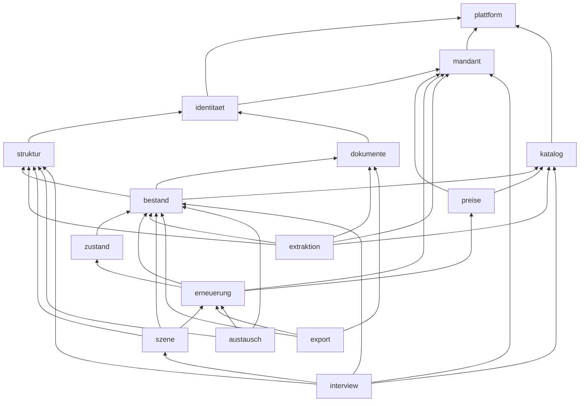

# Architecture Spine — Planora V1

> **Welle 4 / B2B (E34–E37, 2026-11-09):** eine Instanz pro Kunde, Compose-Paket, lokaler Login, Claude API direkt, Kundenmodule mit Schalter. Angepasst: AD-3, AD-9, AD-16, AD-21, AD-22; neu: AD-25, AD-26 (Grundlage `07-analyse-b2b.md` Kap. 4, ADR 0027–0031). [A] Uebrige AD-Eintraege, Diagramm (`mandant` → `instanz`), Stack und Deferred werden in Welle 4b nachgezogen; bei Widerspruch gelten die hier angepassten Eintraege und `03-architektur.md` Kap. 0.

## Design Paradigm

Modularer Monolith (ein Image, Rollen `api` | `worker` | `migrator`), jedes Modul hexagonal: `api/index.ts` (einziger Import-Punkt) → `domain/` (rein, ohne IO) → `ports/` → `adapters/`, `jobs/`, `http/`. Die KI-Pipeline ist eine Kette idempotenter Filter (Scan → Aufbereitung → Klassifikation → Extraktion → Validierung → Pruefung), verbunden ueber pg-boss.

## Invariants & Rules

### AD-1 — Modulgrenzen und Prozessrollen [ADOPTED]
- **Binds:** all
- **Prevents:** Quer-Zugriffe auf Tabellen und Interna fremder Module; Zyklen.
- **Rule:** Import nur ueber `module/<x>/api/index.ts` in Pfeilrichtung des Diagramms; Rueckmeldungen nur per Job/Ereignis; Lint-Regel in CI ab Commit 1.

### AD-2 — Datenhoheit
- **Binds:** all
- **Prevents:** zwei Besitzer einer Tabelle, divergierende Schreibpfade.
- **Rule:** Jede Tabelle gehoert genau einem Modul (Tabelle in 03 Kap. 3.3); nur dieses Modul schreibt sie; andere lesen ueber dessen API.

### AD-3 — Instanz-Isolation (E34, ADR 0031) [Welle 4, ersetzt Mandantentrennung/RLS]
- **Binds:** Compose-Paket, PostgreSQL, Dokumentablage, Secrets, Backups, alle Fachtabellen
- **Prevents:** Datenvermischung zwischen Kunden durch geteilte DB, Volumes, Secrets, Netze oder Backup-Ziele; ueberbreite DB-Rechte.
- **Rule:** pro Kunde eigene DB, eigene Volumes, eigene Secrets, eigenes Netz und eigenes Backup-Ziel; keine geteilten Container mit Kundendaten; keine Mandantenwahl, keine `mandant_id`-Pflicht, keine RLS-Pflicht; normale FKs; `planora_app` ohne Owner/DDL; Autorisierung in der App nach AD-9. (Bis Welle 4: RLS mit `FORCE`, `mitMandant()`, Mandanten-FKs, ADR 0010.)

### AD-4 — Herkunft als Datenmodell
- **Binds:** bestand, extraktion, austausch, preise-Import
- **Prevents:** Kennwerte ohne Herkunft, zwei Wahrheiten.
- **Rule:** Fachliche Kennwerte (ausgelesen, importiert, manuell am Element/Typ) nur als `angabe`-Zeilen; nie aendern, nur ersetzen; effektiver Wert durch reine Funktion; `element_effektiv` ist wegwerfbare Projektion **ohne** aufgeloeste Lebensdauer. Ausnahme: Mandanten-Parameter (Lebensdauer-Tabelle, Preise, Ampel) sind Tabellen mit Audit bzw. `gueltig_ab`.

### AD-5 — Nur Bestaetigtes rechnet
- **Binds:** erneuerung, szene, export, austausch
- **Prevents:** KI-Vorschlaege in Plaenen und Exporten.
- **Rule:** Rechnung, Ampel, Exporte lesen nur `status=bestaetigt`; Elemente nur `status=aktiv`.

### AD-6 — KI-Ausgabe geschlossen und geprueft
- **Binds:** extraktion
- **Prevents:** freie Typen, erfundene Werte.
- **Rule:** Tool-Schema mit Enum der Katalog-IDs + `null`; jeder Wert mit Seite+Zitat; Validator (Schema, Katalog, Grounding, Plausibilitaet) vor Speicherung; nie automatische Bestaetigung. Dokumentinhalte sind nicht vertrauenswuerdig (Prompt Injection, OWASP LLM Top 10): im Prompt als Daten abgegrenzt, Anweisungen darin werden ignoriert, keine Tools mit Nebenwirkung; Golden Set enthaelt Injection-Dokumente (E31).

### AD-7 — Deterministischer Rechenkern
- **Binds:** erneuerung, zustand (Modell), preise (Auswahl)
- **Prevents:** abweichende Ergebnisse, Rundungsdrift.
- **Rule:** reine Funktion, Stichtag als Eingabe, Geld in Rappen (bigint), Dezimalarithmetik, Rundung half-up einmal pro Ereignis, `regelwerk_version` + `eingabe_hash`; Planstand eingefroren.

### AD-8 — Asynchronitaet
- **Binds:** worker, alle Jobs
- **Prevents:** Doppelverarbeitung, Jobs ohne Fachdatensatz.
- **Rule:** nur pg-boss; Job in derselben Transaktion wie Fachaenderung; fachlicher Idempotenzschluessel; Nutzlast mit `mandant_id`, `korrelations_id`.

### AD-9 — AuthN vs. AuthZ (E34, ADR 0028) [Welle 4 angepasst]
- **Binds:** identitaet, api, worker
- **Prevents:** Rechte an zwei Orten, selbstgebaute Kryptografie, weiterlaufende Sessions nach Entzug.
- **Rule:** lokaler Login mit etablierter Auth-Bibliothek und speicherhartem Passwort-Hashing; Erstadmin ohne Standardpasswort; Rollen und Liegenschafts-Scope nur in Planora-Tabellen; BFF-Session, keine Tokens im Browser; Sperre/Rollenentzug/Passwortwechsel entziehen Sessions sofort, Jobs pruefen aktuelle Rechte. Spaeteres SSO-Modul liefert nur Identitaet. (Bis Welle 4: Keycloak nur Identitaet, Rollen in `mitgliedschaft`, ADR 0007.)

### AD-10 — Audit
- **Binds:** alle Fachtabellen
- **Prevents:** unprotokollierte Aenderungen.
- **Rule:** AFTER-Trigger schreibt `audit_eintrag` mit Hash-Kette je Mandant; App-Rollen nur SELECT; Fachereignisse ueber `audit.ereignis()`.

### AD-11 — Optimistic Locking
- **Binds:** alle schreibenden APIs
- **Prevents:** verlorene Aenderungen bei paralleler Bearbeitung.
- **Rule:** `version`-Spalte; Schreibaufruf mit erwarteter Version; Abweichung → 409.

### AD-12 — Katalog
- **Binds:** katalog, extraktion, szene, preise
- **Prevents:** divergierende Typen, wiederverwendete IDs.
- **Rule:** global, versioniert, read-only fuer App; Katalog-ID stabil, nie umbenannt/wiederverwendet; ETIM/eBKP-H nur in `klassifikation_mapping`.

### AD-13 — Lebensdauer-Rangfolge (E11)
- **Binds:** bestand, katalog, erneuerung
- **Prevents:** unterschiedliche Quellenwahl in Liste, 3D, Export.
- **Rule:** manuell Element > manuell Typ (Lebensdauer-Tabelle) > Datenblatt (bestaetigt) > Planora-Standard (bei Typanlage kopiert); ausschliesslich `erneuerung.domain` loest die Lebensdauer auf; Liste, 3D und Export holen sie von dort.

### AD-14 — Zustandsmodell (E14)
- **Binds:** zustand, erneuerung
- **Prevents:** zwei Zustandslogiken.
- **Rule:** Strategie `zhaw_v1` (Formeln 03 Kap. 8.3) im Rechenkern; Bewertung speichert nur Zustandswert 0,0–1,0 in 0,1-Schritten.

### AD-15 — Preise (E15)
- **Binds:** preise, erneuerung
- **Prevents:** ueberschriebene Preise, nicht reproduzierbare Plaene.
- **Rule:** Preise nur einfuegen mit `gueltig_ab`; Auswahl juengster Eintrag ≤ Stichtag nach Rangfolge; Quellen nur ueber Port `PreisQuelle`.

### AD-16 — KI-Zugang und Kostenbremse (E36, ADR 0030, 0017) [Welle 4 angepasst]
- **Binds:** extraktion, interview (Agent), suche (optionales Reranking), worker
- **Prevents:** Datenabfluss bei KI aus, Kostenexplosion, Abhaengigkeit der Grundfunktionen von KI.
- **Rule:** nur Port `KiProvider` mit Adapter `anthropic-direkt` (Claude API) plus Fake; KI ist ein Modul (AD-25), pro Instanz standardmaessig aus, Einschalten nur mit Zustimmung und eigenem Schluessel der Instanz; Pruefung an der Dispatch-Grenze (KI aus → 0 neue Requests); Budget je Instanz reservieren vor Aufruf; Antwort-Cache; jeder Aufruf in `ki_aufruf`. Stufen 1–3 und lokale Suche laufen ohne API-Schluessel. (Bis Welle 4: Bedrock EU-Profil, Budget je Mandant.)

### AD-17 — Fremdformate
- **Binds:** austausch, dokumente
- **Prevents:** Fremdformat-Logik in Fachmodulen.
- **Rule:** Formate nur als Adapter hinter `AustauschFormat`; Importe ueber Vorschau → Bestaetigung → Angaben `quelle_art=import`.

### AD-18 — Mehrsprachigkeit (E20)
- **Binds:** web, katalog, export
- **Prevents:** hart codierte Texte, sprachabhaengige Schluessel.
- **Rule:** UI-Texte nur aus Sprachdateien de/fr/it; Stammdaten-Texte in `*_text`-Tabellen; Schluessel und Codes sprachneutral; Kundendaten nicht uebersetzt.

### AD-19 — Migrationen
- **Binds:** migrator, alle Schemaaenderungen
- **Prevents:** Downtime, nicht ruecksetzbare Deploys.
- **Rule:** expand/contract, N-1-kompatibel; Sicherheits-SQL handgeschrieben; CI prueft Policies (pgTAP) und Migrationen (Squawk).

### AD-20 — Upload (E31, ADR 0016)
- **Binds:** dokumente, web, worker
- **Prevents:** Austausch der Datei zwischen Scan und Freigabe (Review K01).
- **Rule:** Uppy mit S3-Multipart; Browser erhaelt nur URLs fuer einzelne Teile; nur der Server schliesst ab und legt danach in derselben Tx den Scan-Job an; Scan liest mit `If-Match` und gibt **dieselben** gestreamten Bytes nach `dok/` frei.

### AD-21 — Pflicht-Bausteine und Lizenzen (E31, ADR 0024)
- **Binds:** all
- **Prevents:** Eigenbau fuer geloeste Probleme, Lizenzrisiken in der Auslieferung.
- **Rule:** Bausteine aus ADR 0024 sind Pflicht **je Lieferstufe** (Demo / Suche / KI / spaeteres Modul); durch Plan V2 gestrichene Werkzeuge (u.a. Tolgee, GlitchTip, Uptime Kuma, cosign, Renovate, ZAP) sind bis nach der Demo zurueckgestellt [A, 07 Kap. 7]. Eigenbau derselben Funktion nur mit PO-Entscheid. Ausgelieferter Code nur MIT/BSD/ISC/Apache-2.0/MPL-2.0; das On-Prem-Lizenzinventar umfasst Container, transitive Abhaengigkeiten und Modellgewichte; «separater Prozess» ersetzt keine konkrete Lizenzpruefung (z.B. AGPL bei Speicher/Ghostscript, ADR 0027); SBOM + Lizenzpruefung in CI brechen den Build. [Welle 4 angepasst]

### AD-22 — Externe Aufrufe (E36; ADR 0025 zurueckgestellt) [Welle 4 angepasst]
- **Binds:** alle Module, worker, Compose-Netz
- **Prevents:** Abhaengigkeit von fremden Diensten im Kernablauf, Datenabfluss, ungepruefte Fremddaten.
- **Rule:** Einzige fachliche externe API ist die Claude API (nur bei aktivem Modul KI, AD-16). Kein GWR-, Feiertags- oder HIBP-Aufruf und keine dafuer verpflichtenden Adapter/Caches in der Demo; Stammdaten manuell. Wiederaufnahme nur als Modul (AD-25) mit neuem PO-Entscheid. Nie Dokument- oder Personendaten an andere externe Dienste; CI nur mit Fakes. [?] Ob Betriebsverkehr (ClamAV-Signaturen, Image-/Modell-Downloads, SMTP, Zeit) unter diese Regel faellt, ist offen (07 Kap. 8 Punkt 6). (Bis Welle 4: geo.admin.ch/GWR, Nager.Date, Pwned Passwords verbindlich, E32.)

### AD-23 — Geschlossene 3D-Welt (E33, ADR 0026)
- **Binds:** interview, szene, struktur, bestand, katalog, web
- **Prevents:** freie, uneinheitliche Welten; KI-erzeugte, nicht reproduzierbare Geometrie.
- **Rule:** Was es in der Welt gibt und wie es aussieht, steht nur im versionierten Welt-Regelwerk; Interview (Agent oder Formular) liefert nur eine `weltbeschreibung` gegen Regelwerk-Enums und Katalog-IDs; Geometrie erzeugt ausschliesslich der reine Weltgenerator; Uebernahme nur nach Bestaetigung (`quelle_art=interview`); echte Grundriss-Raeume haben Vorrang vor schematischen.

### AD-24 — 3D-Leistungsstufen (E33, ADR 0008)
- **Binds:** web
- **Prevents:** unbrauchbares 3D auf Geraeten ohne GPU.
- **Rule:** Zeichnen nur bei Aenderung; Stufen normal/schwach/2D automatisch nach Renderer und gemessener Bildrate, manuell umschaltbar; kein Postprocessing, keine Echtzeit-Schatten; jede Funktion auch in 2D/Tabelle.

### AD-25 — Feature-Schalter / Kundenmodule (E37, ADR 0029) [Welle 4 neu]
- **Binds:** plattform, alle optionalen Module, api, worker, web
- **Prevents:** kundenspezifische Branches, nur in der UI versteckte Funktionen, kaputte Modulabhaengigkeiten, Datenverlust beim Abschalten.
- **Rule:** eine Codebasis; Modulmanifest im Code (Lieferstufe, Abhaengigkeiten, Routen, Job-Typen); optionale Module Default aus; `modulAktiv(id)` wird serverseitig an jeder HTTP-Route und in jedem Job-Handler vor Rolle/Recht geprueft; Einschalten nur mit erfuellten Abhaengigkeiten; Abschalten erhaelt alle Daten; Schalten nur Instanz-Admin, jede Aenderung im Audit. Keine externe Flag-Plattform. [?] Wer bezahlte Module freischalten darf, ist offen (07 Kap. 8 Punkt 3).

### AD-26 — Betrieb und Instanz-Update (E35, ADR 0027) [Welle 4 neu]
- **Binds:** Compose-Paket, migrator, worker, Backup, alle Schemaaenderungen
- **Prevents:** auseinanderlaufende Kundeninstallationen, abgebrochene Updates ohne Rueckweg, Backups ohne passende Dokumente oder Schluessel.
- **Rule:** dasselbe Compose-Paket fuer CH-VM und On-Premise mit Versionsmanifest (Image-Digests, Schema-, Katalog-/Regelwerk- und Modulmanifest-Version); Update je Instanz: Backup → `migrator` mit Lock und Journal → neue Images → Health-Pruefung; Schema und Job-Payloads N/N-1-kompatibel, Worker lehnen unbekannte Job-Schemaversionen ab; Backup = DB + referenzierte Dokumente + Konfiguration als konsistentes Paar, Kopie ausserhalb der VM; Restore auf frischer VM ist Abnahmenachweis. Lokale Katalog-/Lebensdauer-Overrides ueberleben Updates.

## Consistency Conventions

| Concern | Convention |
| --- | --- |
| Naming | Deutsch, snake_case in DB, camelCase in TS; Tabellen Singular |
| IDs | UUIDv7, in der App erzeugt; Katalog-ID als sprechender String |
| Geld, Zeit, Masse | Rappen bigint; `timestamptz` UTC, Anzeige Europe/Zurich; Meter `numeric(9,3)` |
| Fehler | RFC 9457 Problem Details; 409 bei Versionskonflikt |
| Logging | JSON mit `korrelations_id`, `mandant_id`; nie Dokumentinhalte oder Prompts |
| Konfiguration | Modell-IDs, Schwellen, Budgets, Preise der KI in Konfiguration, nicht im Code |

## Stack

| Name | Version |
| --- | --- |
| Node.js | [A] aktuelle LTS, im Scaffold pinnen |
| react | 19.3.1 |
| vite | 8.3.6 |
| fastify | 5.12.8 |
| drizzle-orm | 0.45.4 |
| pg-boss | 12.38.1 |
| three | 0.187.0 |
| @react-three/fiber | 9.8.2 |
| @react-three/drei | 10.7.9 |
| @gltf-transform/core | 4.5.1 |
| pdfjs-dist | 6.5 |
| Keycloak | 26.8.2 |
| Docling | 2.149.0 |
| OCRmyPDF | 17.13.0 |
| PostgreSQL | [A] ≥ 16 (Exoscale-Version offen) |
| Claude via Bedrock | Sonnet 5.5, Haiku 5.5 |
| Uppy (+ @uppy/aws-s3) | [A] im Scaffold pinnen (E31) |
| react-pdf-highlighter | [A] im Scaffold pinnen, gleiche pdfjs-dist wie Viewer |
| Gotenberg | [A] im Scaffold pinnen |
| Docling Serve | [A] im Scaffold pinnen (statt eigenem docproc-Dienst) |
| pgvector | [A] Version auf Exoscale pruefen (≥ 0.8 fuer iterative Scans) |
| konva / react-konva, zustand, zundo, flatbush | [A] im Scaffold pinnen |
| TanStack Table/Virtual/Query, react-hook-form, zod, shadcn/ui, kbar | [A] im Scaffold pinnen |
| i18next / react-i18next, Tolgee | [A] im Scaffold pinnen |
| pino, file-type, sharp, exceljs, Nodemailer, MJML, @fastify/rate-limit | [A] im Scaffold pinnen |
| pgTAP, Squawk, Playwright, @axe-core/playwright, k6 | [A] nur CI |
| GlitchTip, Healthchecks, Uptime Kuma, Mailpit | [A] im Scaffold pinnen |
| Trivy, Syft, cosign, Gitleaks, Semgrep CE, Renovate, OWASP ZAP, license-checker | [A] nur CI |

Versionen aus 02-tech-recherche (abgerufen 2026-11-08).

## Structural Seed

Siehe 03-architektur Kap. 2 (C4) und Kap. 3.1 (Verzeichnisbaum), Kap. 4.1 (ERD).

## Deferred

- Kubernetes (SKS): ab ca. 5 Mandanten oder SLA-Zusage.
- Preis-Feed-Adapter: nach Spike S12.
- Stratus-Formatadapter: nach Spike S13 (bis dahin Excel/CSV).
- Wahl der Dezimal-Bibliothek: im Scaffold, mit Lizenzpruefung; Rechenregeln oben binden die Wahl. (i18n = i18next, Excel = exceljs, Lint = ESLint + Semgrep + Squawk sind durch E31 entschieden.)
- Lokales KI-Modell, Datenbank pro Mandant, BYOK: V2.
