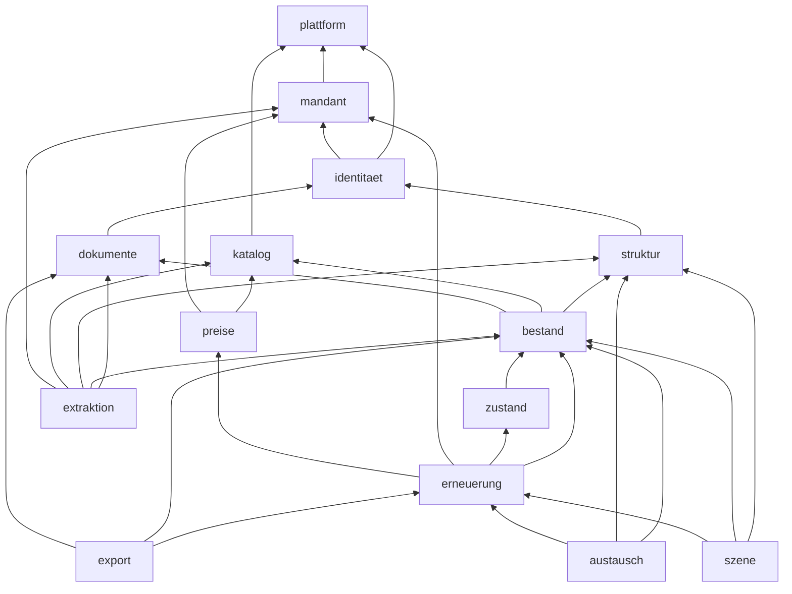

# Architecture Spine — Planora V1

## Design Paradigm

Modularer Monolith (ein Image, Rollen `api` | `worker` | `migrator`), jedes Modul hexagonal: `api/index.ts` (einziger Import-Punkt) → `domain/` (rein, ohne IO) → `ports/` → `adapters/`, `jobs/`, `http/`. Die KI-Pipeline ist eine Kette idempotenter Filter (Scan → Aufbereitung → Klassifikation → Extraktion → Validierung → Pruefung), verbunden ueber pg-boss.

## Invariants & Rules

### AD-1 — Modulgrenzen und Prozessrollen [ADOPTED]
- **Binds:** all
- **Prevents:** Quer-Zugriffe auf Tabellen und Interna fremder Module; Zyklen.
- **Rule:** Import nur ueber `module/<x>/api/index.ts` in Pfeilrichtung des Diagramms; Rueckmeldungen nur per Job/Ereignis; Lint-Regel in CI ab Commit 1.

### AD-2 — Datenhoheit
- **Binds:** all
- **Prevents:** zwei Besitzer einer Tabelle, divergierende Schreibpfade.
- **Rule:** Jede Tabelle gehoert genau einem Modul (Tabelle in 03 Kap. 3.3); nur dieses Modul schreibt sie; andere lesen ueber dessen API.

### AD-3 — Mandantentrennung
- **Binds:** alle Mandantentabellen, Worker, Objektspeicher
- **Prevents:** Mandantenleck durch vergessenen Filter, Pool-Leck, Querreferenz.
- **Rule:** `mandant_id NOT NULL`, ENABLE+FORCE RLS, `planora_app` ohne Owner/BYPASSRLS; Kontext nur via `mitMandant()` mit `SET LOCAL`; `app.mandant()` wirft bei fehlendem Kontext; FKs immer `(mandant_id, x_id)`; Objekt-Schluessel `m/<mandant_id>/…`.

### AD-4 — Herkunft als Datenmodell
- **Binds:** bestand, extraktion, austausch, preise-Import
- **Prevents:** Kennwerte ohne Herkunft, zwei Wahrheiten.
- **Rule:** Fachliche Kennwerte (ausgelesen, importiert, manuell am Element/Typ) nur als `angabe`-Zeilen; nie aendern, nur ersetzen; effektiver Wert durch reine Funktion; `element_effektiv` ist wegwerfbare Projektion **ohne** aufgeloeste Lebensdauer. Ausnahme: Mandanten-Parameter (Lebensdauer-Tabelle, Preise, Ampel) sind Tabellen mit Audit bzw. `gueltig_ab`.

### AD-5 — Nur Bestaetigtes rechnet
- **Binds:** erneuerung, szene, export, austausch
- **Prevents:** KI-Vorschlaege in Plaenen und Exporten.
- **Rule:** Rechnung, Ampel, Exporte lesen nur `status=bestaetigt`; Elemente nur `status=aktiv`.

### AD-6 — KI-Ausgabe geschlossen und geprueft
- **Binds:** extraktion
- **Prevents:** freie Typen, erfundene Werte.
- **Rule:** Tool-Schema mit Enum der Katalog-IDs + `null`; jeder Wert mit Seite+Zitat; Validator (Schema, Katalog, Grounding, Plausibilitaet) vor Speicherung; nie automatische Bestaetigung.

### AD-7 — Deterministischer Rechenkern
- **Binds:** erneuerung, zustand (Modell), preise (Auswahl)
- **Prevents:** abweichende Ergebnisse, Rundungsdrift.
- **Rule:** reine Funktion, Stichtag als Eingabe, Geld in Rappen (bigint), Dezimalarithmetik, Rundung half-up einmal pro Ereignis, `regelwerk_version` + `eingabe_hash`; Planstand eingefroren.

### AD-8 — Asynchronitaet
- **Binds:** worker, alle Jobs
- **Prevents:** Doppelverarbeitung, Jobs ohne Fachdatensatz.
- **Rule:** nur pg-boss; Job in derselben Transaktion wie Fachaenderung; fachlicher Idempotenzschluessel; Nutzlast mit `mandant_id`, `korrelations_id`.

### AD-9 — AuthN vs. AuthZ
- **Binds:** identitaet, api
- **Prevents:** Rechte an zwei Orten.
- **Rule:** Keycloak nur Identitaet; Rollen/Mandanten/Liegenschaften nur in `mitgliedschaft`; BFF-Session, keine Tokens im Browser.

### AD-10 — Audit
- **Binds:** alle Fachtabellen
- **Prevents:** unprotokollierte Aenderungen.
- **Rule:** AFTER-Trigger schreibt `audit_eintrag` mit Hash-Kette je Mandant; App-Rollen nur SELECT; Fachereignisse ueber `audit.ereignis()`.

### AD-11 — Optimistic Locking
- **Binds:** alle schreibenden APIs
- **Prevents:** verlorene Aenderungen bei paralleler Bearbeitung.
- **Rule:** `version`-Spalte; Schreibaufruf mit erwarteter Version; Abweichung → 409.

### AD-12 — Katalog
- **Binds:** katalog, extraktion, szene, preise
- **Prevents:** divergierende Typen, wiederverwendete IDs.
- **Rule:** global, versioniert, read-only fuer App; Katalog-ID stabil, nie umbenannt/wiederverwendet; ETIM/eBKP-H nur in `klassifikation_mapping`.

### AD-13 — Lebensdauer-Rangfolge (E11)
- **Binds:** bestand, katalog, erneuerung
- **Prevents:** unterschiedliche Quellenwahl in Liste, 3D, Export.
- **Rule:** manuell Element > manuell Typ (Lebensdauer-Tabelle) > Datenblatt (bestaetigt) > Planora-Standard (bei Typanlage kopiert); ausschliesslich `erneuerung.domain` loest die Lebensdauer auf; Liste, 3D und Export holen sie von dort.

### AD-14 — Zustandsmodell (E14)
- **Binds:** zustand, erneuerung
- **Prevents:** zwei Zustandslogiken.
- **Rule:** Strategie `zhaw_v1` (Formeln 03 Kap. 8.3) im Rechenkern; Bewertung speichert nur Zustandswert 0,0–1,0 in 0,1-Schritten.

### AD-15 — Preise (E15)
- **Binds:** preise, erneuerung
- **Prevents:** ueberschriebene Preise, nicht reproduzierbare Plaene.
- **Rule:** Preise nur einfuegen mit `gueltig_ab`; Auswahl juengster Eintrag ≤ Stichtag nach Rangfolge; Quellen nur ueber Port `PreisQuelle`.

### AD-16 — KI-Zugang und Kostenbremse
- **Binds:** extraktion
- **Prevents:** Datenabfluss bei KI aus, Kostenexplosion.
- **Rule:** nur Port `KiProvider`; Pruefung KI-Schalter an drei Stellen; Budget reservieren vor Aufruf; Antwort-Cache; jeder Aufruf in `ki_aufruf`.

### AD-17 — Fremdformate
- **Binds:** austausch, dokumente
- **Prevents:** Fremdformat-Logik in Fachmodulen.
- **Rule:** Formate nur als Adapter hinter `AustauschFormat`; Importe ueber Vorschau → Bestaetigung → Angaben `quelle_art=import`.

### AD-18 — Mehrsprachigkeit (E20)
- **Binds:** web, katalog, export
- **Prevents:** hart codierte Texte, sprachabhaengige Schluessel.
- **Rule:** UI-Texte nur aus Sprachdateien de/fr/it; Stammdaten-Texte in `*_text`-Tabellen; Schluessel und Codes sprachneutral; Kundendaten nicht uebersetzt.

### AD-19 — Migrationen
- **Binds:** migrator, alle Schemaaenderungen
- **Prevents:** Downtime, nicht ruecksetzbare Deploys.
- **Rule:** expand/contract, N-1-kompatibel; Sicherheits-SQL handgeschrieben; CI prueft Policies.

## Consistency Conventions

| Concern | Convention |
| --- | --- |
| Naming | Deutsch, snake_case in DB, camelCase in TS; Tabellen Singular |
| IDs | UUIDv7, in der App erzeugt; Katalog-ID als sprechender String |
| Geld, Zeit, Masse | Rappen bigint; `timestamptz` UTC, Anzeige Europe/Zurich; Meter `numeric(9,3)` |
| Fehler | RFC 9457 Problem Details; 409 bei Versionskonflikt |
| Logging | JSON mit `korrelations_id`, `mandant_id`; nie Dokumentinhalte oder Prompts |
| Konfiguration | Modell-IDs, Schwellen, Budgets, Preise der KI in Konfiguration, nicht im Code |

## Stack

| Name | Version |
| --- | --- |
| Node.js | [A] aktuelle LTS, im Scaffold pinnen |
| react | 19.3.1 |
| vite | 8.3.6 |
| fastify | 5.12.8 |
| drizzle-orm | 0.45.4 |
| pg-boss | 12.38.1 |
| three | 0.187.0 |
| @react-three/fiber | 9.8.2 |
| @react-three/drei | 10.7.9 |
| @gltf-transform/core | 4.5.1 |
| pdfjs-dist | 6.5 |
| Keycloak | 26.8.2 |
| Docling | 2.149.0 |
| OCRmyPDF | 17.13.0 |
| PostgreSQL | [A] ≥ 16 (Exoscale-Version offen) |
| Claude via Bedrock | Sonnet 5.5, Haiku 5.5 |

Versionen aus 02-tech-recherche (abgerufen 2026-11-08).

## Structural Seed

Siehe 03-architektur Kap. 2 (C4) und Kap. 3.1 (Verzeichnisbaum), Kap. 4.1 (ERD).

## Deferred

- Kubernetes (SKS): ab ca. 5 Mandanten oder SLA-Zusage.
- Preis-Feed-Adapter: nach Spike S12.
- Stratus-Formatadapter: nach Spike S13 (bis dahin Excel/CSV).
- Wahl Dezimal-, i18n-, Excel- und Lint-Bibliotheken: im Scaffold, mit Lizenzpruefung; Rechen- und Sprachregeln oben binden die Wahl.
- Lokales KI-Modell, Datenbank pro Mandant, BYOK: V2.
