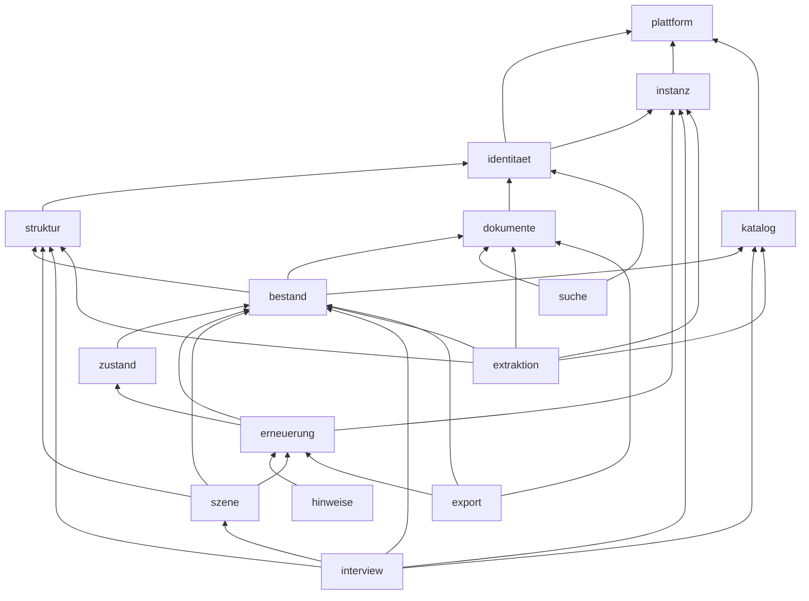

# Architecture Spine — Planora V1

> **Welle 4 / 4b – B2B (E34–E37, 2026-11-09):** eine Instanz pro Kunde, Compose-Paket, lokaler Login, Claude API direkt, Kundenmodule mit Schalter. Welle 4: AD-3, AD-9, AD-16, AD-21, AD-22 angepasst, AD-25, AD-26 neu. Welle 4b: alle uebrigen Abschnitte gemaess `07-analyse-b2b.md` Kap. 4 und Befund 3 in `08-pruefung.md`. Bei Widerspruch gilt `03-architektur.md` Kap. 0. Der Stand vor Welle 4 liegt im Git-Verlauf (Commit `e64fdb9`); in einzelnen AD steht er als "(Bis Welle 4: …)".

### Welle-4b-Nachfuehrung (Befund 3)

| Abschnitt | Owner | Abschlusskriterium | Stand |
|---|---|---|---|
| Frontmatter `scope`, `binds`, `paradigm`, `status` | Programmierer (Claude), Freigabe PO | Single-Tenant, Lieferstufen, E24/E34–E37 genannt; keine Mandanten/Preise im Scope | erledigt Welle 4b |
| Design Paradigm + Diagramm | Programmierer, Freigabe Architekt | Diagramm identisch mit 03 Kap. 3.2 (`instanz`, `suche`, `hinweise`; ohne `preise`/`austausch`) | erledigt Welle 4b |
| AD-1, AD-2, AD-4–AD-8, AD-10–AD-15, AD-17–AD-20, AD-23, AD-24 | Programmierer, Freigabe Architekt | kein `mandant_id`, kein RLS, keine Preise/Bedrock/GWR als Demo-Pflicht; Lieferstufe je Regel | erledigt Welle 4b |
| AD-19 ↔ AD-26 | Programmierer | AD-19 ohne Policy-pgTAP, deckungsgleich mit AD-26/ADR 0027 | erledigt Welle 4b |
| Consistency Conventions | Programmierer | Logging ohne `mandant_id`; keine Geldkonvention in der Demo | erledigt Welle 4b |
| Stack | Programmierer; Pinning im Scaffold (M1) | Keycloak/Bedrock entfernt, Stufen-Zuordnung; konkrete Versionen mit Quelle erst im Scaffold | erledigt Welle 4b, Pinning offen (M1) |
| Structural Seed, Deferred | Programmierer | Verweise auf umgestellte 03-Kapitel; Deferred nach "ersetzt / zurueckgestellt" getrennt | erledigt Welle 4b |
| Status `final` | PO | PO-Entscheide 1–7 aus `08-pruefung.md` geklaert oder begrenzt | offen [?] |

## Design Paradigm

Modularer Monolith (ein Image, Rollen `api` | `worker` | `migrator`), jedes Modul hexagonal: `api/index.ts` (einziger Import-Punkt) → `domain/` (rein, ohne IO) → `ports/` → `adapters/`, `jobs/`, `http/`. Jedes Modul hat eine Lieferstufe und, falls optional, einen Schalter pro Instanz (AD-25). Die Dokumentpipeline ist eine Kette idempotenter Filter, verbunden ueber pg-boss: Scan → Vorschau → Aufbereitung (Stufe 1) → Indexierung (Stufe 3) → Klassifikation → Extraktion → Validierung (Stufe 4) → Pruefung durch den Menschen.

Identisch mit `03-architektur.md` Kap. 3.2. Zurueckgestellte Module (`preise`, Grundriss-Teil von `extraktion`, `austausch`) fehlen bewusst. [A] Offen fuer die M1-Spec (Befund 4 in `08-pruefung.md`): Die Kanten `szene → erneuerung` und `erneuerung → zustand` binden Stufe-1-Module an Stufe-2-Module; der Modulvertrag (Lieferstufe vs. Aktivierung, optionale Faehigkeiten) wird in ADR 0029 festgelegt.

## Invariants & Rules

### AD-1 — Modulgrenzen und Prozessrollen [ADOPTED, Welle 4b angepasst]
- **Binds:** all
- **Prevents:** Quer-Zugriffe auf Tabellen und Interna fremder Module; Zyklen; Modulcode ausserhalb des Manifests.
- **Rule:** Import nur ueber `module/<x>/api/index.ts` in Pfeilrichtung des Diagramms; Rueckmeldungen nur per Job/Ereignis; Lint-Regel in CI ab Commit 1. Jedes Modul steht mit Lieferstufe im Modulmanifest (AD-25); ein neues oder wieder aufgenommenes Modul kommt nur ueber das Manifest mit eigenen Kanten dazu.

### AD-2 — Datenhoheit [Welle 4b angepasst]
- **Binds:** all
- **Prevents:** zwei Besitzer einer Tabelle, divergierende Schreibpfade.
- **Rule:** Jede Tabelle gehoert genau einem Modul (03 Kap. 3.3 / 4.2); nur dieses Modul schreibt sie; andere lesen ueber dessen API. Besitzer der neuen Bereiche: `suche` → `such_abschnitt`; Viewer-Daten (`dokument_seite`, Vorschau) → `dokumente`; `hinweise` → `hinweis` [A]; Erfassung (`erfassung`, `erfassung_zeile`, `interview_nachricht`) → `interview`; `modul_schalter`, `audit_eintrag` → `plattform`.

### AD-3 — Instanz-Isolation (E34, ADR 0031) [Welle 4, ersetzt Mandantentrennung/RLS]
- **Binds:** Compose-Paket, PostgreSQL, Dokumentablage, Secrets, Backups, alle Fachtabellen
- **Prevents:** Datenvermischung zwischen Kunden durch geteilte DB, Volumes, Secrets, Netze oder Backup-Ziele; ueberbreite DB-Rechte.
- **Rule:** pro Kunde eigene DB, eigene Volumes, eigene Secrets, eigenes Netz und eigenes Backup-Ziel; keine geteilten Container mit Kundendaten; keine Mandantenwahl, keine `mandant_id`-Pflicht, keine RLS-Pflicht; normale FKs; `planora_app` ohne Owner/DDL; Autorisierung in der App nach AD-9. (Bis Welle 4: RLS mit `FORCE`, `mitMandant()`, Mandanten-FKs, ADR 0010.)

### AD-4 — Herkunft als Datenmodell [Welle 4b angepasst]
- **Binds:** bestand, interview, dokumente, extraktion
- **Prevents:** Kennwerte ohne Herkunft, zwei Wahrheiten, Bestaetigung ohne gepruefte Quelle.
- **Rule:** Fachliche Kennwerte nur als `angabe`-Zeilen mit **genau einer typisierten Herkunft je Eingabekanal** (formular, excel mit Blatt/Zeile/Zelle, manuell, dokument mit Seite/Markierung, abgeleitet; ab Stufe 4 interview, ki) – 03 Kap. 4.4; nie aendern, nur ersetzen; effektiver Wert durch **einen** reinen Resolver; `element_effektiv` ist wegwerfbare Projektion **ohne** aufgeloeste Lebensdauer; Typaenderung invalidiert alle Elemente des Typs. Excel-Werte werden erst nach validierter Zeilenvorschau bestaetigt. Ausnahme: Instanzparameter (Lebensdauer-Tabelle, Ampel-Schwellen) sind Tabellen mit Audit. Preis-Import zurueckgestellt (E24). (Bis Welle 4: Mandanten-Parameter inkl. Preise.)

### AD-5 — Nur Bestaetigtes rechnet [Welle 4b angepasst]
- **Binds:** erneuerung, szene, export, hinweise
- **Prevents:** unbestaetigte Werte in Ampel, Listen und Exporten.
- **Rule:** Lebensdauer, Ampel, Hinweise und Exporte lesen nur `status=bestaetigt`; Elemente nur `status=aktiv`; Erfassungen wirken erst nach atomarer Uebernahme. Fehlt ein Pflichtwert, ist das Element "unvollstaendig" (grau), nie gruen.

### AD-6 — KI-Ausgabe geschlossen und geprueft (Stufe 4) [Welle 4b angepasst]
- **Binds:** extraktion, interview (Agent), suche (optionales Reranking, [?] E27)
- **Prevents:** freie Typen, erfundene Werte, Wirkung eingeschleuster Anweisungen.
- **Rule:** Nur ueber die Claude API direkt (AD-16). Tool-Schema mit Enum der Katalog-IDs + `null` bzw. Regelwerk-Enums (`weltbeschreibung`); Herkunft passend zum Kanal (Extraktion: Seite + Zitat Pflicht; Interview: Nachricht-ID); Validator (Schema, Katalog, Grounding, Plausibilitaet) vor Speicherung; nie automatische Bestaetigung; Agent und Formular nutzen denselben Schreibpfad. Dokumentinhalte und Interview-Eingaben sind nicht vertrauenswuerdig (Prompt Injection): als Daten abgegrenzt, Anweisungen darin ignoriert, keine Tools mit Nebenwirkung; Golden Set enthaelt Injection-Faelle (E31). (Bis Welle 4: Bedrock, Seite+Zitat universell.)

### AD-7 — Deterministischer Rechenkern Lebensdauer und Ampel [Welle 4b angepasst]
- **Binds:** erneuerung, zustand (Modell, [?] Scope)
- **Prevents:** abweichende Ergebnisse, Rundungsdrift, Zeitabhaengigkeit.
- **Rule:** reine Funktion, Stichtag als Eingabe, Dezimalarithmetik, Rundung half-up auf ganze Jahre, `regelwerk_version` + `katalog_version` + `eingabe_hash`; gleiche Eingabe → byte-identisches Ergebnis; Ampel auf dem technischen Ersatzjahr (03 Kap. 8). **Keine Geldwerte**, kein Investitionsplan, keine Folgezyklen in der Demo (E24). (Bis Welle 4: Geld in Rappen, Rundung pro Ereignis, Investitionsplan.)

### AD-8 — Asynchronitaet [Welle 4b angepasst]
- **Binds:** worker, alle Jobs
- **Prevents:** Doppelverarbeitung, Jobs ohne Fachdatensatz, Jobs mit veralteten Rechten oder abgeschaltetem Modul, Fehlausfuehrung nach Update.
- **Rule:** nur pg-boss; Job in derselben Transaktion wie Fachaenderung; fachlicher Idempotenzschluessel; Nutzlast mit `korrelations_id`, `ausloeser_id`, `modul_id` und **Schemaversion** (kein `mandant_id`); Handler prueft vor Wirkung `modulAktiv()` und das **aktuelle** Recht des Ausloesers; unbekannte Schemaversion → ablehnen statt ausfuehren; keine Exactly-once-Zusage fuer externe Abrechnung. (Bis Welle 4: Nutzlast mit `mandant_id`.)

### AD-9 — AuthN vs. AuthZ (E34, ADR 0028) [Welle 4 angepasst]
- **Binds:** identitaet, api, worker
- **Prevents:** Rechte an zwei Orten, selbstgebaute Kryptografie, weiterlaufende Sessions nach Entzug.
- **Rule:** lokaler Login mit etablierter Auth-Bibliothek und speicherhartem Passwort-Hashing; Erstadmin ohne Standardpasswort; Rollen und Liegenschafts-Scope nur in Planora-Tabellen; BFF-Session, keine Tokens im Browser; Sperre/Rollenentzug/Passwortwechsel entziehen Sessions sofort, Jobs pruefen aktuelle Rechte. Spaeteres SSO-Modul liefert nur Identitaet. (Bis Welle 4: Keycloak nur Identitaet, Rollen in `mitgliedschaft`, ADR 0007.)

### AD-10 — Audit [Welle 4b angepasst]
- **Binds:** alle Fachtabellen, plattform, identitaet
- **Prevents:** unprotokollierte Aenderungen, Personendaten in unveraenderlichen Ereignissen.
- **Rule:** AFTER-Trigger schreibt `audit_eintrag` mit **Hash-Kette je Instanz**; App-Rolle nur SELECT; Fachereignisse (Login, Fehlversuche, Rollen-/Modul-Schalter-Aenderung, Import, Export, Instanz-Update, ab Stufe 4 KI-Aufruf) ueber `audit.ereignis()`. Akteur nur als **pseudonyme Audit-ID ab Erstschreiben**; Zuordnung Pseudonym → Person getrennt und loeschbar; gehashte Ereignisse werden nie umgeschrieben (ADR 0015, Befund 10 in `08-pruefung.md`). Host-/DB-Owner kann technisch manipulieren; die taegliche Kettenpruefung macht es erkennbar. (Bis Welle 4: Hash-Kette je Mandant.)

### AD-11 — Optimistic Locking
- **Binds:** alle schreibenden APIs
- **Prevents:** verlorene Aenderungen bei paralleler Bearbeitung.
- **Rule:** `version`-Spalte; Schreibaufruf mit erwarteter Version; Abweichung → 409.

### AD-12 — Katalog und Welt-Regelwerk [Welle 4b angepasst]
- **Binds:** katalog, interview, szene, extraktion
- **Prevents:** divergierende Typen, wiederverwendete IDs, Verlust lokaler Anpassungen bei Updates.
- **Rule:** mit dem Release je Instanz ausgeliefert, versioniert, read-only fuer die App; Katalog-ID stabil, nie umbenannt/wiederverwendet; ETIM/eBKP-H nur in `klassifikation_mapping`. Katalog-/Regelwerk-Updates sind ueber alle Instanzen kompatibel: lokale Overrides (Lebensdauer-Tabelle, Ampel-Schwellen) bleiben, bestehende Welten/Zuordnungen werden nicht still neu erzeugt; Abweichungen erscheinen als Vorschlag. Keine frei editierbaren Laufzeit-Kataloge (E37). (Bis Welle 4: global fuer alle Mandanten.)

### AD-13 — Lebensdauer-Rangfolge (E11)
- **Binds:** bestand, katalog, erneuerung
- **Prevents:** unterschiedliche Quellenwahl in Liste, 3D, Ampel und Export.
- **Rule:** manuell Element > manuell Typ (Lebensdauer-Tabelle) > Datenblatt (bestaetigt) > Planora-Standard (bei Typanlage kopiert); ausschliesslich `erneuerung.domain` loest die Lebensdauer auf; Liste, 3D/2D, Ampel und Export holen sie von dort.

### AD-14 — Zustandsmodell (E14) [Welle 4b angepasst, Scope [?]]
- **Binds:** zustand, erneuerung
- **Prevents:** zwei Zustandslogiken; ungepruefte Formel als validierte Methode.
- **Rule:** Falls Zustand im Demo-Scope: Strategie `zhaw_v1` (Formeln 03 Kap. 8.3) im Rechenkern; Bewertung speichert nur Zustandswert 0,0–1,0 in 0,1-Schritten; Auslieferung erst nach fachlicher Freigabe der Kurve. Ohne Zustand rechnet der Kern Alter/Lebensdauer/Ampel. [?] PO: Umfang (`08-pruefung.md` PO-Entscheid Nr. 8).

### AD-15 — Preise (E15) [zurueckgestellt bis nach der Demo, E24]
- **Binds:** – (spaeteres Modul `preise`, ADR 0018)
- **Prevents:** Preis- oder Investitionslogik im Demo-Kern.
- **Rule:** In den Stufen 1–4 gibt es keine Preise, Feeds, Teuerung oder Investitionsplanung. Bei Wiederaufnahme gilt die bisherige Regel: Preise nur einfuegen mit `gueltig_ab`; Auswahl juengster Eintrag ≤ Stichtag nach Rangfolge; Quellen nur ueber Port `PreisQuelle`.

### AD-16 — KI-Zugang und Kostenbremse (E36, ADR 0030, 0017) [Welle 4 angepasst]
- **Binds:** extraktion, interview (Agent), suche (optionales Reranking), worker
- **Prevents:** Datenabfluss bei KI aus, Kostenexplosion, Abhaengigkeit der Grundfunktionen von KI.
- **Rule:** nur Port `KiProvider` mit Adapter `anthropic-direkt` (Claude API) plus Fake; KI ist ein Modul (AD-25), pro Instanz standardmaessig aus, Einschalten nur mit Zustimmung und eigenem Schluessel der Instanz; Pruefung an der Dispatch-Grenze vor **jedem** Provider-Request (KI aus → 0 neue Requests); Budget je Instanz reservieren vor Aufruf; Antwort-Cache; jeder Aufruf in `ki_aufruf`. Stufen 1–3 und lokale Suche laufen ohne API-Schluessel ([?] unter PO-Vorbehalt E27: Anfrageverstaendnis/Reranking/Antwort mit Quellen in Stufe 3 oder 4, `08-pruefung.md` PO-Entscheid Nr. 11). (Bis Welle 4: Bedrock EU-Profil, Budget je Mandant.)

### AD-17 — Import und Fremdformate [Welle 4b angepasst]
- **Binds:** interview (Excel), dokumente; spaeter `austausch`
- **Prevents:** Fremdformat-Logik in Fachmodulen, Import ohne Kontrolle.
- **Rule:** Excel-Erfassung gehoert zu `interview`: feste Planora-Vorlage → validierte Zeilenvorschau → Bestaetigung → Angaben `quelle_art=excel` mit Zeile/Zelle; Wiederimport gleicht ueber stabile IDs ab. Fremdformate nur als Adapter hinter `AustauschFormat`. [?] Stratus-Adapter erst nach Scope-Entscheid (`08-pruefung.md` PO-Entscheid Nr. 9). (Bis Welle 4: `quelle_art=import` ueber `austausch`.)

### AD-18 — Sprache (E20, ADR 0019 zurueckgestellt) [Welle 4b angepasst]
- **Binds:** web, katalog, export
- **Prevents:** hart codierte Texte, sprachabhaengige Schluessel, falsche Zahlen-/Datumsformate.
- **Rule:** Lieferumfang DE/de-CH; UI-Texte nur aus Sprachdateien; Stammdaten-Texte in `*_text`-Tabellen mit Sprachschluessel; Schluessel und Codes sprachneutral; de-CH-Zahlen/Datum in Anzeige, Import und Export; Kundendaten nicht uebersetzt. FR/IT, Tolgee und Vollstaendigkeits-Gates zurueckgestellt. (Bis Welle 4: de/fr/it ab V1.)

### AD-19 — Migrationen [Welle 4b angepasst, deckungsgleich mit AD-26]
- **Binds:** migrator, alle Schemaaenderungen
- **Prevents:** abgebrochene oder parallele Migrationen, Updates ohne Rueckweg, N-1-Bruch.
- **Rule:** nur der `migrator` (Owner-Rolle) aendert das Schema, mit **Migrationslock und Journal** je Instanz; expand → backfill (Job in Bloecken) → contract **ueber kompatible Releases**: eine Spalte wird erst entfernt, wenn kein unterstuetztes Release (N-1) sie mehr schreibt oder liest; nichttransaktionale Schritte (`CREATE INDEX CONCURRENTLY`) einzeln im Journal; Sicherheits-SQL (Rechte, Trigger, `SECURITY DEFINER`) handgeschrieben; CI prueft Migrationen (Squawk), Constraints, GRANTs und Audit-Trigger. Ablauf, Drain/Quieszenz der Worker und Rueckweg nach AD-26 und ADR 0027 ([A] Detail in M1-Spec, Befund 7 in `08-pruefung.md`). (Bis Welle 4: CI prueft RLS-Policies mit pgTAP.)

### AD-20 — Upload (E31, ADR 0016) [Welle 4b angepasst]
- **Binds:** dokumente, web, worker
- **Prevents:** Austausch der Datei zwischen Scan und Freigabe (Review K01), Zugriff auf Quarantaene.
- **Rule:** Uppy mit Multipart; nur der Server schliesst den Upload ab (einmalig, mit Abschluss-Lock) und legt danach in derselben Tx den Scan-Job an; Scan streamt die Datei einmal und gibt **dieselben** Bytes nach `dok/` frei (Hash/Scan/Freigabe ueber identische Bytes); kein Vorschau-/Download-Zugriff auf `quarantaene/`; Zugriff ueber Objekt-/Rollenrechte je Abruf statt Mandantenprefix. Konkretes lokales Speicher-Backend vor M1 verifizieren ([?] `08-pruefung.md` PO-Entscheid Nr. 3); K01 gilt erst nach Race-/Crash-Test auf dem gelieferten Speicher als geschlossen. (Bis Welle 4: SOS-Multipart mit `If-Match`, signierte Teil-URLs.)

### AD-21 — Pflicht-Bausteine und Lizenzen (E31, ADR 0024) [Welle 4 angepasst]
- **Binds:** all
- **Prevents:** Eigenbau fuer geloeste Probleme, Lizenzrisiken in der Auslieferung.
- **Rule:** Bausteine aus ADR 0024 sind Pflicht **je Lieferstufe** (Demo / Suche / KI / spaeteres Modul); durch Plan V2 gestrichene Werkzeuge (u.a. Tolgee, GlitchTip, Uptime Kuma, cosign, Renovate, ZAP) sind bis nach der Demo zurueckgestellt [A, 07 Kap. 7]. Eigenbau derselben Funktion nur mit PO-Entscheid. Ausgelieferter Code nur MIT/BSD/ISC/Apache-2.0/MPL-2.0; das On-Prem-Lizenzinventar umfasst Container, transitive Abhaengigkeiten und Modellgewichte; «separater Prozess» ersetzt keine konkrete Lizenzpruefung (z.B. AGPL bei Speicher/Ghostscript, ADR 0027); SBOM + Lizenzpruefung in CI brechen den Build. [A] Die Allowlist fuer ausgelieferte Container (u.a. PostgreSQL License, GPLv2 bei ClamAV) ist vor Paketfreigabe zu ergaenzen (Befund 9 in `08-pruefung.md`).

### AD-22 — Externe Aufrufe (E36; ADR 0025 zurueckgestellt) [Welle 4 angepasst]
- **Binds:** alle Module, worker, Compose-Netz
- **Prevents:** Abhaengigkeit von fremden Diensten im Kernablauf, Datenabfluss, ungepruefte Fremddaten.
- **Rule:** Einzige fachliche externe API ist die Claude API (nur bei aktivem Modul KI, AD-16). Kein GWR-, Feiertags- oder HIBP-Aufruf und keine dafuer verpflichtenden Adapter/Caches in der Demo; Stammdaten manuell. Wiederaufnahme nur als Modul (AD-25) mit neuem PO-Entscheid. Nie Dokument- oder Personendaten an andere externe Dienste; CI nur mit Fakes. [?] Ob Betriebsverkehr (ClamAV-Signaturen, Image-/Modell-Downloads, SMTP, Zeit) unter diese Regel faellt, ist offen (`08-pruefung.md` PO-Entscheid Nr. 6). (Bis Welle 4: geo.admin.ch/GWR, Nager.Date, Pwned Passwords verbindlich, E32.)

### AD-23 — Geschlossene 3D-Welt (E33, ADR 0026) [Welle 4b angepasst]
- **Binds:** interview, szene, struktur, bestand, katalog, web
- **Prevents:** freie, uneinheitliche Welten; KI-erzeugte, nicht reproduzierbare Geometrie; stille Neuerzeugung bestehender Welten.
- **Rule:** Was es in der Welt gibt und wie es aussieht, steht nur im versionierten Welt-Regelwerk; Erfassung liefert nur eine `weltbeschreibung` gegen Regelwerk-Enums und Katalog-IDs – **zuerst Formular/Excel (Stufe 1)**, Claude-Agent erst Stufe 4 mit demselben Schema und Schreibpfad; Geometrie erzeugt ausschliesslich der reine Weltgenerator mit stabilen IDs; Uebernahme nur nach atomarer Bestaetigung mit Herkunft je Kanal; keine GWR- oder Grundriss-Vorbelegung als Demo-Pflicht. Neues Regelwerk/Katalog erzeugt bestehende Welten nur als sichtbare, bestaetigte Aktion neu. (Bis Welle 4: GWR-Vorbelegung, Grundriss-Raeume mit Vorrang.)

### AD-24 — 3D-Leistungsstufen (E33, ADR 0008)
- **Binds:** web
- **Prevents:** unbrauchbares 3D auf Geraeten ohne GPU (auch Kunden-VDI).
- **Rule:** `InstancedMesh` pro Katalogtyp; Zeichnen nur bei Aenderung; Stufen normal/schwach/2D automatisch nach Renderer und gemessener Bildrate, manuell umschaltbar; kein Postprocessing, keine Echtzeit-Schatten; jede Funktion auch in 2D/Tabelle (funktionaler 2D-Weg bleibt Pflicht); Abnahme auf Kunden-Laptop/VDI.

### AD-25 — Feature-Schalter / Kundenmodule (E37, ADR 0029) [Welle 4 neu]
- **Binds:** plattform, alle optionalen Module, api, worker, web
- **Prevents:** kundenspezifische Branches, nur in der UI versteckte Funktionen, kaputte Modulabhaengigkeiten, Datenverlust beim Abschalten.
- **Rule:** eine Codebasis; Modulmanifest im Code (Lieferstufe, Abhaengigkeiten, Routen, Job-Typen); optionale Module Default aus; `modulAktiv(id)` wird serverseitig an jeder HTTP-Route und in jedem Job-Handler vor Rolle/Recht geprueft; Einschalten nur mit erfuellten Abhaengigkeiten; Abschalten erhaelt alle Daten; Schalten nur Instanz-Admin, jede Aenderung im Audit. Keine externe Flag-Plattform. [?] Wer bezahlte Module freischalten darf, ist offen (`08-pruefung.md` PO-Entscheid Nr. 7).

### AD-26 — Betrieb und Instanz-Update (E35, ADR 0027) [Welle 4 neu]
- **Binds:** Compose-Paket, migrator, worker, Backup, alle Schemaaenderungen
- **Prevents:** auseinanderlaufende Kundeninstallationen, abgebrochene Updates ohne Rueckweg, Backups ohne passende Dokumente oder Schluessel.
- **Rule:** dasselbe Compose-Paket fuer CH-VM und On-Premise mit Versionsmanifest (Image-Digests, Schema-, Katalog-/Regelwerk- und Modulmanifest-Version); Update je Instanz: Backup → `migrator` mit Lock und Journal → neue Images → Health-Pruefung; Schema und Job-Payloads N/N-1-kompatibel als technisches Ziel [A] (betreuter Versionsumfang [?] `08-pruefung.md` PO-Entscheid Nr. 5), Worker lehnen unbekannte Job-Schemaversionen ab; Backup = DB + referenzierte Dokumente + Konfiguration als konsistentes Paar, Kopie ausserhalb der VM; Restore auf frischer VM ist Abnahmenachweis. Lokale Katalog-/Lebensdauer-Overrides ueberleben Updates.

## Consistency Conventions

| Concern | Convention |
| --- | --- |
| Naming | Deutsch, snake_case in DB, camelCase in TS; Tabellen Singular |
| IDs | UUIDv7, in der App erzeugt; Katalog-ID als sprechender String; stabile Erfassungs-IDs fuer Wiederimport |
| Zeit, Masse, Zahlen | `timestamptz` UTC, Anzeige Europe/Zurich; Datum `date`; Meter `numeric(9,3)`; Anzeige de-CH. Keine Geldspalten in der Demo (E24) |
| Fehler | RFC 9457 Problem Details; 409 bei Versionskonflikt |
| Logging | JSON mit `korrelations_id`, Modul, Job-/Request-Typ; Benutzer nur als pseudonyme ID; **kein `mandant_id`**; nie Dokumentinhalte, Prompts, Passwoerter, Tokens oder Secrets. Betreiber-Logs mehrerer Instanzen tragen eine nicht geheime `instanz_kennung` und werden nicht vermischt abgelegt [A] |
| Konfiguration | Modell-IDs, Schwellen, Budgets, Ressourcenlimits in Konfiguration, nicht im Code; Secrets nur als Secret-Dateien, nie im Paket |
| Module | Modul-ID = Verzeichnisname; Lieferstufe und Abhaengigkeiten nur im Manifest |

## Stack

[A] Versionsnummern aus `02-tech-recherche.md` (abgerufen 2026-11-08) sind **historische Recherchewerte**; verbindlich gepinnt und mit Quelle belegt wird im Scaffold (M1). Spalte "Stufe" = ab welcher Lieferstufe im Paket.

| Name | Version | Stufe |
| --- | --- | --- |
| Node.js | [A] aktuelle LTS, im Scaffold pinnen | 1 |
| react | 19.3.1 (Recherchewert) | 1 |
| vite | 8.3.6 (Recherchewert) | 1 |
| fastify | 5.12.8 (Recherchewert) | 1 |
| drizzle-orm | 0.45.4 (Recherchewert) | 1 |
| pg-boss | 12.38.1 (Recherchewert) | 1 |
| three | 0.187.0 (Recherchewert) | 1 |
| @react-three/fiber | 9.8.2 (Recherchewert) | 1 |
| @react-three/drei | 10.7.9 (Recherchewert) | 1 |
| @gltf-transform/core | 4.5.1 (Recherchewert) | 1 (Build) |
| pdfjs-dist | 6.5 (Recherchewert) | 1 |
| PostgreSQL (selbst betrieben im Paket) | [A] ≥ 16, Image im Scaffold pinnen | 1 |
| Lokale Dokumentablage | [?] Dateisystem-Volume oder S3-kompatibler Server (`08-pruefung.md` PO-Entscheid Nr. 3) | 1 |
| Auth-Bibliothek lokaler Login | [A] Wahl vor M1 (ADR 0028) | 1 |
| OCRmyPDF | 17.13.0 (Recherchewert) | 1 |
| Gotenberg | [A] im Scaffold pinnen | 1 |
| ClamAV | [A] im Scaffold pinnen | 1 |
| Reverse Proxy + TLS | [A] im Scaffold waehlen | 1 |
| Uppy | [A] im Scaffold pinnen | 1 |
| react-pdf-highlighter | [A] im Scaffold pinnen, gleiche pdfjs-dist wie Viewer | 1 |
| zustand, TanStack Table/Virtual/Query, react-hook-form, zod, shadcn/ui, kbar | [A] im Scaffold pinnen | 1 |
| i18next / react-i18next (nur `de`) | [A] im Scaffold pinnen | 1 |
| pino, file-type, sharp, exceljs, @fastify/rate-limit | [A] im Scaffold pinnen | 1 |
| Nodemailer, MJML, Mailpit | [A] nur falls SMTP vorhanden; Mailpit nur lokal/CI | 2 |
| Healthchecks (Dead-Man's-Switch) | [A] im Scaffold pinnen | 1 |
| Squawk, Playwright, @axe-core/playwright, k6 | [A] nur CI | 1 |
| Trivy, Syft, Gitleaks, Semgrep CE, license-checker | [A] nur CI | 1 |
| Docling / Docling Serve | 2.149.0 (Recherchewert) / [A] pinnen, falls fuer Indexierung benoetigt | 3 |
| pgvector | [A] ≥ 0.8 im eigenen PG-Image pruefen | 3 |
| Lokaler Embedding-Server + Modell | [A] offen, `bge-m3` Kandidat ([?] `08-pruefung.md` PO-Entscheid Nr. 10) | 3 |
| Claude API (Anthropic, direkt) | [A] Modell-IDs bei Stufe-4-Start festlegen (ADR 0030) | 4 |
| *zurueckgestellt:* Tolgee, GlitchTip, Uptime Kuma, cosign, Renovate, OWASP ZAP, konva/react-konva/zundo/flatbush (Grundriss) | – | spaeter |
| *ersetzt, nicht mehr im Stack:* Keycloak 26.8.2, Claude via Bedrock | – | – |

## Structural Seed

Siehe `03-architektur.md` Kap. 2 (C4 einer Kundeninstanz), Kap. 3.1 (Verzeichnisbaum mit Modulmanifest), Kap. 3.3 (Modulkatalog mit Lieferstufen), Kap. 4.1/4.2 (ERD und Tabellen ohne `mandant_id`), Kap. 10.2 (Compose-Paket). ADR 0027 (Paket), 0028 (Login), 0029 (Modulmanifest), 0031 (Instanz-Isolation).

## Deferred

**Dauerhaft ersetzt (keine spaetere Zusage):** Bedrock, Exoscale-Managed-Dienste, RLS als Kundengrenze, Kubernetes/SKS als Ausbaupfad fuer Mandanten.

**Zurueckgestellt bis nach der Demo (spaeteres Modul, eigener PO-Entscheid):**
- Preise, Preis-Feed-Adapter, Investitionsplan (E24; AD-15, Spike S12).
- Grundriss-Erkennung und Korrektur-Editor (ADR 0014).
- FR/IT, Tolgee (ADR 0019).
- Oeffentliche APIs GWR, Nager.Date, Pwned Passwords (ADR 0025).
- SSO/Keycloak/Entra, SCIM.
- Stratus-Formatadapter ([?] `08-pruefung.md` PO-Entscheid Nr. 9; Spike S13).

**Im Scaffold (M1) zu entscheiden:** Auth-Bibliothek, Speicher-Backend, Reverse Proxy, Backup-Werkzeug, Dezimal-Bibliothek (mit Lizenzpruefung; Rechenregeln AD-7 binden die Wahl), Mindest-Linux/CPU/RAM/Disk. (i18n = i18next, Excel = exceljs, Lint = ESLint + Semgrep + Squawk sind durch E31 entschieden.)

**Nicht geplant:** lokales generatives KI-Modell, BYOK, Hochverfuegbarkeit einer Einzelinstanz.
