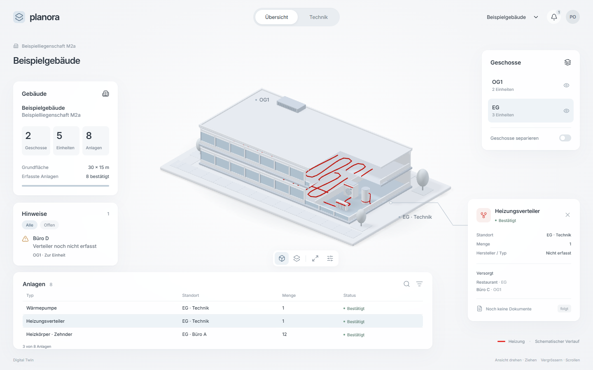
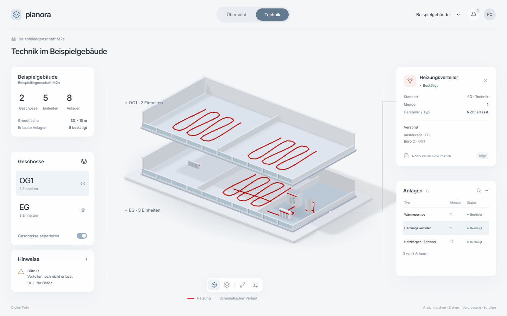

# Digital Twin – Wahl der Gestaltungsrichtung

12.11.2026 · Teilaufgabe 1 · **Richtungswechsel, PO-Wahl offen**

[F] Auftrag: [Brief](2026-11-12-redesign-brief.md), [Übergabe Abschnitt 4](../../superpowers/plans/2026-11-12-uebergabe-codex.md). Zwei eigenständige Gesamtansätze verbinden die Gebäudeszene mit dem Dashboard. Die Bilder sind lokale, statische Richtungsstudien bei 1440 × 900; sie sind keine implementierte Produktansicht und keine Funktionsabnahme. Produktcode, APIs und Datenbank bleiben unverändert.

## Gemeinsame Fakten und Grenzen

[F] Die Inhalte stammen aus `app/src/welt/beispiel.ts`: zwei Geschosse, fünf Einheiten, acht Anlagen-Symbole. Die acht Einträge sind bestätigt. Die zwei Heizkörpergruppen unterscheiden sich durch den Hersteller (Zehnder: 12, Prolux: 3); deshalb ergeben Wärmepumpe, Speicher, Verteiler, zwei Heizkörpergruppen und drei FBH-Gruppen insgesamt acht Symbole. Büro D hat eine bestätigte FBH-Gruppe mit unbekannter Menge; eine unbekannte Menge ist kein unbestätigter Status. Der Hinweis zum fehlenden Verteiler wird durch `verteilerHinweise` abgeleitet. Es gibt keine erfundenen Energieverbräuche, Betriebszustände, Hersteller, Prozentwerte oder Diagramme.

[A] Gebäudekörper, Öffnungen, Positionen, Kulisse und Darstellungsschnitt sind schematische Gestaltungsstudien, keine vermessene Architektur. Der Standort des ausgewählten Verteilers ist durch die Darstellung illustriert; die Verbindungslinien der Mockups sind noch keine projizierten Objektanker. Die drei sichtbaren Tabellenzeilen sind ausdrücklich als «3 von 8 Anlagen» gekennzeichnet. Keine künstlichen Daten-IDs werden gezeigt. IDs werden in der Produktumsetzung aus den echten Symbol-Schlüsseln übernommen.

[F] Inter und die Icon-Pfade stammen aus den bereits installierten lokalen Paketen. Die Szene ist echtes Three.js mit orthografischer Kamera; alle Dateien und Schriften sind lokal. Es wurden keine generierten Bildassets und keine externen Medien eingesetzt.

## Ansatz A – Architekturatelier



- **Leitidee:** Das Gebäude steht wie ein sorgfältig gefertigtes Architekturmodell auf einem hellen Modellbrett; ein präziser Schnitt öffnet die ausgewählte Technikecke.
- **Eigenständig:** Eine geschlossene Fassaden- und Dachsilhouette schafft Wiedererkennbarkeit. Das Schnittfenster verbindet Architektur und Technik, während die Umgebung mit Wegen, zurückhaltenden Bäumen und Parkfeldern räumlichen Massstab gibt. Ruhige Satellitenkarten ergänzen das Modell; die Anlagenliste bildet eine flache Basis.
- **Farbskizze [A]:** Hintergrund `#f5f6f8`, Flächen `#ffffff`, Architektur `#f3f4f5`, Platten `#ced5dc`, Eisglas `#d0dfe9`, Heizung `#d92320`. Das endgültige Heizungs-Token bleibt das PO-bestätigte KOO-Rot; der Materialwert wird mit Neutral-Tone-Mapping darauf kalibriert.
- **Typografie:** Inter 10–13 px für Daten, 14 px Kartentitel, 22 px Gebäudetitel; Zahlen tabellarisch, Gewicht 450–600. Kein Werbetext und keine dekorativen Versalien.
- **Material und Licht:** Matte Putz- und Plattenmaterialien, fein differenzierte Stirnflächen, sanft getöntes Glas, silbergraue Anlagen mit roten Anschlüssen. Seitliches Tageslicht, aufgehellte Schatten und dezente Bodenkontakte. In der Umsetzung einmalig akkumulierte Schatten und N8AO statt der vereinfachten Mockup-Kontaktflächen.
- **Bewegung [A]:** 700 ms Kamerafahrt zum Schnittfenster; Hülle tritt beim Geschossfokus hell zurück. Panelantworten 160–280 ms. Im Richtungsbild sind die Bewegungen nicht umgesetzt.

```text
Wortmarke                 Übersicht / Technik              Gebäude · Profil
Kontext + Gebäudename
Gebäude                                                    Geschosse
                      geschlossenes Architekturmodell
Hinweise                  mit Schnittfenster                 Objektkarte
                                Werkzeuge
Anlagenliste                                          Legende
```

**Machbarkeit:** Parametrische Hülle auf Basis der bestehenden Ableitungen, lokaler Präsentationsschnitt oder ausgeblendete Hüllsegmente; die Datengeometrie bleibt unverändert. GLB-Anlagen werden im Schnittbereich sichtbar, Auswahl und Tabellenweg behalten echte IDs. Dach/Oberschoss müssen beim Fokus vollständig hell zurücktreten, damit keine Anlagen verdeckt bleiben. Die Szene wird in R3F umgesetzt; die Skizzengeometrie ist keine neue Produktarchitektur.

**Risiken:** Der Ausschnitt darf nicht mit einer tatsächlichen Gebäudeform verwechselt werden. Automatisches Einpassen muss Kulisse und Karten berücksichtigen. Das Gebäude muss auch ohne ausgewählte Anlage eine überzeugende geschlossene Silhouette behalten. Detailauswahl und Schnittkamera brauchen eine klare Regel je Gebäudegeometrie.

**Aufwand [A]:** Gegenüber 8–12 PT etwa +0,5–1 PT für den gezielten Hüllschnitt und die zusätzliche Einpassungsprüfung. Die Schätzung wird nach Abnahme 1 überprüft.

## Ansatz B – Geschossgalerie



- **Leitidee:** Zwei räumlich getrennte Geschosse werden wie ausgestellte technische Schnittmodelle lesbar; links führt das Geschossregister, rechts bündelt sich die Anlagenarbeit.
- **Eigenständig:** Der offene, vertikale Zwischenraum wird zur Signatur. Statt einer breiten unteren Tabelle bleibt die Bühnenmitte frei: Gebäudedaten und ein grosszügiges Geschossregister links, Objektinspektor und kompakte Anlagenliste rechts. Der Blick wechselt direkt zwischen Raum, Register und ausgewähltem Objekt. Keine Kulisse lenkt vom Zusammenhang der Gebäudetechnik ab.
- **Farbskizze [A]:** Hintergrund `#f4f6f8`, Flächen `#ffffff`, Böden `#dce2e7`, Technikzone `#ccd7df`, Auswahl `#eef3f7`, Heizung `#d92320`. Graphit und eine kleine blaugraue Navigationspille ergänzen die sechs Flächen-/Szenenwerte.
- **Typografie:** Inter wie A, aber Geschosscodes 22 px als primäre räumliche Orientierung. Kompakte rechte Tabelle; in der Umsetzung bei Bedarf intern scrollend, mit vollständig zugänglichem Standort.
- **Material und Licht:** Derselbe hochwertige Materialmassstab, deutlich differenzierte Geschossböden und sichtbare Plattenstärke. Kontaktschatten vermitteln Bodenhaftung innerhalb jeder Ebene, die Separierung schafft echte Tiefe ohne Verdunkelung.
- **Bewegung [A]:** Vertikales Auseinanderfahren in 800 ms; Kamera passt sich gleichzeitig an. Das aktive Geschoss bleibt kräftig und hell, die andere Ebene wird blasser. `prefers-reduced-motion` überspringt die Fahrt. Im Bild ist die Separation statisch vorgegeben.

```text
Wortmarke                 Übersicht / Technik              Gebäude · Profil
Kontext + Gebäudename
Gebäudedaten                                               Objektinspektor
                      Obergeschoss als Schnittmodell
Geschossregister             freier Zwischenraum
                      Erdgeschoss mit sichtbarer Technik  Anlagenliste
Hinweise                         Werkzeuge
                                  Legende
```

**Machbarkeit:** Geschosse als getrennte Gruppen mit animierter Y-Verschiebung, vorhandene Geometrie- und Anlagenableitung weiterverwenden. Hülle im Technikmodus auf Brüstungshöhe; offene Rückseiten behalten Fensterbänder und Volumen. Unterschiedliche Anlagen-/Raumböden bleiben dekorativ neutral, keine Statuscodierung. Layoutflächen und Kamerafit müssen gemeinsam dimensioniert werden. Das Mockup zeigt keine Leitungen, die eine Stockwerksverbindung behaupten: versorgte Einheiten stehen als echte Daten im Objektinspektor.

**Risiken:** Mehr Höhe benötigt eine aufmerksamere Kameraeinstellung bei 1280 × 720. Ein schmaler Inspektor kann lange Typnamen nicht immer in einer Zeile zeigen; die Umsetzung braucht Umbruch und erreichbare Details. Das Erscheinungsbild ist stärker auf technische Bearbeitung als auf die räumliche Identität des Gebäudes ausgerichtet.

**Aufwand [A]:** Gegenüber 8–12 PT etwa +0,5–1,5 PT für Kamerafit, das kompakte Anlagenregister und dessen schmalen Zustand. Separation ist bereits im bestätigten Umfang und wird nicht doppelt berechnet.

## Bewertung (1–5)

Gestalterische Einschätzung [A], keine unabhängige Abnahme. 5 bedeutet beste Eignung; beim Aufwand bedeutet 5 den geringsten Zusatzaufwand.

| Kriterium | A | B |
|---|---:|---:|
| Gestaltungsqualität | 4 | 4 |
| Eigenständigkeit | 4 | 4 |
| Referenz-Qualitätsrichtung | 4 | 4 |
| Produktanforderung / Lesbarkeit | 4 | 4 |
| Machbarkeit / Leistung | 4 | 4 |
| Aufwand (5 = gering) | 4 | 3 |

## Empfehlung

**A – Architekturatelier** als Richtung für den ersten Eindruck. Der Baukörper hat eine stärkere Identität als Ort und bleibt auch ausserhalb der Technikarbeit nachvollziehbar. Das Schnittfenster schafft einen eigenen Übergang von Gebäude zu Anlage. B ist die bewusst stärker auf technische Zusammenhänge ausgerichtete Alternative mit freier Szenenmitte und räumlichem Geschossregister. Die Bilder sind als zwei vollständige Gestaltungsrichtungen zu wählen; eine automatische Mischung ist nicht vorgesehen.

Die [unabhängige Schlusskritik](../kritiken/2026-11-12-redesign-r3.md) bewertet die Bilder als **bereit für den PO-Richtungsentscheid**, ausdrücklich nicht als Produktabnahme. Das Referenzniveau ist noch nicht erreicht; Geometrie-/Materialdetails, kleine Datentexte sowie reale Objektanker und Kamerafit bleiben Umsetzungsauflagen. Die Prinzipien bleiben unverändert.

[F] Endgültige GPU-Nachweise: [A](2026-11-12-redesign/pruefung-r3-a/bericht.json), [B](2026-11-12-redesign/pruefung-r3-b/bericht.json). Beide 1440 × 900, NVIDIA RTX 3070 Ti / D3D11, keine Konsolenmeldungen. Die Bilder `ansatz-a.png` und `ansatz-b.png` entsprechen diesen letzten Aufnahmen. Die unabhängigen Aufnahmen sind im Kritikbericht verlinkt.

## Reproduktion und Geltungsbereich

```powershell
node docs/design/entscheide/2026-11-12-redesign/gemeinsam/bauen.mjs
node werkzeug/design/screenshot.mjs --datei docs/design/entscheide/2026-11-12-redesign/ansatz-a/index.html --szenario docs/design/entscheide/2026-11-12-redesign/ansatz-a/szenario.json --aus docs/design/entscheide/2026-11-12-redesign/pruefung-a
node werkzeug/design/screenshot.mjs --datei docs/design/entscheide/2026-11-12-redesign/ansatz-b/index.html --szenario docs/design/entscheide/2026-11-12-redesign/ansatz-b/szenario.json --aus docs/design/entscheide/2026-11-12-redesign/pruefung-b
```

[F] Die lokalen IIFE-Bundles sind generierte, ignorierte Dateien; Quellen und Bauanweisung bleiben erhalten. Die PNGs sind reproduzierbare Browserbilder. Die statischen HTML-Dateien benötigen weder Produktserver noch Login. Funktion, Hover, Tabellenverknüpfung, Kamerafahrten, Responsive-Verhalten und Leistung des späteren Produkts sind in Teilaufgabe 1 noch nicht abgenommen.

## PO-Entscheid

[?] Offen: A oder B; konkrete Änderungswünsche können zur Wahl festgehalten werden. Teilaufgabe 2 beginnt nach dieser Wahl. Datum und Wortlaut werden vom Hauptagenten ergänzt.
