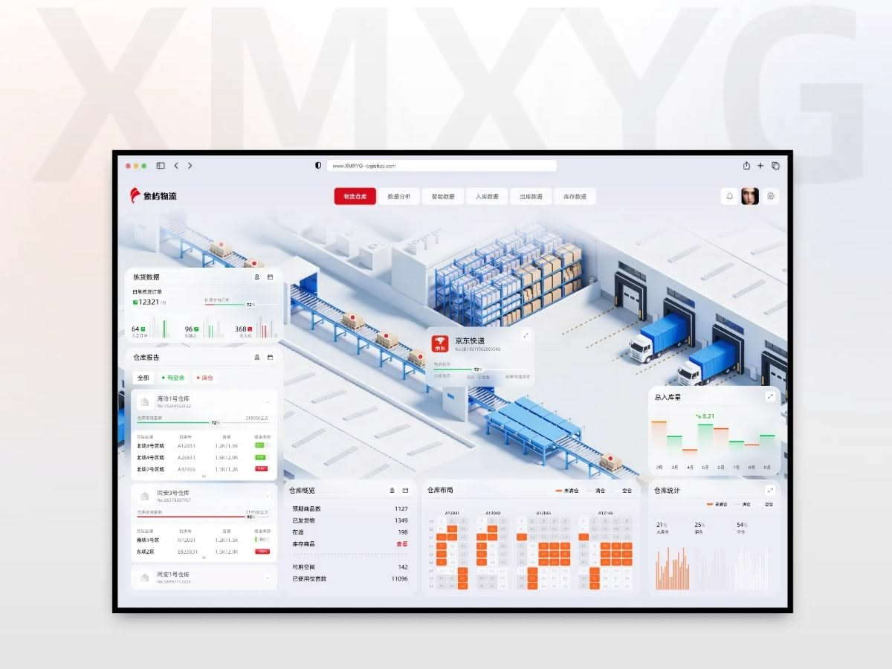
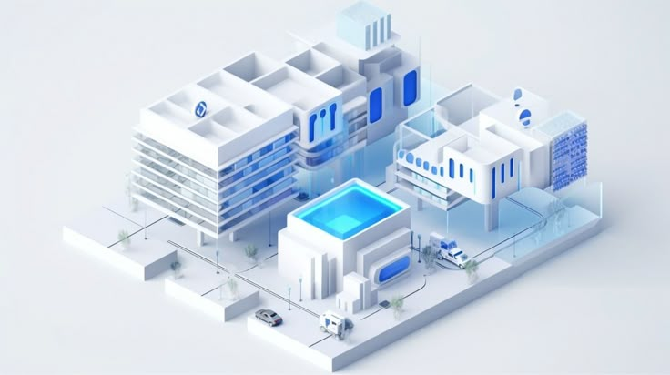
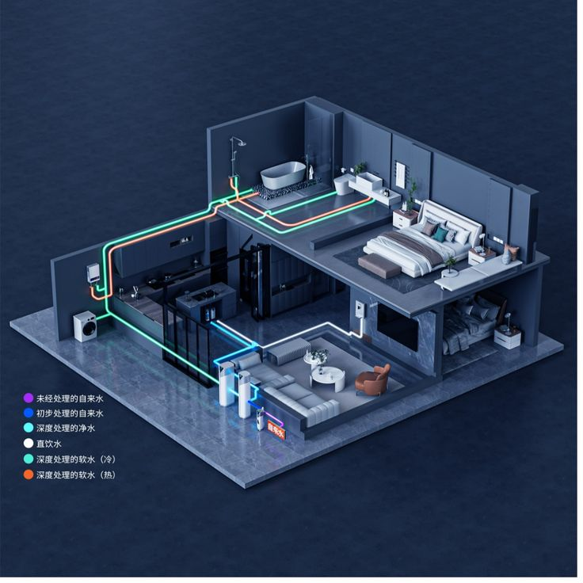

# Referenzbilder

Vom PO gelieferte Gestaltungsreferenzen, keine Produktassets. Qualitaetsrichtung, keine Kopiervorlage ([prinzipien.md](../prinzipien.md) Nr. 2).

## 01-dashboard.png – Hauptreferenz

Uebernehmen:
- 3D-Welt als grosses Zentrum, UI-Karten schweben darueber und lassen die Szene atmen.
- Fast weisse Welt mit vielen feinen Grautoenen; Farbe nur gezielt (dort Blau fuer Regale/Foerderband, bei uns KOO-Gewerkefarben).
- Sehr weiches, gleichmaessiges Licht, weiche Schatten nach rechts unten, Kanten durch Licht statt Linien.
- Detaillierte, stilisierte Objekte (Foerderband, Regale, LKW) – Detail macht die Wertigkeit.
- Pill-Navigation oben mittig, aktive Pill gefuellt; kleine, praezise Typografie; Karten mit klarer Hierarchie.
- Eine am Objekt verankerte Infokarte.

Nicht uebernehmen:
- Logistik-Inhalte und erfundene Diagramme; rote Primaerakzente fuer Navigation (Rot ist bei uns Heizung/Stoerung).
- Die dichte untere Diagrammreihe nur, wenn echte Daten da sind.

## 02-gebaeude.png – Gebaeudegeometrie

Uebernehmen: plastische weisse Baukoerper, sichtbare Geschossplatten mit Kante, Fensterbaender mit Rahmen, Dachaufbauten, Diorama-Grundplatte mit Wegen, Baeumen, Fahrzeugen; weiche Schatten.
Nicht uebernehmen: kraeftiges Blau als Hauptfarbe (wir: Weiss/Grau, Blau nur ganz leicht).

## 03-technik.png – technische Anlagen

Uebernehmen: aufgeschnittene Geschosse, erkennbare technische Geraete, Leitungen als farbige Rohre mit Boegen entlang Boden/Wand, Legende.
Nicht uebernehmen: dunkle Umgebung und Neon-Leuchten (PO: hell bleiben), Mobiliar (keine Daten).
